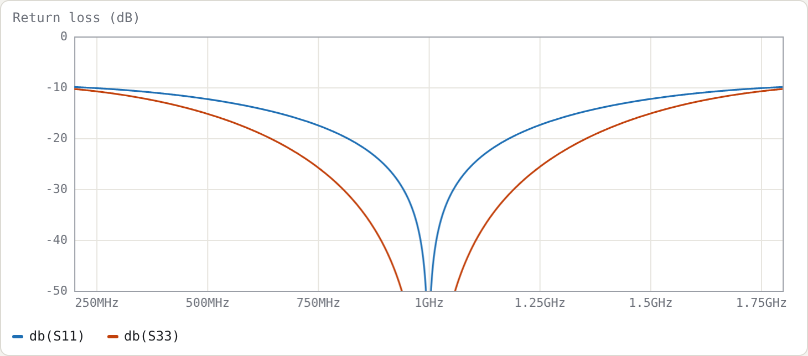
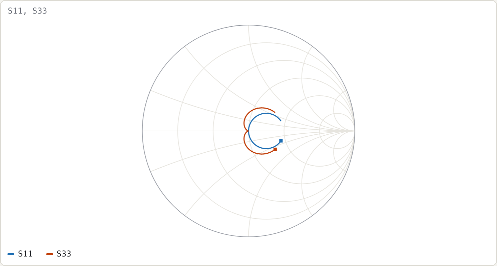

# Example 1: Quarter-wave transformers

**Netlist:** [`examples/transformers.cir`](../../examples/transformers.cir)

**Goal:** match 50 Ω to 100 Ω at 1 GHz, and compare a single quarter-wave section with a two-section binomial transformer. On the way you'll write a first netlist, use `.param` expressions, and put two independent networks in one file.

## The netlist

```
.freq 0.2G 1.8G 801
.ref 1G
.param ZL = 100
port a1 50      # 1
port a2 ZL      # 2
T1 a1 a2 Z0=sqrt(50*ZL) len=90deg
port b1 50      # 3
port b3 ZL      # 4
T2 b1 b2 Z0=50*(ZL/50)^0.25 len=90deg
T3 b2 b3 Z0=50*(ZL/50)^0.75 len=90deg
.plot ylim=-50,0 title=Return_loss_(dB) db(S11) db(S33)
.smith S11 S33
```

What to notice:

- **Port impedances.** Ports 2 and 4 are referenced to `ZL` = 100 Ω, so S11 and S33 are the input reflections when the far end is terminated in 100 Ω. A port's reference impedance *is* its termination.
- **`.ref`.** `.ref 1G` makes `len=90deg` a quarter wave at 1 GHz.
- **`T` elements.** A `T` element is a single line with both ends referenced to ground. It is shorthand for a one-line `cline`.
- **Two networks in one file.** Ports 1–2 and ports 3–4 share no nodes, so they are independent and their S-parameters don't interact. This is a convenient way to compare designs on one plot.
- **Expressions.** Z0 values are expressions, with no spaces inside them. The single section uses √(50·100) = 70.71 Ω. The binomial sections use 50·2<sup>¼</sup> = 59.46 Ω and 50·2<sup>¾</sup> = 84.09 Ω.

## Results





Measured on a 16 001-point sweep:

| | single section | two-section binomial |
|---|---|---|
| return loss ≥ 20 dB | 0.8165–1.1835 GHz (**36.7 %**) | 0.6421–1.3579 GHz (**71.6 %**) |
| return loss ≥ 15 dB | 68.3 % | 101.4 % |
| at 0.8 GHz | 19.28 dB | 29.44 dB |

## Check against the closed form

For a single section with maximum tolerable reflection Γm (the standard result; see e.g. Pozar, *Microwave Engineering*, quarter-wave transformer bandwidth):

```
cos θm = 2 Γm √(Z0 ZL) / ( |ZL − Z0| √(1 − Γm²) )
FBW    = 2 − 4θm/π
```

With Γm = 0.1 (20 dB): cos θm = 2·0.1·70.71/(50·0.995) = 0.2843, so θm = 73.48° and FBW = 2 − 4·1.2825/π = **0.3671**. This agrees with the simulated 36.7 %.

The Smith chart shows why the binomial version is wider. Its locus winds more tightly around the centre, because its reflection has a double zero at f0 (maximally flat) instead of a single one.

## Try

- Drag `ZL` (add `tune 60 300` to its `.param`) and watch both bandwidths shrink as the ratio grows.
- Replace the binomial impedances with `.param z1 = 60 tune 50 100` and `.param z2 = 85 tune 50 100`. Then add `.goal db(S33) < -20 0.6G 1.4G` and press **Optimise**. It stops as soon as the goal is met (z1 ≈ 64 Ω, z2 ≈ 85 Ω), giving a 20 dB band of about 83 % against the binomial's 71.6 %. That is the equal-ripple (Chebyshev) trade: less flatness at f0 for more bandwidth.
