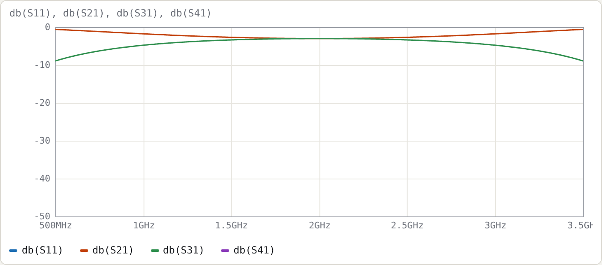
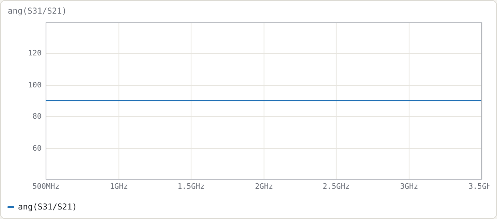
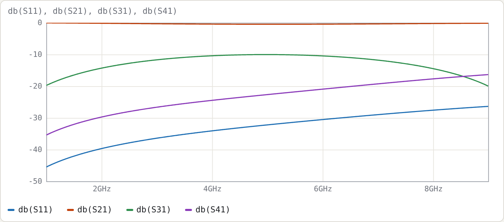
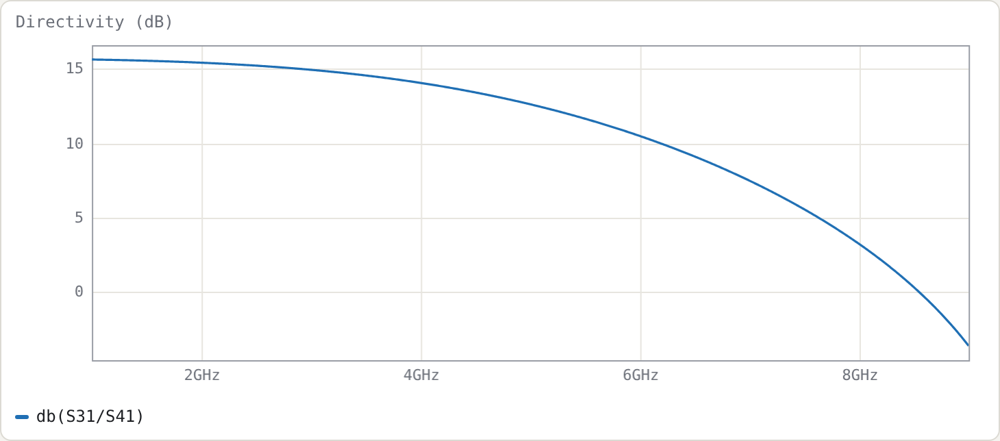
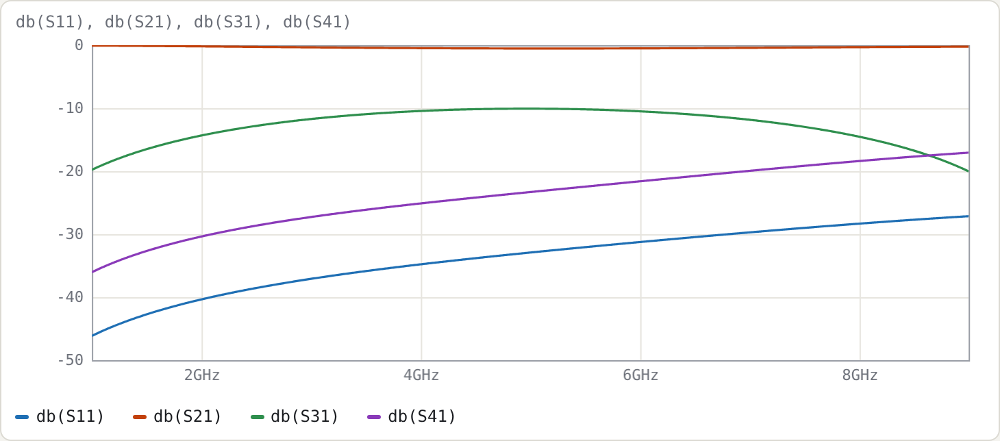

# Example 2: Coupled-line couplers

**Netlists:**
- [`examples/coupler-3dB-stripline.cir`](../../examples/coupler-3dB-stripline.cir)
- [`examples/coupler-10dB-microstrip.cir`](../../examples/coupler-10dB-microstrip.cir)

**Goal:** design a quarter-wave backward-wave coupler from its even/odd impedances. Then see what an inhomogeneous medium (microstrip) does to directivity, and fix it with lumped capacitors and the optimiser.

## Design equations

For a symmetric pair with voltage coupling factor k and system impedance Z0:

```
Z0e = Z0 √((1+k)/(1−k))       Z0o = Z0 √((1−k)/(1+k))       Z0e·Z0o = Z0²
```

For 3 dB, k = 1/√2, which gives Z0e = 120.71 Ω and Z0o = 20.71 Ω. That is far tighter than edge-coupled lines can practically reach, which is why Lange (interdigitated) couplers exist. The netlist computes them from `k` itself:

```
.param k = 1/sqrt(2)
.param Z0 = 50
port in Z0      # 1
port thru Z0    # 2
port cpl Z0     # 3
port iso Z0     # 4
cline K
  Zeo Z0*sqrt((1+k)/(1-k)) Z0*sqrt((1-k)/(1+k))
  er 2.2
  len 90deg
  A in   cpl
  B thru iso
end
```

**Terminal layout.** Line 1 runs from `in` (end A) to `thru` (end B). Line 2 runs from `cpl` (end A) to `iso` (end B). The coupled port is at the **same end** as the input: TEM coupled-line couplers are backward-wave devices.

## Homogeneous result (stripline, εr = 2.2)





Measured on a 12 001-point sweep:

| quantity | result |
|---|---|
| line length | 25.27 mm (λ/4 at 2 GHz in εr = 2.2) |
| \|S31\| within 0.5 dB of 3 dB | 1.416–2.584 GHz (58 %) |
| match S11, isolation S41 | below −250 dB at every point (numerically zero) |
| ang(S31/S21) | 90° at every frequency |

**Why S11 and S41 are zero everywhere, not just at f0.** In a homogeneous medium the even and odd modes travel at the same speed. Because Z0e·Z0o = Z0², an ideal TEM coupler is perfectly matched and isolated at all frequencies. Only the coupling magnitude varies:

```
|S31|² = k² sin²θ / (1 − k² cos²θ)
```

Setting |S31|² = ½·10<sup>−0.05</sup> gives θ = 63.7°, i.e. f = 0.708·f0 = 1.416 GHz, which matches the measured band edge.

## Inhomogeneous result (microstrip)

The second netlist gives each mode its own effective permittivity:

```
Zeo 69.4 36.0 6.9 5.6     # Z0e Z0o eps_eff_e eps_eff_o   (10 dB, alumina-like; illustrative)
```

The **Line sections** panel confirms two modes: ε<sub>eff</sub> 6.9 (even, vector [0.707 0.707], Z = 69.4 Ω) and ε<sub>eff</sub> 5.6 (odd, [0.707 −0.707], Z = 36.0 Ω). With `len 90deg`, the length is set by the mean √ε<sub>eff</sub>, giving 6.00 mm at 5 GHz.





| f (GHz) | S31 (dB) | S41 (dB) | directivity `db(S31/S41)` | S11 (dB) |
|---|---|---|---|---|
| 2 | −14.31 | −29.73 | 15.4 | −39.7 |
| 5 | −10.03 | −22.66 | **12.6** | −32.2 |
| 8 | −14.46 | −17.70 | 3.2 | −27.6 |

The coupling is right (−10.0 dB at f0), but directivity is only 12.6 dB. The even and odd modes reach the far end with different electrical lengths, so their contributions at the isolated port no longer cancel. This is the classic microstrip coupler problem.

## Fixing it: end compensation capacitors

A common fix is a small capacitor across the gap at each end, which slows the odd mode. Add to the microstrip netlist:

```
.param cc = 0.05p tune 0.001p 1p
Cc1 in cpl cc
Cc2 thru iso cc
.goal db(S31/S41) > 40 4.5G 5.5G
```

and press **Optimise**. It converges to **cc ≈ 70.8 fF**, with these results:

| f (GHz) | S31 (dB) | S41 (dB) | directivity | S11 (dB) |
|---|---|---|---|---|
| 2 | −12.92 | −42.14 | 29.2 | −31.9 |
| 5 | −10.00 | −54.69 | **44.7** | −62.2 |
| 8 | −26.16 | −29.22 | 3.1 | −19.3 |

Directivity now exceeds 20 dB from 1.0 to 6.86 GHz. This illustrates the general pattern for using the tool: lines from the field solution, lumped elements for discontinuities and fixes, and the optimiser to size them.

## The same coupler from copper dimensions

[`examples/coupler-10dB-ro4350b.cir`](../../examples/coupler-10dB-ro4350b.cir) describes the 10 dB coupler on JLC's 0.508 mm RO4350B by strip width and gap rather than impedances:

```
.substrate jlc-ro4350b-0.508
.param w = 0.8831mm tune 0.5mm 1.3mm
.param s = 0.1025mm tune 0.1mm 0.4mm
cline K geom=msl W=w S=s
  len 90deg
  A in   cpl
  B thru iso
end
```

The dimensions came from `node tools/mscalc.mjs --sub jlc-ro4350b-0.508 --ze 69.4 --zo 36`. The microstrip models turn them into:

- even and odd impedances of 69.40 Ω and 36.00 Ω at 5 GHz;
- εeff of 3.025 (even mode) and 2.490 (odd mode);
- a length of 9.04 mm;
- a Q of 187 for the even mode and 111 for the odd mode.



| f (GHz) | S11 (dB) | S21 (dB) | S31 (dB) | S41 (dB) | directivity |
|---|---|---|---|---|---|
| 2 | −40.35 | −0.19 | −14.33 | −30.36 | 16.0 |
| 5 | −32.91 | −0.53 | −10.07 | −23.31 | 13.2 |
| 8 | −28.33 | −0.31 | −14.52 | −18.39 | 3.9 |

The results are close to the electrical microstrip version above:

- **Directivity.** Its limit has the same cause as before: unequal mode velocities.
- **Loss.** About 1 % of the power is dissipated at 5 GHz, mostly in the odd mode.
- **Gap.** The gap is right at JLC's 0.1 mm minimum space.
- **Thickness warning.** The status line notes that the strip-thickness correction is approximate for a gap this small compared with the copper thickness.

With `w` and `s` as `tune` parameters, the end-capacitor trick and the optimiser from the previous section can work on the real dimensions.

## Try

- Set the even/odd ε<sub>eff</sub> equal in the microstrip file. The directivity becomes infinite, as in the stripline case.
- Change `k` in the stripline file to 0.316 (10 dB) and compare the flatness of the coupling with the 3 dB case.
- Load **Lange coupler, 4 fingers** from the Examples menu. Four interdigitated fingers, with alternate fingers joined by `wire`, reach the 3 dB coupling a single pair can't.
