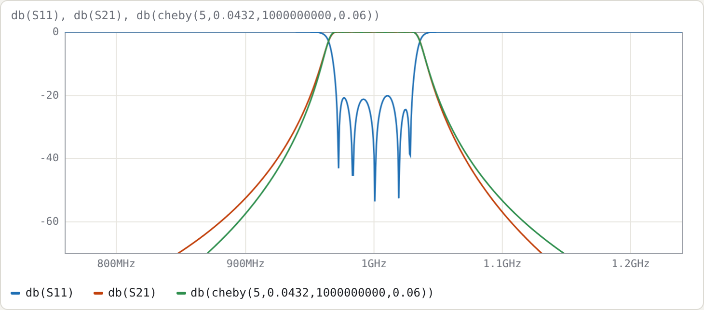
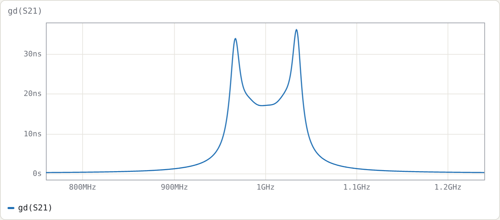
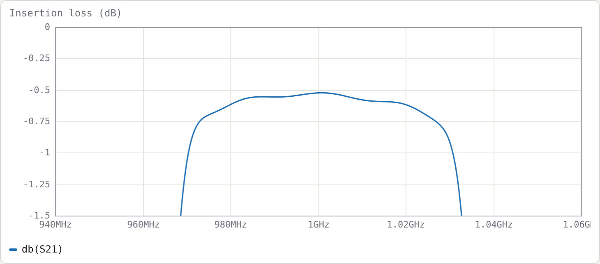
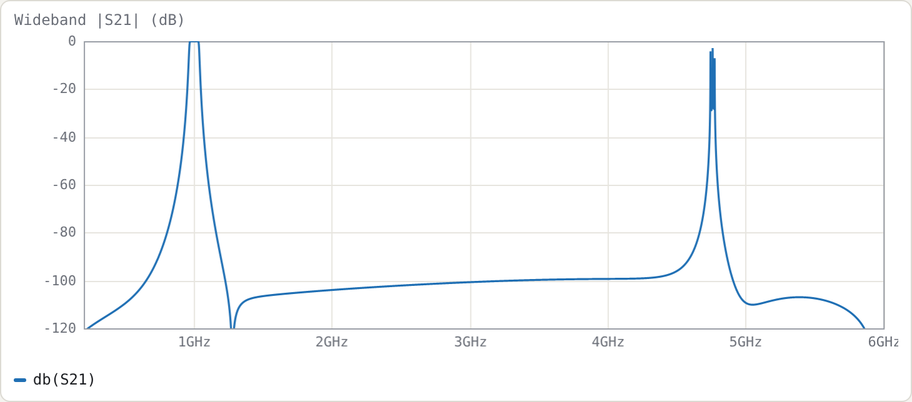

# Example 3: Comb-line filter, from specification to loss budget

**Netlist (final):** [`examples/combline-synth-5pole.cir`](../../examples/combline-synth-5pole.cir)

## Specification

| | |
|---|---|
| response | Chebyshev, 0.0432 dB ripple (20 dB return loss) |
| order | n = 5 |
| centre | 1.000 GHz |
| ripple bandwidth | 6 % (FBW = 0.06) |
| construction | air-dielectric comb-line (εr = 1), resonators 40° long at f0, loaded by capacitors |
| line impedance | Z<sub>r</sub> = 70 Ω (each resonator with its neighbours grounded) |
| ports | 50 Ω, tapped onto the end resonators |

The plan has five steps:
1. Do the closed-form design by hand, to see where every number comes from.
2. Let **Synthesise…** refine it.
3. Polish it with the optimiser.
4. Estimate insertion loss for realistic Q.
5. Look at the wideband response.

## Step 1: closed form by hand

**Prototype.** From the Chebyshev formulas (Matthaei §4.05), for 0.0432 dB, n = 5:

```
g0..g6 = 1, 0.97136, 1.37207, 1.80132, 1.37207, 0.97136, 1
```

**Couplings and external Q:**

```
k12 = k45 = 0.06/√(0.97136·1.37207) = 0.051972
k23 = k34 = 0.06/√(1.37207·1.80132) = 0.038165
Qe        = 0.97136/0.06            = 16.189
```

**Resonator.** Yₐ = 1/70 = 14.286 mS and θ0 = 40° (0.69813 rad), so cot θ0 = 1.19175 and θ0 csc²θ0 = 1.68967.

```
slope   b  = (Yₐ/2)(cot θ0 + θ0 csc² θ0) = 7.1429 mS · 2.88142 = 20.582 mS
load    Cl = Yₐ cot θ0 / ω0             = 2.7096 pF
```

**Mutual admittances**, from J = Yₘ cot θ0 = k·b:

```
Ym12 = 0.051972 · 20.582 / 1.19175 = 0.89757 mS
Ym23 = 0.038165 · 20.582 / 1.19175 = 0.65911 mS
```

**Normalised capacitances**, with η = 376.73 Ω:

```
Cg1 = (Yₐ − Ym12)·η          = 5.0437     Cm12 = Ym12·η = 0.33814
Cg2 = (Yₐ − Ym12 − Ym23)·η   = 4.7954     Cm23 = Ym23·η = 0.24831
Cg3 = (Yₐ − 2·Ym23)·η        = 4.8852
```

**Tap position:**

```
sin θt = sin 40° · √(b·50/Qe) = 0.64279 · √(1.02908/16.189) = 0.16206   →   θt = 9.327°
```

These are exactly the values the tool produces with **Refine** unticked. Untick it, generate, and compare with the comment header and `.param` lines.

The closed-form design, measured on a 2001-point sweep:

| | target | closed form |
|---|---|---|
| centre (geometric mean of −3 dB points) | 1.0000 GHz | 0.99805 GHz |
| −3 dB bandwidth | 7.108 % | 7.135 % |
| worst return loss, central 80 % of ripple band | 20.04 dB | **12.44 dB** |

The skirts and centre are already close. The return loss is not, mainly because the closed-form tap formula assumes a single isolated line.

## Step 2: refine

Run **Synthesise…** with the specification above, with **Refine** ticked and **Polish** unticked.


The refinement does three things:

- **Couplings.** It adjusts each Yₘ so the isolated pair's split-mode coupling equals k exactly. For this design the change is tiny: −0.07 % on Ym12 and −0.04 % on Ym23. The split-mode and J/b definitions agree closely at 6 % bandwidth.
- **Tap.** It moves the tap to 9.46° and sets the end capacitors to 2.736 pF. With these, the tap-loaded first resonator has Qe = 16.24 (the target at the design bandwidth) and resonates exactly at the design centre.
- **Centre and bandwidth.** It pre-distorts the design to f0 = 1.002106 GHz and FBW = 5.982 %, so the realised centre and −3 dB bandwidth land on target.

| | target | refined |
|---|---|---|
| centre | 1.0000 GHz | 1.00001 GHz |
| −3 dB bandwidth | 7.108 % | 7.108 % |
| worst return loss | 20.04 dB | **18.35 dB** |

## Step 3: polish

Press **Optimise**, or tick **Polish** in the dialog. The netlist already contains everything the optimiser needs:

- **Tune ranges:** on `tt`, `cg1..cg3`, `cm12`, `cm23`, `cl1` and `cl`.
- **A return-loss goal** over the ripple band.
- **Two skirt goals**, which pin the rejection at the ideal −20 dB points so the band can't simply widen.

It converges in 88 evaluations:

| | target | polished |
|---|---|---|
| centre | 1.0000 GHz | 1.00011 GHz |
| −3 dB bandwidth | 7.108 % | 7.107 % |
| worst return loss | 20.04 dB | **20.21 dB** |

These are the final values in the example file:

```
.param th0 = 39.9159442      # resonator length at 1 GHz  (8.020 mm + 25.221 mm = 33.24 mm)
.param tt  = 9.6302          # tap, degrees from the short
.param cg1 = 5.0444   .param cg2 = 4.8033   .param cg3 = 4.8891
.param cm12 = 0.34298 .param cm23 = 0.24749
.param cl1 = 2.7417p  .param cl  = 2.7071p
```



The green trace is the ideal prototype `cheby(5,0.0432,1G,0.06)`. Both skirts sit slightly outside it. Comb-line coupling varies as cot θ, so the band edges are not arithmetically symmetric; the optimiser holds the −20 dB points, not the whole skirt shape.



The peak passband group delay is 36 ns, at the band edges.

## Step 4: insertion loss for realistic Q

Add `Q 2000` inside both `cline` blocks to model conductor loss. To model lossy tuning capacitors, add `Q=1000` to the capacitor lines (`C1 r1 0 cl1 Q=1000`, …). Measured at f0:

| line Q | capacitor Q | IL at f0 |
|---|---|---|
| ∞ | ∞ | 0.002 dB |
| 5000 | ∞ | 0.056 dB |
| 2000 | ∞ | 0.138 dB |
| 2000 | 1000 | 0.524 dB |



### Checking it

The usual estimate of midband dissipation loss is

```
ΔIL ≈ 4.343 · Σgᵢ / (FBW · Qu)        Σg1..g5 = 6.4882
```

Simply putting Qu = 2000 gives 0.235 dB, which overestimates the simulated loss. The resonator Q is not the line Q, because part of the stored energy sits in the (lossless) capacitor. The energy fractions follow from the two terms of the slope parameter:

```
line fraction  p_line = θ0 csc²θ0 / (cot θ0 + θ0 csc²θ0) = 1.68967/2.88142 = 0.5864
cap fraction   p_cap  = cot θ0 / (cot θ0 + θ0 csc²θ0)    = 0.4136

1/Qu = p_line/Q_line + 2·p_cap/Q_cap
```

The factor 2 on the capacitor term arises because a capacitor's Q counts only its electric energy. With this:

| line Q | cap Q | Qu | predicted ΔIL | simulated |
|---|---|---|---|---|
| 5000 | ∞ | 8527 | 0.055 dB | 0.056 dB |
| 2000 | ∞ | 3411 | 0.138 dB | 0.138 dB |
| 2000 | 1000 | 892 | 0.526 dB | 0.524 dB |

There is a practical point here: a short, heavily loaded comb-line resonator is only as good as its tuning capacitor.

## Step 5: wideband response and the spurious passband

Set `.freq 0.2G 6G 12001`.



- **Stopband.** The rejection is at least 92 dB from 1.2 to 4 GHz in the lossless model. The deep notch just above the passband is at 1.278 GHz.
- **Spurious passband.** The first spurious passband is at about **4.75 GHz**, where the resonators next satisfy ωC<sub>l</sub> = Yₐ cot θ. With θ = 40°·x and f = x·f0, the root of x·cot 40° = cot(40x°) is x ≈ 4.75.

  This is the main attraction of comb-line with short resonators. A 90° interdigital resonator has its first spurious passband at 3f0 (the 3 GHz design in Example 4 has it at 9.0 GHz). The shorter θ0 and heavier loading push the spurious passband further out, at the cost of a lower resonator Q (Step 4).

## Try

- Re-synthesise with θ0 = 60° and compare the Step-4 Qu and the Step-5 spurious frequency.
- Change Z<sub>r</sub> to 50 Ω. The C/ε values scale, the couplings don't (Yₘ/Yₐ is independent of Z<sub>r</sub>), and the tap moves.
- Push the bandwidth to 20 %, then compare refined and polished results. The refinement still lands centre and bandwidth; the polish matters more.
