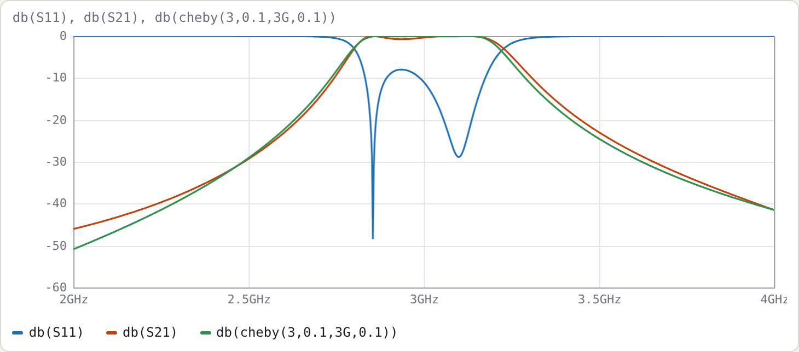
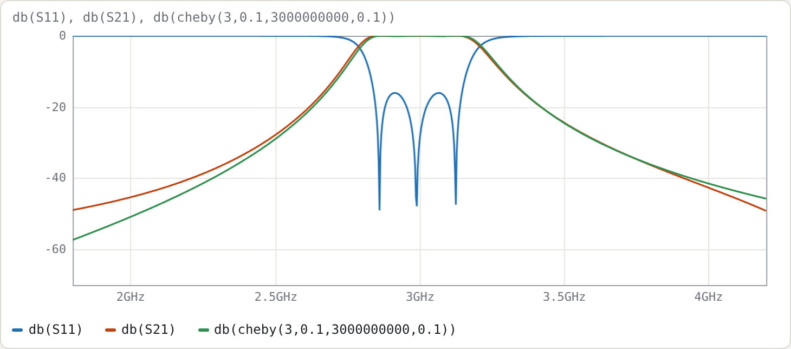

# Example 4: Interdigital filter by hand

**Netlists:**
- [`examples/interdigital-by-hand.cir`](../../examples/interdigital-by-hand.cir): the hand design
- [`examples/interdigital-synth-3pole.cir`](../../examples/interdigital-synth-3pole.cir): the same specification, refined and polished

**Goal:** design a 3-resonator tapped interdigital filter entirely inside the netlist, with every equation written as a `.param`. Then compare it with the refined synthesis to see what the closed form misses.

| | |
|---|---|
| response | Chebyshev, 0.1 dB ripple (16.43 dB return loss), n = 3 |
| centre / ripple bandwidth | 3 GHz / 10 % |
| medium | stripline, εr = 2.2 |
| resonator line impedance | Z<sub>r</sub> = 60 Ω (neighbours grounded) |
| ports | 50 Ω, tapped |

## The design as a netlist

```
.param fbw = 0.10
.param er  = 2.2
.param Zr  = 60
.param R0  = 50
.param g1 = 1.0316            # Chebyshev 0.1 dB, n = 3
.param g2 = 1.1474
.param g3 = 1.0316
.param k12 = fbw/sqrt(g1*g2)
.param Qe  = g1/fbw
.param Ya  = 1/Zr
.param b   = pi/4*Ya          # interdigital slope parameter (θ0 = 90°)
.param Ym  = k12*b            # J = Ym for interdigital
.param eta = eta0/sqrt(er)
.param cg1 = (Ya-Ym)*eta
.param cg2 = (Ya-2*Ym)*eta
.param cm  = Ym*eta
.param tt  = asin(sqrt(b*R0/Qe))*180/pi
```

`.param`s are evaluated in order, and each can use the earlier ones and the built-in constants (`pi`, `eta0`). The file *is* the hand calculation, and changing `fbw` or `Zr` redoes the whole design.

| quantity | value |
|---|---|
| k12 | 0.091915 |
| Qe | 10.316 |
| b | 13.090 mS |
| Ym | 1.2032 mS |
| η = η0/√2.2 | 253.99 Ω |
| Cg1 = Cg3 | 3.9276 |
| Cg2 | 3.6220 |
| Cm12 = Cm23 | 0.30559 |
| θt | 14.589° |

### Why these formulas

Each resonator's open end is taken as a node, with every other resonator node grounded. Two interdigital lines are shorted at opposite ends. Their 2×2 admittance between the two open ends then comes straight from the coupled-line Y-matrix:

- **Diagonal:** −jYₐ cot θ, which is zero at θ = 90°, so the resonators need no capacitors.
- **Off-diagonal:** −jYₘ csc θ, which is a nearly frequency-independent inverter J = Yₘ near 90°.

The resonator's susceptance slope gives b = (ω0/2)·d(Yₐ cot θ)/dω = πYₐ/4. Setting J = k·b gives Yₘ.

## Building the structure

The taps divide the lines into two coupled sections, which share the tap-plane node names:

```
cline LOW                     # from end A to the tap plane
  er er
  len tt*1deg
  Cg cg1 cg2 cg1
  Cm cm cm
  A 0  -   0                  # lines 1 and 3 shorted at A; line 2 open at A
  B t1 m2  t3                 # tap nodes on lines 1 and 3; m2 is just line 2 continuing
end
cline HIGH                    # from the tap plane to end B
  er er
  len (90-tt)*1deg
  Cg cg1 cg2 cg1
  Cm cm cm
  A t1 m2 t3
  B -  0  -                   # line 2 shorted at B; lines 1 and 3 open at B
end
port t1 R0
port t3 R0
```

Points to notice:

- **Alternating shorts.** In the `A`/`B` rows, line 2 is shorted at the opposite end from lines 1 and 3. That is the "interdigital" part.
- **Lengths.** `len tt*1deg` is in degrees because the expression contains a `deg` number. The two sections sum to 90° at 3 GHz: 2.730 mm + 14.113 mm = 16.843 mm, which is λ/4 in εr = 2.2.
- **Odd n.** Because n is odd, both end resonators are shorted at A and both taps are in the same plane. With even n the last resonator is reversed, and you need three sections (cut at θt and at 90° − θt). **Synthesise…** handles that automatically.

## Result of the hand design



Measured on a 20 001-point sweep:

| | ideal | hand design |
|---|---|---|
| centre | 3.000 GHz | 3.0075 GHz |
| −3 dB bandwidth | 13.89 % | 14.18 % |
| worst S11 in the ripple band | −16.43 dB | **−7.99 dB** |
| S21 at 2.5 GHz | −29.08 dB | −29.31 dB |
| S21 at 3.5 GHz | −24.46 dB | −22.93 dB |

The skirts are close to ideal; the passband match is not. The closed form makes two approximations that hurt at 10 % bandwidth:

- **Isolated-line tap.** The tap formula assumes the tapped resonator is an isolated line. In the array, its voltage distribution and loading are changed by its neighbours, and the input tap also couples directly to resonator 2 through the coupled segment.
- **Detuning ignored.** The tap detunes the end resonators, which the closed form ignores.

## Refined synthesis

**Synthesise…** with the same specification (Interdigital, Chebyshev, n = 3, ripple 0.1, f0 3G, 10 %, Z<sub>r</sub> 60, εr 2.2, R0 50) starts from exactly the same closed form. Untick **Refine** and the Cg/Cm/θt values match the table above. With **Refine** on:

- **Tap.** It moves to 14.97°. A 13.9 fF trim capacitor on each end resonator pulls them back to the design frequency.
- **Centre and bandwidth.** These are pre-distorted to 3.005 GHz and 9.835 %.

| | ideal | refined | refined + polish |
|---|---|---|---|
| centre | 3.000 GHz | 3.0000 GHz | 2.9915 GHz |
| −3 dB bandwidth | 13.89 % | 13.89 % | 14.04 % |
| worst return loss (central 80 % of ripple band) | 16.43 dB | 12.33 dB | **16.05 dB** |



The polish here does **not** fully reach the goal; the status line shows a non-zero cost. The optimiser trades a 0.3 % centre shift and 1 % of bandwidth for return loss, and stalls 0.4 dB short.

The reason is how few degrees of freedom there are. A 3-pole interdigital design has only five tune parameters (`tt`, `cg1`, `cg2`, `cm12`, `cl1`). The extra couplings that the nodal model ignores cannot all be compensated within the ±30 % ranges and the skirt constraints. In practice:

- widen a range, or add `Cm(1,3)` (the non-adjacent coupling, which you would get from a field solver); or
- accept 16 dB.

Compare the 5-pole comb-line in Example 3, which reached its target in 88 evaluations.

## Try

- Change `.param fbw = 0.03` in the hand-design file. The worst in-band S11 only improves from −8.0 dB to −11.0 dB, so the error is dominated by the tap approximation, not by bandwidth. That is why the refinement concentrates on the tap.
- Sweep 4–12 GHz. The first spurious passband of an interdigital filter is at 3f0, 9.0 GHz here; compare the 4.75f0 of the comb-line in Example 3.
- Add `Cm(1,3) 0.02` to both sections of the hand design, to represent the small non-adjacent coupling a real structure has, and watch the passband change.
