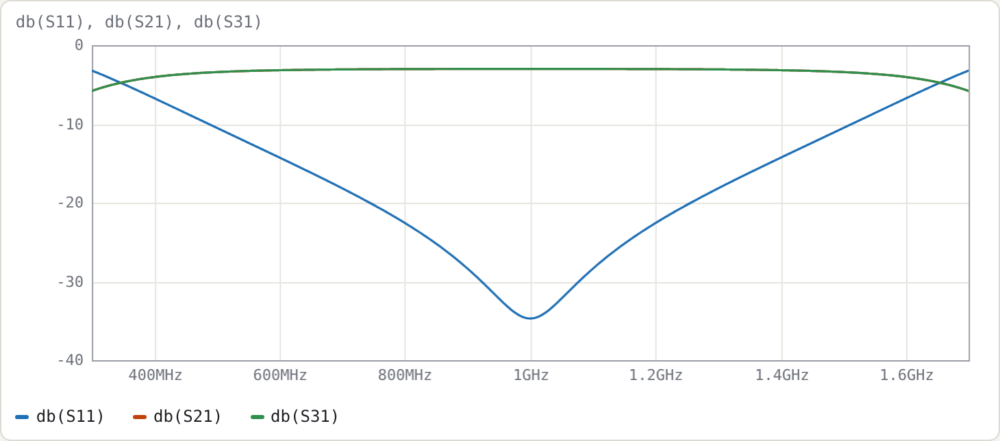
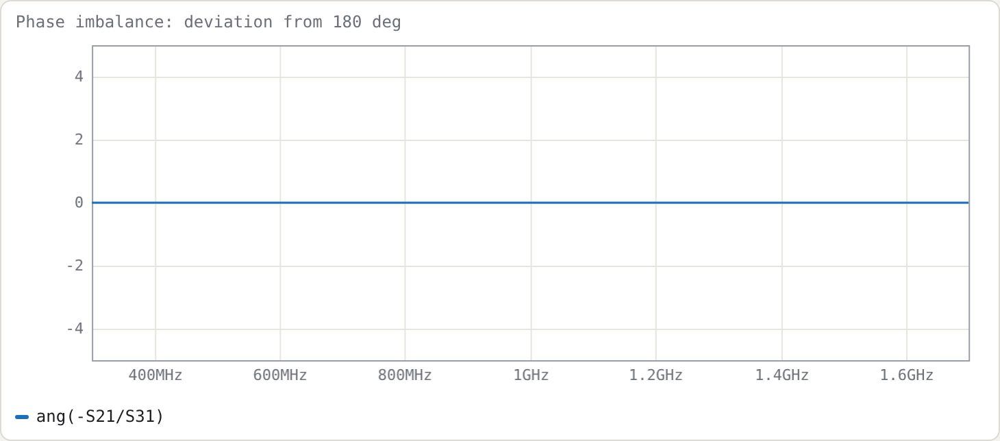
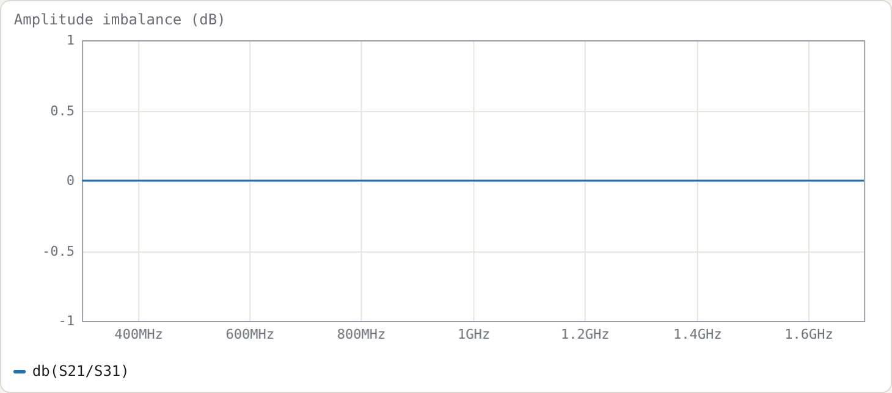

# Example 5: Marchand balun

**Netlist:** [`examples/marchand-balun.cir`](../../examples/marchand-balun.cir)

**Goal:** an unbalanced 50 Ω input to two 50 Ω outputs in antiphase (a 100 Ω differential load) at 1 GHz. Along the way: a two-section topology joined with node names and `wire`, balance traces, and the Z0e/Z0o design trade-off.

## Topology

```
.param ze = 204.19 tune 60 400
.param zo = 30.613 tune 10 80
port in    # 1  unbalanced input
port outp  # 2  balanced output +
port outn  # 3  balanced output −
cline S1
  Zeo ze zo
  len 90deg
  A in m          # main line enters; secondary line, end A = m
  B mid outp      # main line continues to "mid"; secondary line, end B = output +
end
cline S2
  Zeo ze zo
  len 90deg
  A mid outn      # main line from "mid"; secondary line, end A = output −
  B -   0         # main line open-circuited; secondary line grounded
end
wire m 0          # ground the outer end of S1's secondary line
```

**How to read it:**

- **Main line.** It runs `in → mid → open` through both sections.
- **Secondary lines.** Each is a quarter-wave line grounded at its outer end, and the outputs come out at the centre.
- **Node `mid`.** It joins the two sections' main lines.
- **`wire m 0`.** This grounds a named node. Writing `0` in the `A` row would do the same; the wire just makes the ground connection explicit.

The ze/zo values came from the optimiser, with one goal: `db(S11) < -20` from 0.75 to 1.25 GHz.

## Results







Measured on a 16 001-point sweep:

| | result |
|---|---|
| \|S21\|, \|S31\| at f0 | −3.012 dB each |
| return loss ≥ 20 dB | 0.7435–1.2565 GHz (51.3 %) |
| return loss ≥ 15 dB | 0.6189–1.3811 GHz (76.2 %) |
| amplitude imbalance `db(S21/S31)` | < 1e−13 dB over the whole sweep |
| phase imbalance `ang(-S21/S31)` | 0° to numerical precision over the whole sweep |
| output match S22 at f0 | −5.86 dB |
| output isolation S32 at f0 | −6.18 dB |

**Balance.** In this ideal model, with identical sections in a homogeneous medium, the balance is perfect at every frequency. What sets the usable bandwidth is the input match, not the balance. The balance degrades as soon as the symmetry is broken:

| variant (balance over 0.75–1.25 GHz) | amplitude imbalance | phase imbalance |
|---|---|---|
| as above | 0 | 0 |
| second section with Z0e × 1.2 | 0.44–0.48 dB | ±1.46° |
| both sections inhomogeneous (`Zeo ze zo 6.9 5.6`) | ±0.26 dB | 2.1–3.7° |

**Outputs.** The outputs are neither matched nor isolated from each other. That is not a design flaw: a lossless, reciprocal 3-port cannot be matched at all three ports. If you need output isolation, add a resistive network between the outputs and accept the loss of the odd-mode power in it.

## The Z0e / Z0o trade-off

Higher even-mode impedance gives more bandwidth, which is why practical Marchands use broadside or suspended coupled lines. For each Z0e below, Z0o was scanned to maximise the 20 dB return-loss bandwidth:

| Z0e (Ω) | best Z0o (Ω) | RL ≥ 20 dB bandwidth |
|---|---|---|
| 100 | 25.25 | 31.4 % |
| 150 | 28.0 | 42.1 % |
| 204 | 30.25 | 51.5 % |
| 300 | 33.5 | 63.6 % |
| 500 | 36.25 | 73.8 % |

The best Z0o rises slowly with Z0e. The coupling factor (Z0e − Z0o)/(Z0e + Z0o) at the optimum is 0.60 at Z0e = 100 Ω and 0.87 at 500 Ω, i.e. the wider designs need very tight coupling.

## Try

- Change the port impedances to `port outp 25` / `port outn 25` (a 50 Ω differential load). Then re-optimise ze/zo with the existing goal and see how the required coupling changes.
- Add `Q 300` to both sections and plot `db(S21)`. A balun stores little energy, so the loss is small (about 0.04 dB total at f0); compare the filter in Example 3, where Σg/FBW multiplies the effect of Q.
