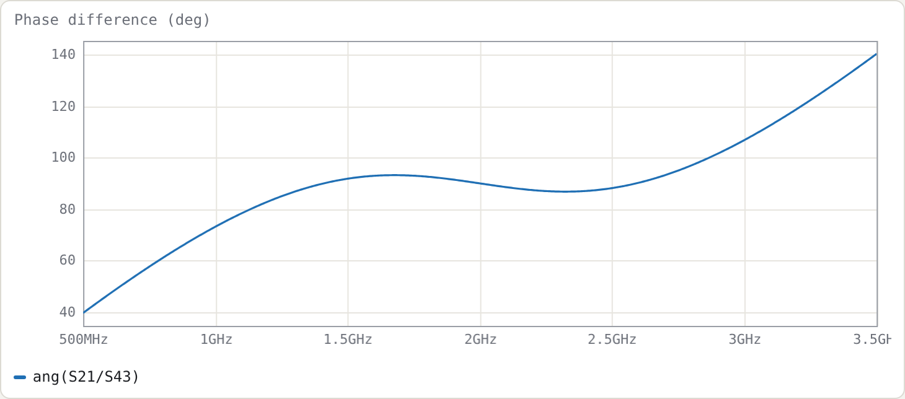

# Example 6: Schiffman 90° phase shifter

**Netlist:** [`examples/schiffman-90.cir`](../../examples/schiffman-90.cir)

**Goal:** a broadband 90° differential phase shifter at 2 GHz. It uses a coupled-line C-section against a uniform reference line, and shows how to compare two networks in one netlist and write an equality goal on a phase trace.

## The structure

```
.param rho = 2.7866 tune 1.5 10      # rho = Z0e/Z0o
port a     # 1
port b     # 2
port r1    # 3
port r2    # 4
cline CS
  Zeo 50*sqrt(rho) 50/sqrt(rho)      # keeps sqrt(Z0e*Z0o) = 50
  len 90deg
  A a b                              # both ports at end A
  B j j                              # far ends joined: same node name on both lines
end
Tref r1 r2 Z0=50 len=270deg          # reference line
.goal ang(S21/S43) = 90 1.3G 2.7G
.plot title=Phase_difference_(deg) ang(S21/S43)
```

**The C-section.** The far ends of the two lines are joined simply by giving them the same node name `j`. This makes the pair a "C-section": a two-port whose ports are the two A ends.

**Why it is matched at every frequency.** With Z0e·Z0o = 50², the C-section is an all-pass network: matched at every frequency, with a phase that varies non-linearly. The tool shows S11 below −250 dB everywhere. Its transmission phase φ obeys the standard Schiffman relation

```
cos φ = (ρ − tan²θ) / (ρ + tan²θ)
```

The tool agrees exactly. For ρ = 2.7866, the formula gives φ = 61.8474° at 1 GHz and 110.6761° at 1.5 GHz. `angu(S21)` reads −61.8474° and −110.6761°, the minus sign being the phase-lag convention. Above f0, φ continues past 180° (−249.32° at 2.5 GHz).

**The reference line.** It is 270° long. The C-section's phase slope crosses the reference line's around f0, so the difference stays near 90° over a wide band.

## Results



With ρ = 2.7866 (Z0e = 83.47 Ω, Z0o = 29.95 Ω), found by the optimiser from the `=` goal; measured on a 12 001-point sweep:

| | result |
|---|---|
| phase difference at f0 | 90.00° |
| over 1.3–2.7 GHz | 86.80° … 93.20° (±3.2°) |
| within ±5° | 1.250–2.750 GHz (2.20 : 1) |
| within ±2° | 1.859–2.141 GHz (1.15 : 1) |

## Choosing ρ

ρ trades ripple against bandwidth. Larger ρ means tighter coupling and a steeper C-section phase; past an optimum it overshoots. The table below uses a 6001-point sweep. The ±5° band is the contiguous band around 2 GHz; the peak deviation is measured over 1.4–2.6 GHz.

| ρ | ±5° band | ratio | phase over 1.4–2.6 GHz |
|---|---|---|---|
| 2.0 | 1.581–2.418 GHz | 1.53 | 80.6°–99.4° |
| 2.5 | 1.341–2.659 GHz | 1.98 | 86.7°–93.3° |
| 3.0 | 1.199–2.801 GHz | 2.34 | 85.2°–94.8° |
| 4.0 | 1.885–2.115 GHz | 1.12 | 77.9°–102.1° |
| 6.0 | 1.941–2.059 GHz | 1.06 | 66.5°–113.5° |

Of the values tried, ρ = 3.0 gives the widest ±5° band. By ρ = 4 the phase ripple exceeds ±5°, and the band collapses to a narrow region around f0.

The optimiser's ρ = 2.79 is lower than 3 because its goal is a least-squares-plus-peak fit over 1.3–2.7 GHz, not a maximised ±5° band. **Your goal defines "best".**

## Try

- Replace the goal with two inequalities, `.goal ang(S21/S43) < 95 1.2G 2.8G` and `.goal ang(S21/S43) > 85 1.2G 2.8G`, and re-optimise.
- Cascade two C-sections with different ρ (two `cline` blocks in series, joined at a shared node, with the reference line lengthened by 180°, since each C-section contributes 180° at f0) for a wider band. This is the usual next step.
