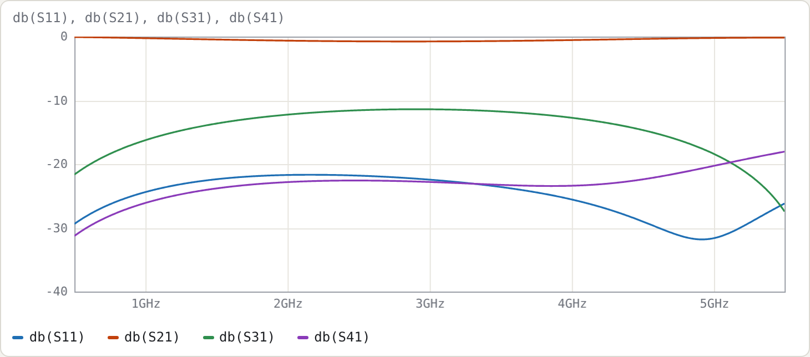

# Example 7: Three-line section from C and L matrices

**Netlist:** [`examples/three-line-CL.cir`](../../examples/three-line-CL.cir)

**Goal:** use the general `C`/`L` input, which is what a 2-D field solver gives you, for an inhomogeneous three-conductor section. Then read the modal analysis and build a symmetric coupler with the centre line as input.

> The matrices here are **illustrative**: they have the structure and magnitudes of three coupled microstrip lines, but they are not the solution for a specific geometry.

## Input

```
cline TL3
  C [110p -28p -4p; -28p 125p -28p; -4p -28p 110p]      # F/m (Maxwell matrix)
  L [420n 140n 70n; 140n 400n 140n; 70n 140n 420n]      # H/m
  len 90deg
  A l_cpl c_in  r_cpl
  B l_iso c_out r_iso
end
```

Requirements on the matrices:

- **C is the Maxwell matrix.** The diagonal is each line's total capacitance with the others grounded; the off-diagonals are negative. If your solver reports ground and mutual capacitances instead, convert with C<sub>ii</sub> = Cg<sub>i</sub> + ΣCm<sub>ij</sub> and C<sub>ij</sub> = −Cm<sub>ij</sub>.
- **L is the inductance matrix.** All entries are positive.
- **Both are symmetric**, and C must be positive definite.

The tool checks all three.

## The modal analysis

The **Line sections** panel shows:

| mode | ε<sub>eff</sub> | Z<sub>mode</sub> (Ω) | voltage vector (lines 1, 2, 3) |
|---|---|---|---|
| 1 | 4.3558 | 93.07 | [0.548 0.633 0.548] |
| 2 | 3.5860 | 55.41 | [−0.707 0 0.707] |
| 3 | 3.3969 | 39.38 | [−0.457 0.763 −0.457] |

How to read it:

- **Number of modes.** Three conductors give three quasi-TEM modes with three different velocities, which is the hallmark of an inhomogeneous medium.
- **Mode 1** is the all-in-phase "even" mode. It has the most field in the substrate, so the highest ε<sub>eff</sub>, and the highest impedance.
- **Mode 2** is the antisymmetric outer-line mode. The centre line carries no voltage, because by symmetry it cannot couple to this mode.
- **Mode 3** drives the centre line against the outer lines.

`len 90deg` is referenced to the mean of √ε<sub>eff</sub> over the three modes, which gives 12.87 mm at 3 GHz. Each mode therefore sees a slightly different electrical length.

The characteristic admittance matrix Y<sub>c</sub> = W diag(v) Wᵀ (§9 of the manual) is, in mS,

```
[ 17.231  −5.051  −0.817 ]
[ −5.051  19.737  −5.051 ]
[ −0.817  −5.051  17.231 ]
```

Note the small but non-zero coupling between the outer lines (−0.817 mS). The `Cg`/`Cm` nearest-neighbour model in the filter examples ignores this kind of term unless you add it with `Cm(1,3)`.

## The coupler

Port 1 drives the centre line at end A. Port 2 is the centre line's other end. Ports 3/5 are the outer lines at the input end (coupled), and ports 4/6 are the outer lines at the far end (isolated).



| f (GHz) | S11 | S21 | S31 = S51 | S41 = S61 | total coupled (S31 + S51 power) |
|---|---|---|---|---|---|
| 1.5 | −22.38 | −0.46 | −13.64 | −23.82 | −10.63 dB |
| 3.0 | −22.44 | −0.76 | −11.40 | −22.80 | −8.39 dB |
| 4.5 | −29.00 | −0.37 | −14.66 | −22.40 | −11.65 dB |

- **Symmetry.** `db(S31/S51)` is zero to 2e−13 dB, because the structure is symmetric and the centre line feeds both outer lines equally.
- **Directivity.** It is only about 11 dB at f0, the same inhomogeneous-medium problem as in Example 2. Lumped compensation capacitors between the lines at each end would improve it.
- **Match.** The input is not matched to 50 Ω (S11 ≈ −22 dB). These matrices were not designed for a particular impedance; scaling C up and L down by the same factor lowers all impedances while leaving the velocities unchanged.

## Try

- Multiply every entry of C by 1.2 and divide every entry of L by 1.2. The ε<sub>eff</sub> values are unchanged and every Z<sub>mode</sub> drops by 1.2. Watch S11 change.
- Set L = μ0ε0·C0⁻¹ for some air-filled C0 to make your own physically consistent pair. A field solver gives you C and C0 (C with the dielectric removed), and L follows exactly that way.
- Replace the end connections to make a three-line comb or interdigital resonator array. For example, `A 0 0 0` and `B r1 r2 r3` with loading capacitors gives an inhomogeneous comb-line, which the synthesiser does not yet cover.
