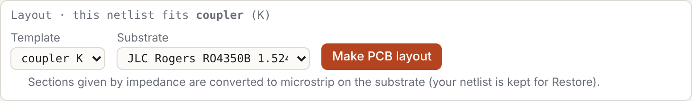
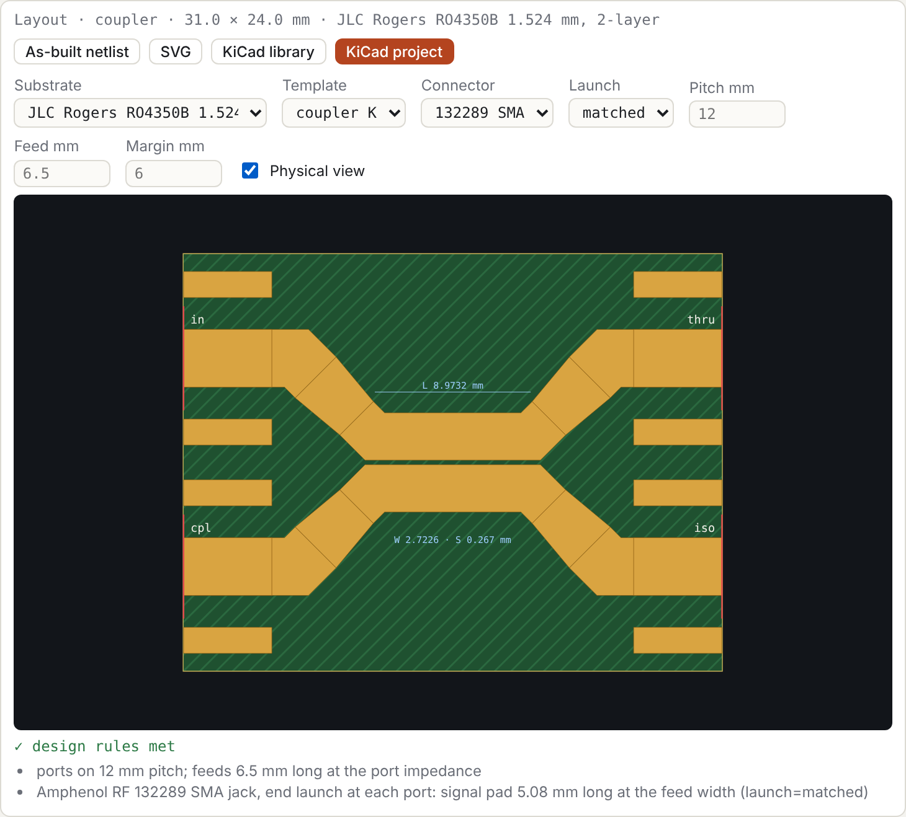
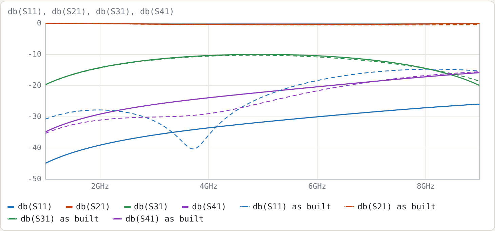
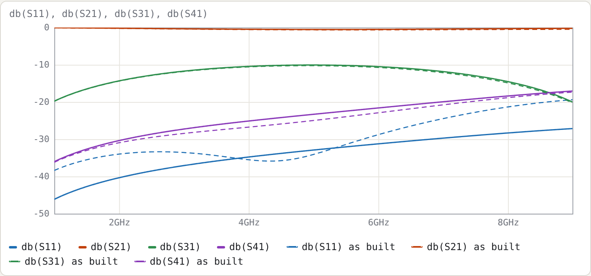

# 8. From a coupler netlist to a KiCad board

This example takes the 10 dB coupler of Example 2, which is defined only by its even/odd impedances, and turns it into a KiCad 9 project with edge-launch SMA connectors. Nothing is typed into the netlist: every step uses the layout panel.

Netlist: [`examples/coupler-10dB-microstrip.cir`](../../examples/coupler-10dB-microstrip.cir)

## 1. The offer

The netlist has no `.layout` line. Its topology, one coupled pair with a port at each of its four ends, fits the coupler template, so the panel offers a layout:

Choose a substrate and press **Make PCB layout**. The panel then:

1. Writes `.substrate jlc-ro4350b-1.524` after the header.
2. Converts the section to microstrip. The even/odd impedances come from the section's Maxwell matrices, Z0e = √((L11 + L12)/(C11 + C12)) and Z0o = √((L11 − L12)/(C11 − C12)), and the coupled-microstrip synthesis then finds W and S for them on the substrate. Here Z0e 69.40 / Z0o 36.00 Ω becomes **W 2.7226 mm, S 0.267 mm**. The `Zeo` line is removed; `len 90deg` and the port wiring stay.
3. Adds `.layout coupler K`.

Your previous netlist is kept: the notice above the status line has **Restore it**.

## 2. The panel

| control | writes |
|---|---|
| Substrate | `.substrate ID`. It also re-synthesises W and S so the sections keep their impedances on the new substrate. |
| Template | `.layout TYPE SECTIONS…`, from the templates the topology fits |
| Connector, Launch | `connector=` and `launch=` (§8.4 of the manual); the defaults are omitted |
| Pitch, Feed, Margin | `pitch=`, `feed=`, `margin=` in mm; blank uses the connector-derived default, shown greyed |
| Physical view | nothing in the netlist; adds the as-built response to the plots |

**KiCad project** downloads the board (manual §8.3). **KiCad library** downloads the part alone (§8.2).

## 3. Physical view: what will actually be built

With **Physical view** on, every plotted trace gets a dashed twin, computed from the as-built netlist. That netlist covers:

- the connector pads (`launch=matched`) and their launch placeholders;
- the feeds;
- the W → feed-width tapers;
- the diagonal escapes from the coupled lines.

At 5 GHz on the two RO4350B thicknesses:

| | 1.524 mm: bare section | 1.524 mm: as built | 0.508 mm: bare section | 0.508 mm: as built |
|---|---|---|---|---|
| W / S | 2.7226 / 0.267 mm | | 0.8831 / 0.1025 mm | |
| S11 | −31.78 dB | **−23.72 dB** | −32.91 dB | −34.10 dB |
| S31 (coupling) | −10.07 dB | −10.34 dB | −10.07 dB | −10.25 dB |
| S41 | −22.19 dB | −25.60 dB | −23.31 dB | −24.98 dB |
| board | | 31.0 × 24.0 mm, 0 stitching vias | | 33.1 × 24.0 mm, 20 stitching vias |

On 1.524 mm the as-built match is 8 dB worse than the bare section's. The reason is the size of the copper relative to the wavelength. The coupled lines are 2.7 mm wide and the 50 Ω feeds 3.3 mm, so the escapes, tapers and connector pads add a few millimetres of mismatched line at each port, roughly 15–20° at 5 GHz.

The same coupler on 0.508 mm keeps its match as built:

## 4. The trade-off

The thinner board is the better coupler at 5 GHz. But the Amphenol 132289 SMA is made for 0.062" (1.57 mm) boards, and the panel says so:

> ⚠ 132289 is made for 1.57 mm (0.062" board) boards; this board is 0.578 mm. The ground legs will not clamp the board…

There are three ways out:

1. **Stay on 1.524 mm.** The connector fits; accept or optimise the match (next section).
2. **Use 0.508 mm** with a connector made for that thickness. Only one connector is built in so far; others are added as entries in `js/connectors.js`.
3. **Lower the frequency.** The escapes shrink in electrical length.

The thickness check sits on the layout card, not in the DRC list, because it is a mechanical fit, not a copper rule.

## 5. Optimising what is built

The physical view is for looking. To optimise the board itself, press **As-built netlist**. It opens the netlist of the layout, with every line section as a `T` element, so you can:

- add `tune` ranges to the coupled section's `W=` and `S=`;
- set `.goal db(S11) < -25 4G 6G`;
- press **Optimise**;
- copy the optimised W and S back into the design netlist.

The launch placeholders `sma_l` and `sma_c` are already tunable, for fitting to a measured board.

## Try

- Press **KiCad project**, open the `.kicad_pro` in KiCad 9 and press **B** to fill the zones. The DRC reports no errors (CI checks this board). The connector pads may meet the board edge because of a rule in the project's `.kicad_dru` file. On 1.524 mm there are two "isolated copper" warnings: the 3h keepout around the part leaves only small top-pour islands on this small board, each touching one connector ground pad, and there is no room for stitching vias (manual §8.3).
- Change **Launch** to `library` on 0.508 mm and watch S11 and S31 in the physical view: KiCad's 1.5 mm pad is a 41 Ω section at every port (manual §8.4).
- Set **Pitch** to 20 mm. The diagonal escapes get longer, and the physical view shows what that costs.
