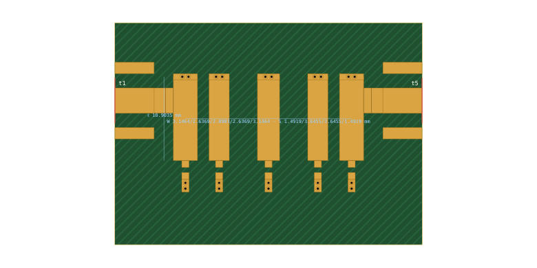

# 9. Comb-line filter: from a specification to Gerbers

This example takes a filter specification all the way to a board that can be ordered: synthesis, physical geometry in microstrip, layout with taps, capacitors and connectors, KiCad project and Gerbers. CI repeats every step on each pull request.

Netlist: [`examples/combline-5pole-2g-ro4350b-1524.cir`](../../examples/combline-5pole-2g-ro4350b-1524.cir) · specification: [`examples/combline-5pole-2g-ro4350b-1524.json`](../../examples/combline-5pole-2g-ro4350b-1524.json)

## 1. The specification

| | |
|---|---|
| response | Chebyshev, 5 poles, 0.1 dB ripple (16.43 dB return loss) |
| band | 2 GHz, 10 % ripple bandwidth (1.9–2.1 GHz) |
| structure | comb-line, θ0 45°, resonator impedance Zr 55 Ω, 50 Ω ports, εr 3.66 (the substrate's: the homogeneous design the geometry starts from) |
| board | JLC RO4350B, 1.524 mm, 1 oz copper |
| loading capacitors | SMD 0603, two 0.3 mm vias each |

**Why 1.524 mm.** The Amphenol 132289 edge-launch SMA (manual §8.4) is made for 1.57 mm boards. On thinner material the layout warns that its ground legs will not clamp, as in example 8. The thicker board also raises the resonator Q.

## 2. Synthesis and physical geometry

In the synthesis dialog (**Synthesise…**) enter the specification, set **Realise in microstrip** to `jlc-ro4350b-1.524` and **Loading capacitors** to *SMD 0603*. The same from the command line:

```sh
node tools/synth.mjs examples/combline-5pole-2g-ro4350b-1524.json --substrate jlc-ro4350b-1.524 --cap smd-0603 --out filter.cir
```

It takes about 40 s (manual §7.6 describes the steps). The report:

| | |
|---|---|
| widths | 3.146 / 2.637 / 2.890 / 2.637 / 3.146 mm |
| gaps | 1.492 / 3.645 / 3.645 / 1.492 mm |
| line length | 10.90 mm (43.6° at f0); tap 3.10 mm from the shorted end |
| capacitors | 0603, 1.22 / 0.98 / 1.00 / 0.98 / 1.22 pF nominal |
| shorted ends | 2 × 0.3 mm vias per resonator (0.25 nH) |
| lossless response | centre 1.9945 GHz, −3 dB bandwidth 11.08 % (ideal 11.35 %), return loss ≥ 16.43 dB over the central 80 % |
| insertion loss at f0 | 1.48 dB: conductor and dielectric loss (modal Q ≈ 218) plus the capacitors' assumed Q of 300 |
| capacitor self-resonance | 4.9–5.5 GHz with ESL and vias, under 3 f0 (the app also flags it on the `cap` lines) |

The netlist has the resonator array as `geom msl W [...] S [...]` sections, split at the tap so that a `tee` sits at each tap. It also has a `via` at each shorted end, the open-end fringing, the `cap` lines and `.layout comb`. Every geometric parameter keeps a `tune` range.

**What is not met exactly.** The return-loss goal covers 96 % of the ripple band (1.904–2.096 GHz). At the band edges themselves, 1.900 and 2.100 GHz, the lossless return loss falls to 9.3 dB, because the realised band is about 0.3 % low and 2 % narrow. The cross-couplings between non-adjacent resonators (manual §7.6) make the response not exactly Chebyshev. If the edges matter, widen the specified bandwidth by a few per cent, or run the optimiser on the netlist.

**Capacitor values.** The nominal values (1.22, 0.98, 1.00 pF) are those whose effective capacitance at f0, with the 0603's pads, ESL and vias, is what each resonator needs. They are not E24 values. Use the nearest E24 part plus the length trim, a tighter series, or trimmers (**Loading capacitors** → *trimmer*).

## 3. Layout

The netlist already has `.layout comb`, so the layout panel shows the board:



- The five resonators, shorted at the top through their via lands, with the 0603 capacitors below the open ends.
- At each outer line a 1 mm feed-width stub (part of the KiCad part) and the 50 Ω feed to the SMA at the board edge.
- A board margin of the RF keepout plus a via row, so the board gets a via fence.

Board size: 39.9 × 28.8 mm. comb-over's DRC is clean.

**As built.** The as-built netlist (**As-built netlist**) adds the feed lines and connector pads behind each tee. It changes the response by almost nothing, because the feeds are matched lines:

| with loss | design (ports at the tees) | as built (ports at the connectors) |
|---|---|---|
| S21 at f0 | −1.48 dB | −1.50 dB |
| peak S21 | −1.36 dB at 1.959 GHz | −1.38 dB at 1.959 GHz |
| −3 dB below the peak | 1.8886–2.1012 GHz | 1.8886–2.1012 GHz |
| worst S11, 1.91–2.09 GHz | −17.39 dB | −17.43 dB |
| worst insertion loss, 1.91–2.09 GHz | 2.87 dB | 2.89 dB |
| S21 at 1.6 / 1.8 / 2.2 / 2.4 GHz | −43.7 / −24.6 / −43.8 / −46.8 dB | −43.7 / −24.7 / −43.8 / −46.8 dB |

The skirts are asymmetric (−24.6 dB at 1.8 GHz against −43.8 dB at 2.2 GHz). The non-adjacent couplings put a transmission zero above the band, which comb-over leaves to the physics (manual §7.6). There is no spurious passband above −10 dB below 8 GHz. Above the capacitors' self-resonance (about 5 GHz) they are inductive, so the stopband up there is not that of an ideal-capacitor comb-line. It is modelled, but measure it if it matters.

## 4. KiCad project

**KiCad project** on the layout card, or:

```sh
node tools/kicad.mjs examples/combline-5pole-2g-ro4350b-1524.cir --out board/ --board
```

The project (manual §8.3) holds:

- the filter as one part, `COMB_2G00_jlc-ro4350b-1.524`, with the tapped lines as the port pads and the inner lines as nets `r2`…`r4`, all tied to GND in one net tie (the filter is a DC short);
- five `CAP_0603_GND2V` footprints `C1`…`C5` on the open ends, valued 1.22pF … 1.22pF;
- two SMA edge launches `J1`, `J2` and their 50 Ω tracks;
- GND pours on both layers, with 20 stitching and fence vias (pitch 5 mm) in a ring round the part and its capacitors, outside the RF keepout;
- the as-built netlist and a `.kicad_dru` that allows the connector pads at the board edge and the capacitor courtyards on the part.

## 5. Gerbers

Open the `.kicad_pro`, press **B** to fill the zones, run DRC, and plot. Headless, with KiCad 9:

```sh
kicad-cli pcb export gerbers --output gerbers/ board/COMB_2G00_jlc-ro4350b-1.524.kicad_pcb
kicad-cli pcb export drill   --output gerbers/ board/COMB_2G00_jlc-ro4350b-1.524.kicad_pcb
```

(`kicad-cli` does not fill zones. CI fills them first through KiCad's Python API, `tools/kicad-check.sh`.)

CI does exactly this for every pull request in the `kicad/kicad:9.0.8` container. It synthesises the filter from the JSON specification and requires the result to equal the committed netlist byte for byte, then exports the board, checks the libraries, fills the zones, runs DRC against `tools/kicad-expected.json` and writes the Gerbers and drill files. They are in the `kicad-out-9.0.8` artifact of the run, under `example9-comb/gerbers/`.

**Before ordering:**

- Check the capacitor values against parts you can buy (section 2).
- Look at the via lands and capacitor pads in the KiCad 3-D view.
- Tell the fab the material and thickness. The title block and the note under the board say so.
- Measure. The tee, open-end and via models are closed-form (manual §4.7) and have not been checked against EM simulation yet; issue #16 adds that.
