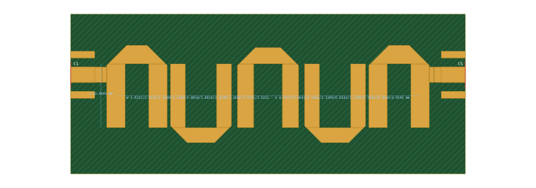
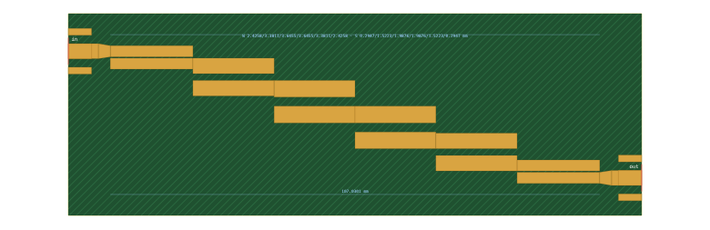

# 10. Hairpin and edge-coupled filters from one specification

The edge-coupled (parallel-coupled) filter is the classic printed bandpass filter: a staircase of half-wave resonators, each coupled to the next over a quarter wavelength. Fold every resonator in the middle into a U, flipping alternate U's, and the same coupled sections become a **hairpin** filter, less than half the area. This example designs both from one specification, on one board, and compares them as built.

Netlists: [`examples/hairpin-5pole-2g4-ro4350b-1524.cir`](../../examples/hairpin-5pole-2g4-ro4350b-1524.cir), [`examples/edgecoupled-5pole-2g4-ro4350b-1524.cir`](../../examples/edgecoupled-5pole-2g4-ro4350b-1524.cir) · specifications: the matching `.json` files.

## 1. The specification

Chebyshev, 5 poles, 0.1 dB ripple (16.43 dB return loss), 2.4 GHz, 10 % ripple bandwidth (2.28–2.52 GHz), 50 Ω. The board is JLC RO4350B 1.524 mm, the thickness the edge-launch SMA is made for. The hairpin resonators are 50 Ω lines (Zr).

In the synthesis dialog, choose **Hairpin** or **Edge-coupled** as the structure and a substrate under **Realise in microstrip**. Both are microstrip-only designs. From the command line:

```sh
node tools/synth.mjs examples/hairpin-5pole-2g4-ro4350b-1524.json --substrate jlc-ro4350b-1.524 --out hairpin.cir
node tools/synth.mjs examples/edgecoupled-5pole-2g4-ro4350b-1524.json --substrate jlc-ro4350b-1.524 --out edge.cir
```

The edge-coupled design takes about 2 s and the hairpin about 2 minutes, most of it field solves of the 10-arm array (manual §7.7).

## 2. What the synthesis gives

| | edge-coupled | hairpin |
|---|---|---|
| geometry | 6 coupled sections: W 2.43 / 3.38 / 3.65 mm, gaps 0.295 / 1.52 / 1.99 mm, about 17.7–18.1 mm long | 5 U's: arm W 3.92 / 3.17 / 3.47 mm, arm length 13.49 mm, inner gaps 4.96 / 6.57 / 6.01 mm, gaps between hairpins 0.664 / 1.231 mm; taps 2.29 mm from the bends |
| lossless response | centre 2.3976 GHz, −3 dB 11.23 % (ideal 11.35 %), return loss 16.41 dB | centre 2.3997 GHz, −3 dB 11.73 %, return loss 16.21 dB |
| insertion loss at f0 | 1.43 dB | 1.02 dB |
| spurious passband (lossless) | 2.07 f0, −0.02 dB | 1.98 f0, −0.29 dB |

Both meet the goals within 1 dB with no warnings. The hairpin's widths and inner gaps are not those of a textbook design. The polish uses them to trim each resonator and to absorb the coupling between a hairpin's own two arms and between non-adjacent arms. The field-solved array includes both.

**The spurious passband** sits near 2f0. The resonators are half-wave long and resonate again there. In a homogeneous TEM medium every coupled section is a half wavelength at 2f0 and transmits nothing, so the filter has a transmission zero exactly there. In microstrip the even and odd modes travel at different speeds, which removes the zero (manual §7.7). That is why both filters pass at 1.9–2.1 f0. If it matters, add a low-pass filter, or wait for velocity-compensated couplers (#41).

## 3. Layout





| | edge-coupled | hairpin |
|---|---|---|
| filter copper | 112.2 × 31.0 mm | 70.1 × 20.6 mm (41 % of the area) |
| board, with the SMA launches and the fence margin | 125.4 × 44.2 mm | 83.3 × 33.7 mm |
| conductors | 2 port lines + 5 resonators, each its own net | 5 hairpins: two on the port nets, three on nets of their own |
| comb-over DRC | clean | clean |

The hairpin's U bottoms are optimally mitred (Douville–James, manual §4.7). The edge-coupled resonators change width at their middles. Those steps are drawn one-sided, on the edge that faces no other line, so every coupling gap is kept.

## 4. As built

The as-built netlists add the feeds, tapers and connector pads. With the substrate's loss:

| | edge-coupled design | edge-coupled as built | hairpin design | hairpin as built |
|---|---|---|---|---|
| S21 at f0 | −1.43 dB | −1.46 dB | −1.02 dB | −1.04 dB |
| −3 dB below the peak | 2.2714–2.5315 GHz | 2.2716–2.5320 GHz | 2.2646–2.5431 GHz | 2.2647–2.5431 GHz |
| worst S11, 2.29–2.51 GHz | −17.61 dB | −16.31 dB | −16.97 dB | −16.97 dB |
| worst insertion loss, 2.29–2.51 GHz | 2.25 dB | 2.31 dB | 1.58 dB | 1.60 dB |
| S21 at 2.0 / 2.2 / 2.6 / 2.8 GHz | −65.7 / −29.1 / −23.7 / −52.5 dB | −65.7 / −29.3 / −23.5 / −52.6 dB | −49.7 / −19.1 / −16.0 / −43.7 dB | −49.7 / −19.1 / −16.0 / −43.8 dB |
| spurious peak | −5.7 dB at 4.87 GHz | −5.7 dB at 4.87 GHz | −1.6 dB at 4.76 GHz | −1.6 dB at 4.76 GHz |

**Trade-offs:**
- **Size and loss.** The hairpin is less than half the size and loses less: its resonators are wider strips at 50 Ω.
- **Skirts.** Its skirts are 8–10 dB softer at ±8 % from f0, because its realised band is 4 % wider and the folded geometry adds cross-couplings.
- **Spurious passband.** Its spurious passband is stronger and closer to f0, at 1.98 f0.
- **Edge-coupled filter.** It is long and narrow, but its skirts are steeper here. Its first gaps (0.295 mm) are the tightest dimension of either board.

## 5. KiCad and Gerbers

Both boards export as KiCad projects (manual §8.3), with a via fence ring round the filter outside the RF keepout:

```sh
node tools/kicad.mjs examples/hairpin-5pole-2g4-ro4350b-1524.cir --out hairpin-board/ --board
```

CI reruns both syntheses from their JSON specifications. It requires each to reproduce the committed netlist byte for byte, exports both boards, runs KiCad's DRC and writes the Gerbers and drill files, as in example 9.

**Not modelled, so worth an EM check (manual §8.6) before ordering:**
- the coupling of the U bottoms to their neighbours;
- the radiation of the open ends;
- the one-sided width steps of the edge-coupled resonators (the model's step is symmetric, and steps under 1.5:1 are not modelled at all).
