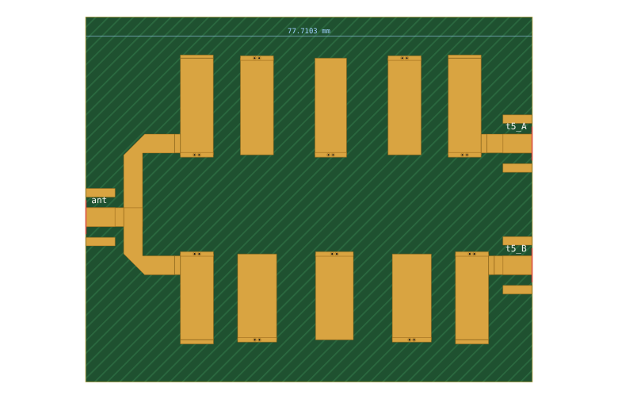

# 11. A duplexer from a specification to Gerbers

A duplexer separates two bands that share one antenna: transmit in one, receive in the other. Without ferrite, it is two bandpass filters joined at a junction. The trick is the line from the junction to each filter. It must make that filter look like an open circuit in the other filter's band, so neither loads the other. This example designs one for two bands 10 % apart and states the isolation against the specification.

Netlist: [`examples/duplexer-2g30-2g53-ro4350b-1524.cir`](../../examples/duplexer-2g30-2g53-ro4350b-1524.cir) · specification: [`examples/duplexer-2g30-2g53-ro4350b-1524.json`](../../examples/duplexer-2g30-2g53-ro4350b-1524.json)

## 1. The specification

| | |
|---|---|
| band A | 2.30 GHz, 4 % (2.2545–2.3465 GHz) |
| band B | 2.53 GHz, 4 % (2.4799–2.5811 GHz) |
| isolation between the two filter ports | ≥ 40 dB in both bands |
| filters | interdigital, Chebyshev, 5 poles, 0.1 dB ripple, Zr 35 Ω |
| board | JLC RO4350B 1.524 mm (the SMA's thickness) |

```sh
node tools/synth.mjs examples/duplexer-2g30-2g53-ro4350b-1524.json --substrate jlc-ro4350b-1.524 --out duplexer.cir
```

It takes about 1.5 minutes, most of it the two interdigital syntheses (manual §7.6).

**Why Zr 35 Ω and interdigital.** At 4 % bandwidth each filter needs an external Q of 28.7. On 1.524 mm the 50 Ω feed is 3.3 mm wide, so the tap junction cannot get close enough to the shorted end to reach it. The refinement stops at about 20, whatever the resonator impedance or type (comb-line reaches 18.6). The goal polish then makes up for it, and the report records that as a note. At Zr 50 Ω filter B's band came out 1 dB too wide. At 35 Ω both filters meet their goals.

## 2. The manifold

```
ant ── tee ──┬── 9.52 mm up ── bend ── 6.58 mm ── filter A (2.30 GHz) ── port A
             └── 5.08 mm down ── bend ── 6.58 mm ── filter B (2.53 GHz) ── port B
```

The synthesis measures each filter's reflection at the other band's centre:
- **Filter A at 2.53 GHz:** |Γ| 0.988. It looks open after 95.9° of line.
- **Filter B at 2.30 GHz:** |Γ| 0.991. It looks open after 63.1°.

Those angles, less the horizontal runs and the tee, give the starting vertical runs (k = 0: the filters fit without adding half-waves). The polish then trims them on the joint goals, from a goal cost of 1.3 to 0.

## 3. The isolation budget

From the report (with the substrate's loss):

| | band A (2.30 GHz) | band B (2.53 GHz) |
|---|---|---|
| **isolation port A ↔ port B** (spec ≥ 40 dB) | **≥ 49.6 dB** | **≥ 72.3 dB** |
| antenna return loss, central 80 % | ≥ 15.5 dB | ≥ 15.4 dB |
| insertion loss antenna → own port, centre / worst in the central 80 % | 2.86 / 3.93 dB | 2.59 / 3.56 dB |
| leakage antenna → the other port | ≥ 46.5 dB down | ≥ 69.6 dB down |
| the other filter alone rejects this band by | ≥ 39.0 dB | ≥ 62.8 dB |

**Reading the budget:**
- **The asymmetry.** Band A's isolation (49.6 dB) is set mostly by filter B's rejection of band A, 39 dB on its own. Filter B is the upper filter, and its lower skirt is the soft one. Filter A's own selectivity and the manifold's mismatch add the rest. Band B has 30 dB of margin.
- **To raise band A:** one more pole in filter B, or more space between the bands.
- **Insertion loss.** At 4 % bandwidth the resonators' Q (about 225 on this board) costs nearly 3 dB. That is the price of a narrow filter in microstrip, and a duplexer doesn't change it.

## 4. Layout

The layout panel, or `.layout duplexer`, draws both filters with the resonator-array template (manual §8.1). Filter A is mirrored so its tap faces the manifold. The filters are placed so their taps meet the manifold branches, and the antenna feed runs to the left edge and both outputs to the right.



| | |
|---|---|
| board | 77.7 × 63.4 mm, three edge-launch SMAs |
| design rules | clean |
| as built vs design | passband S21/S31 within 0.03 dB; isolation unchanged (49.6 / 72.3 dB) |

## 5. KiCad and Gerbers

```sh
node tools/kicad.mjs examples/duplexer-2g30-2g53-ro4350b-1524.cir --out duplexer-board/ --board
```

The project holds:
- one part: both filters and the manifold, with the antenna, the two outputs and GND in one net tie, since interdigital filters are DC shorts;
- three SMA footprints;
- GND pours with a via fence round the part;
- the as-built netlist.

CI reruns the synthesis from the JSON specification and requires the committed netlist byte for byte. It then exports the board, runs KiCad's DRC and writes the Gerbers.

**Not modelled, and the main risk to the isolation figure:** coupling between the two filters across the 7.6 mm gap, and between the manifold and the nearest resonators. 50–70 dB of isolation is exactly where such stray coupling shows, so check it in EM (manual §8.6) or measure it before relying on the margin.
