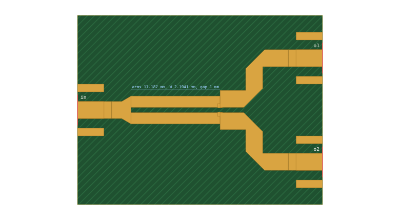
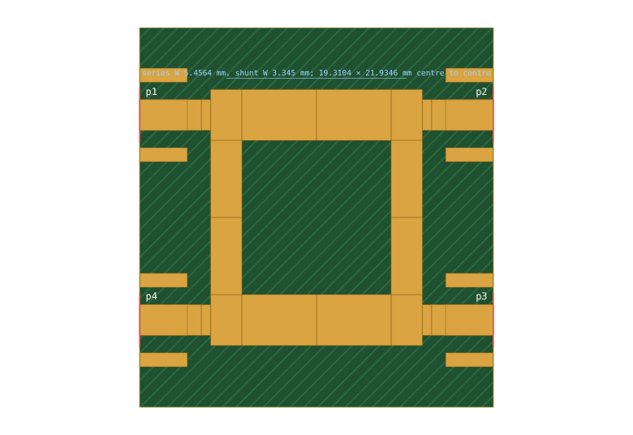

# 12. A compact Wilkinson and a branch-line hybrid, to Gerbers

Two workhorse parts at 2.4 GHz on 1.524 mm RO4350B:
- an equal-split Wilkinson divider, laid out compactly with its arms side by side;
- a 90° branch-line hybrid.

The Wilkinson shows two things. First, compact layouts couple: the arms couple across the gap between them, and a design that ignores this does not do what it says. Second, comb-over's closed-form discontinuity models are not enough on their own for this board. The final dimensions were trimmed against openEMS ([worked example 13](13-openems-coupler.md), section 5).

Netlists:
- [`examples/wilkinson-2g4-ro4350b-1524.cir`](../../examples/wilkinson-2g4-ro4350b-1524.cir): the board, trimmed against openEMS.
- [`examples/wilkinson-2g4-ro4350b-1524-model.cir`](../../examples/wilkinson-2g4-ro4350b-1524-model.cir): comb-over's own design, arms modelled as coupled.
- [`examples/wilkinson-2g4-ro4350b-1524-uncoupled.cir`](../../examples/wilkinson-2g4-ro4350b-1524-uncoupled.cir): arms modelled as independent lines, for comparison.
- [`examples/branchline-2g4-ro4350b-1524.cir`](../../examples/branchline-2g4-ro4350b-1524.cir).

Specifications: the `.json` files.

```sh
node tools/divider.mjs examples/wilkinson-2g4-ro4350b-1524.json --substrate jlc-ro4350b-1.524 --out wilkinson-model.cir
node tools/divider.mjs examples/wilkinson-2g4-ro4350b-1524.json --substrate jlc-ro4350b-1.524 --coupled false --out wilkinson-uncoupled.cir
node tools/divider.mjs examples/branchline-2g4-ro4350b-1524.json --substrate jlc-ro4350b-1.524 --out branchline.cir
# the trim needs openEMS (about 4 min):
node tools/emtrim.mjs examples/wilkinson-2g4-ro4350b-1524.json --substrate jlc-ro4350b-1.524 --out trim/ --e24
```

Each synthesis takes a few seconds. Without `--substrate` the tool gives the ideal TEM design instead (manual §7.9).

## 1. The compact Wilkinson



**The layout:**
- **Input.** The 50 Ω input line tapers out over 1.78 mm to the arms' outer edges. The netlist models the taper as four stepped lines.
- **Arms.** The two quarter-wave arms run side by side, 1 mm apart.
- **Resistor.** A 0603 resistor stands across that gap at the arms' far ends. Its pads land on both arms, so no extra copper is needed to reach it.
- **Outputs.** After the resistor the 50 Ω outputs run on side by side for 6.6 mm, still 1 mm apart. The netlist models this run as a coupled pair. They then turn away through two mitred bends each, to a 20 mm pitch, which keeps the bends well apart and clear of the resistor.

The board is 47.2 × 36.4 mm.

**Does the coupling matter?** A 1 mm gap on a 1.524 mm board is a strongly coupled pair. The divided power travels in the even mode, so the even-mode impedance of the pair, not the impedance of an isolated arm, must be √2·50 Ω. The isolation works in the odd mode, which now has a different impedance and velocity. Three designs, all lossless, in comb-over's model, over 2.16–2.64 GHz (±10 %):

| arms | how they were designed | modelled | input return loss | output return loss | isolation |
|---|---|---|---|---|---|
| 2.01 mm × 16.98 mm, R 91.1 Ω | as independent lines | as independent lines | 21.1 dB | 24.8 dB | 21.9 dB |
| the same copper | as independent lines | **as coupled (what is built)** | **14.5 dB** | **17.2 dB** | 22.0 dB |
| 2.87 mm × 15.83 mm, R 69.4 Ω | **as coupled** | as coupled | **20.1 dB** | **21.3 dB** | 20.7 dB |

Ignoring the coupling costs about 7 dB of match at both the input and the outputs. Designed with the coupling, the arms come out wider, to bring the pair's even-mode impedance back up to the arm impedance.

**Full wave.** openEMS does not agree with the third design. Over the band it gives 14.4 dB input match, 15.4 dB output match and 21.3 dB isolation, against comb-over's 20.1, 21.3 and 20.7 dB. Worked example 13 (section 5) traces where the two differ:
- The taper, the coupled arms, the step to the output width and the coupled output run each agree with openEMS on their own.
- The difference is at the mitred bends and where the two outputs split. Douville and James's bend model misjudges an isolated bend on this substrate: it predicts S11 −26 dB where openEMS gives −32 dB, and about 2° too little phase. The two bends at the split also interact.

**The trim.** `tools/emtrim.mjs` corrects for this by output space mapping:
1. Simulate the design in openEMS.
2. Take the complex difference between openEMS and comb-over at the same reference planes.
3. Re-optimise the arm width, arm length, resistor and taper so that comb-over plus that difference meets the goals.
4. Repeat until openEMS itself meets them.

Here it took one correction, then a final check with the resistor rounded to E24 (95.0 → 91 Ω): three openEMS runs of about 70 s each. The log is in [`examples/em/`](../../examples/em/).

| over 2.16–2.64 GHz, as built (worst) | comb-over alone | openEMS | openEMS, mesh halved |
|---|---|---|---|
| input return loss | 17.3 dB | **20.9 dB** | 20.4 dB |
| output return loss | 19.2 dB | **26.4 dB** | 27.4 dB |
| isolation | 22.8 dB | **23.8 dB** | 23.3 dB |
| split | −3.14 … −3.18 dB | −3.10 … −3.12 dB | −3.10 … −3.12 dB |

The trimmed arms are 2.19 mm × 17.19 mm, with 91 Ω across them. The board netlist has no `.goal` lines: comb-over alone predicts it 3.6 dB short at the input, and the trim is what makes it work. The input match has the least margin, 0.4 dB at 2.64 GHz on the finer mesh.

**Not modelled in comb-over:** the bends' interaction where the outputs split, the start of the gap at the end of the taper, and the resistor body over the gap (its pads, ESL and body capacitance are). The openEMS model has the resistor as a plain 91 Ω, without its ESL.

## 2. The branch-line hybrid



**The layout:**
- **Arms.** Series arms (35.4 Ω, 5.46 mm wide) form the top and bottom; shunt arms (50 Ω, 3.35 mm) form the sides.
- **Corners.** Each corner is a Hammerstad tee. The port line and the series arm are its main arms, the shunt arm its side arm.
- **Lengths.** These are measured between the tees' reference planes, so the polish absorbs the junctions: series 15.97 mm, shunt 16.48 mm.

The board is 37.8 × 40.5 mm.

| over 2.28–2.52 GHz (±5 %) | lossless | with loss |
|---|---|---|
| return loss | ≥ 20.0 dB | ≥ 20.1 dB |
| isolation | ≥ 20.3 dB | ≥ 20.4 dB |
| through / coupled | −3.29 … −2.91 dB | −3.35 … −2.97 dB (−3.075 dB each at f0) |
| phase difference | −90.0 … −89.6° | −90.0 … −89.5° |

As built, nothing changes beyond the second decimal.

## 3. KiCad and Gerbers

```sh
node tools/kicad.mjs examples/wilkinson-2g4-ro4350b-1524.cir --out wilkinson-board/ --board
```

**The Wilkinson project:**
- **Part.** The arms, input stub and output routes are one copper piece, so `in`, `o1` and `o2` share a net tie.
- **Resistor.** RI1 is a `RES_0603` footprint with pad 1 on `o1` and pad 2 on `o2`.
- **Design rules.** A rule lets the resistor's courtyard sit on the part.
- **Board.** Three SMAs and a via fence.

The branch-line part is one piece of copper with its four ports in one tie. CI exports both boards, runs KiCad's DRC and writes the Gerbers.

**Before ordering:**
- The resistor is already an E24 value (91 Ω). Check its datasheet for ESL and body capacitance: comb-over assumes 0.6 nH and 0.03 pF (set `esl=` and `cp=` on the `res` line), and the openEMS check has none. In comb-over the ESL is worth about 4 dB of isolation, so a part with much more than 0.6 nH deserves a second look.
- The full-wave check is committed in [`examples/em/`](../../examples/em/). After changing anything, rerun it (`node tools/openems.mjs examples/wilkinson-2g4-ro4350b-1524.cir --out oems/`, manual §8.6) or the trim.
