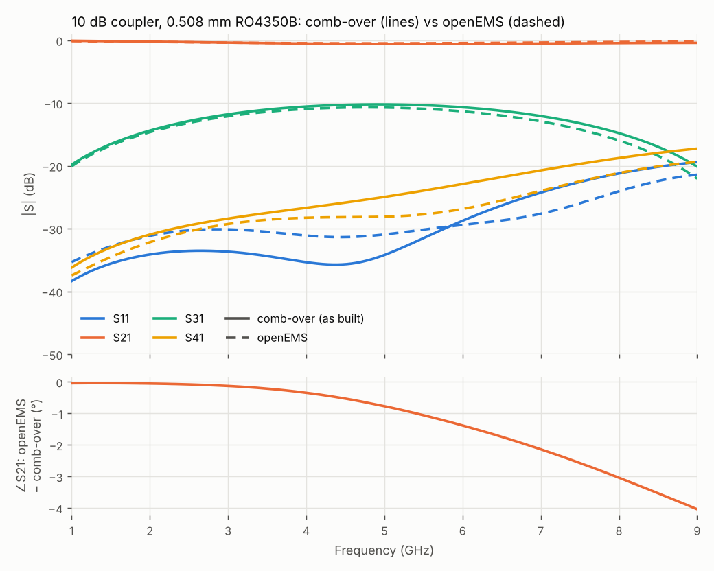

# 13. Checking a coupler in openEMS

comb-over's models are closed forms and 2-D field solutions joined by circuit theory. A full-wave simulation solves Maxwell's equations on the actual copper and includes everything those models leave out. This example exports the 10 dB coupler on 0.508 mm RO4350B to [openEMS](https://openems.de) (an open-source FDTD solver), runs it, and compares the two.

Netlist: [`examples/coupler-10dB-ro4350b.cir`](../../examples/coupler-10dB-ro4350b.cir) (from [worked example 2](02-couplers.md)) · results: [`examples/em/`](../../examples/em/) (the openEMS Touchstone files and comparison netlists). Section 5 runs the same check on the compact Wilkinson of example 12, and finds a real problem.

```sh
node tools/openems.mjs examples/coupler-10dB-ro4350b.cir --out oems/ --excite 1
cd oems && python3 10_dB_coupled-line_coupler_*.py        # openEMS's Python modules must be importable
cd .. && node tools/openems.mjs --compare oems/
```

The run takes 5 min 20 s on two cores: 1.71 M cells, 18 800 timesteps to −40 dB of the peak field energy. `--excite all` drives each port in turn and fills the whole S-matrix (four runs).

## 1. What is exported

- **Copper.** The layout's core, feeds and part pads as polygons on the substrate: zero-thickness conducting sheets with the copper's conductivity and thickness (for loss), or PEC with `--lossless`. Vias are PEC cylinders; chip resistors and capacitors are lumped elements across their pads.
- **Substrate.** εr and tan δ of the `.substrate`, the loss as a conductivity matched at the sweep centre.
- **Ports.** The feeds are rebuilt as straight lines to the board edge (no edge connectors). Each has an openEMS microstrip port terminated in its impedance, with its measurement plane max(3 mm, 2W) in from the edge.
- **Boundaries.** PEC ground; PML on every other side, 5h (at least 3 mm) beyond the copper, except at the port ends, where the feeds run into it.
- **Comparison netlist.** The as-built netlist with each feed shortened to the measurement plane, so both sides have the same reference planes. It overlays the openEMS result as `.data em … overlay`, so it can be opened in the designer with **Data…**.

## 2. The result



Port 1 driven, comb-over's as-built model against openEMS:

| | 1 GHz | 3 GHz | 5 GHz | 7 GHz | 9 GHz |
|---|---|---|---|---|---|
| S31, coupling (dB) | −19.80 / −20.07 | −11.79 / −12.10 | −10.20 / −10.71 | −12.06 / −12.91 | −20.12 / −22.04 |
| S41, isolation (dB) | −36.2 / −37.4 | −28.4 / −29.3 | −24.9 / −28.1 | −20.7 / −24.0 | −17.2 / −19.4 |
| S11, match (dB) | −38.4 / −35.3 | −33.7 / −30.1 | −34.2 / −30.9 | −24.3 / −27.6 | −19.4 / −21.4 |
| ∠S21, openEMS − comb-over | −0.0° | −0.1° | −0.8° | −2.1° | −4.0° |
| power lost (%) | 0.6 / 1.9 | 1.6 / 1.9 | 2.6 / 1.8 | 3.7 / 2.1 | 4.8 / 2.1 |

**Coupling.** openEMS's coupling is weaker: by 0.3 dB from 1 to 3 GHz, 0.5 dB at the 5 GHz centre and 0.65 dB at 6 GHz. Above that openEMS falls off faster still. Neither the cause nor a correction has been found yet; the mesh is not it (section 3).

**Phase.** openEMS's transmission lags by 0.8° at 5 GHz and 4° at 9 GHz, over a 26 mm path. The lag grows faster than frequency, which fits dispersion: comb-over evaluates each line once, at the `.ref` frequency (5 GHz here), and keeps that εeff across the sweep (manual §4.6), so above 5 GHz its εeff is slightly too low. For this line Kirschning–Jansen gives εeff 2.852 at 1 GHz, 2.870 at 5 GHz and 2.894 at 9 GHz. Not modelled in comb-over and evidently small: the copper thickness (the openEMS strips are zero-thickness sheets) and the layout's corners.

*Before #41 this section reported a 6° lag at 5 GHz, attributed to copper thickness (2°) and the corners (4°). Most of it was mesh error: the export's mesh smoother left a strip narrower than the maximum step as a single cell between its edge lines (section 4).*

**Isolation** is 1–3 dB better in openEMS. In comb-over's model, the coupled section's directivity is set by the difference between the even- and odd-mode velocities. The full-wave model also includes the arms' coupling and the corners at each end of the section, which are not in comb-over's netlist; they partly compensate. The cause is not separated here.

**Match** agrees within 3.5 dB. openEMS is worse matched up to 5 GHz and better matched above 7 GHz. Both are below −19 dB everywhere.

**Radiation.** With `--lossless`, openEMS's power balance is within the port's accuracy (0 to −1 %) across the band, so this coupler radiates less than about 1 % of the power up to 9 GHz. On 0.508 mm material this is expected: the substrate is thin compared with the wavelength.

**Loss.** comb-over's loss grows with frequency as it should (dielectric ∝ f, conductor ∝ √f). openEMS's stays near 2 %, because its dielectric loss is a conductivity, which gives the right tan δ only at the sweep centre. To check loss, export a narrow band (`--fmin`, `--fmax`).

## 3. Is the mesh fine enough?

The `fine` cell (default: a third of the narrowest strip or gap, here 0.034 mm) sets the mesh at copper edges. Halving it (`--fine 0.017`: 2.80 M cells, 12 min):

| at 5 GHz | fine 0.034 mm | fine 0.017 mm |
|---|---|---|
| S31 | −10.71 dB | −10.71 dB |
| S41 | −28.1 dB | −28.2 dB |
| S11 | −30.9 dB | −31.3 dB |
| ∠S21 − comb-over | −0.8° | −0.6° |

Coupling does not move, phase by 0.2° and isolation and match by 0.1–0.4 dB, so the default mesh is converged. (Before the grading fix in section 4, halving `fine` moved coupling by 0.24 dB and isolation by 1 dB.)

## 4. Lessons from setting this up

These are built into the export now, but they matter if you edit the script or write your own.

- **Grade every gap.** Between fixed lines (edges, ports) the mesh must grow by at most about 1.4× per cell. The export first filled only gaps wider than its maximum step (λ/20 in the substrate), so a strip narrower than that was a single cell between its two edge-line pairs, up to 25× its neighbours. On the 0.79 mm backbones of #41's finger-loaded lines that put the odd-mode εeff 3.5 % low and Zo 11 % low; on this coupler it gave 5° of the phase lag above. The export now grades every gap (worst neighbour ratio 2.8 on the worked examples, at fixed line pairs), at about three times the cells here.
- **Edges by the thirds rule.** A zero-thickness strip's edge should sit a third of the way into its mesh cell: one line fine/3 inside the metal and one 2·fine/3 outside. With a line on each side at ±fine/2 instead, a straight 50 Ω line's εeff came out 4 % high and the coupler's coupling 0.9 dB too strong.
- **The port's feed outside the PML.** openEMS silently drops a port's terminating resistor inside the absorber (the log says "Unused primitive … port_resist"). The export meshes each port end uniformly so the feed sits on the 10th line, beyond the 8 PML cells.
- **No DC in the excitation.** The coupler's two strips are not connected at DC. A Gaussian pulse with a DC component leaves charge on them, and the field energy never falls to the end criterion. The export subtracts the DC from openEMS's pulse.
- **Port orientation.** An openEMS microstrip port's `start` is at the strip and `stop` at the ground; the port draws its own strip at `start`.
- **No series lumped elements.** A series R–L lumped element (a chip resistor with its ESL) gave NaN fields from the first timestep in some runs of openEMS v0.37 (development), depending on the script's memory layout, not on the model. The export uses a plain R.

## 5. A second board: the compact Wilkinson

The same check on the compact Wilkinson of [worked example 12](12-wilkinson-and-branch-line.md) found a real problem, which led to #47. The export gives the isolation resistor to openEMS as a plain R, without the ESL and body capacitance in comb-over's `res` model. The comparison netlist drops them too (`esl=0 cp=0`), so both sides have the same circuit.

**The original layout** (arms 2.78 mm, R 73.3 Ω, outputs turning to a 12 mm pitch), at 2.4 GHz:

| | comb-over | openEMS |
|---|---|---|
| S11, input match | −38.2 dB | −13.3 dB |
| S22, output match | −25.6 dB | −14.4 dB |
| S32, isolation | −26.7 dB | −20.7 dB |

Halving the mesh cell changed S11 by 0.2 dB, so this is not mesh error.

**Where the two differ.** Each piece of the board was simulated on its own (the export can take a hand-built piece of copper) and compared with comb-over:

| piece | result |
|---|---|
| the outputs' 4.9 mm side-by-side run after the resistor | modelled as two independent lines. As a coupled pair, comb-over's isolation matches openEMS within 0.5 dB across the band: **this explained the isolation** |
| the coupled arms, even and odd mode (by a magnetic or electric wall on the centre line) | Kirschning–Jansen within 1–3 % in Z and εeff |
| an input taper into the arms, and the step to the output width | \|S11\| within 0.2 dB |
| the resistor pads | removing them changes nothing |
| one optimum-mitred 90° bend, 3.29 mm on 1.524 mm | as comb-over then had it, S11 −26 dB against openEMS's −32 dB; openEMS fits twice the model's inductance. comb-over had put half the published L in each arm, where the published circuit (and Qucs) has the whole L in each: fixed in #49 |
| the two outputs' bends where they split, 1 mm apart | not separable from the above; the corrected bend explains about half of the remaining mismatch |

So the remaining error was in the bends, and in their interaction where the outputs split.

**Bends against openEMS (#49).** `tools/bendcheck.mjs` simulates single 90° bends:
- **Range:** five substrates (εr 2.55–10.2, 0.508–1.6 mm), W/h 0.5–4, mitred and square.
- **Ports:** at the strip's own impedance.
- **Lines:** a straight reference of the same length takes out the lines' own εeff error.

With the whole L in each arm, the S11 error is the same or smaller in all 40 cases.

| optimum mitre | W/h ≤ 2 | W/h 4 |
|---|---|---|
| transmission-phase error at the top frequency | within 2° in 13 of 15 cases (4° in the other two) | −3° to −17°, largest at high εr and f·h |
| complex S11 error | mostly below 0.1 | mostly below 0.1 |

The square corner's phase error grows with W/h, from about 1° to 35°. The models are otherwise used as published (manual §4.7).

**The fix** (#47, then #49):
- **Input.** A taper into the arms, modelled as stepped lines.
- **Outputs.** The side-by-side run after the resistor is modelled as a coupled pair, and the outputs go to a 20 mm pitch so the bends sit apart and off the resistor pads.
- **Bend model.** The whole L in each arm (#49). comb-over's own design then gives 18.1 dB input match in openEMS, against 14.4 dB before.
- **Trim.** The dimensions are trimmed against openEMS by output space mapping (`tools/emtrim.mjs`). It takes the complex difference between openEMS and comb-over, adds it to comb-over's response, and re-optimises the arms, resistor and taper. It converged after one correction.

| over 2.16–2.64 GHz (worst) | comb-over alone | openEMS | openEMS, mesh halved |
|---|---|---|---|
| input return loss | 20.6 dB | 21.6 dB | 21.6 dB |
| output return loss | 21.8 dB | 25.1 dB | 25.8 dB |
| isolation | 24.1 dB | 23.0 dB | 23.6 dB |

The committed result ([`examples/em/`](../../examples/em/)) is for this trimmed board, with its comparison netlist and the trim's log. With the corrected bend model, comb-over alone agrees with openEMS on it within about 1 dB on input match and isolation.

*Post-processing.* Since #41, when every port is driven the export computes S = B·A⁻¹ from the incident and reflected waves at all ports, so a port's termination needs no match to the reference. The figures in this section from before that change used b_i/a_exc. For these 50 Ω ports the difference is under 1 dB. The committed result and the trimmed board's figures are re-processed.

**Loss.** On both boards openEMS shows less loss than comb-over (about 1 % against 1.8 % for the trimmed Wilkinson at 2.4 GHz, port 1 driven). This has not been investigated.
