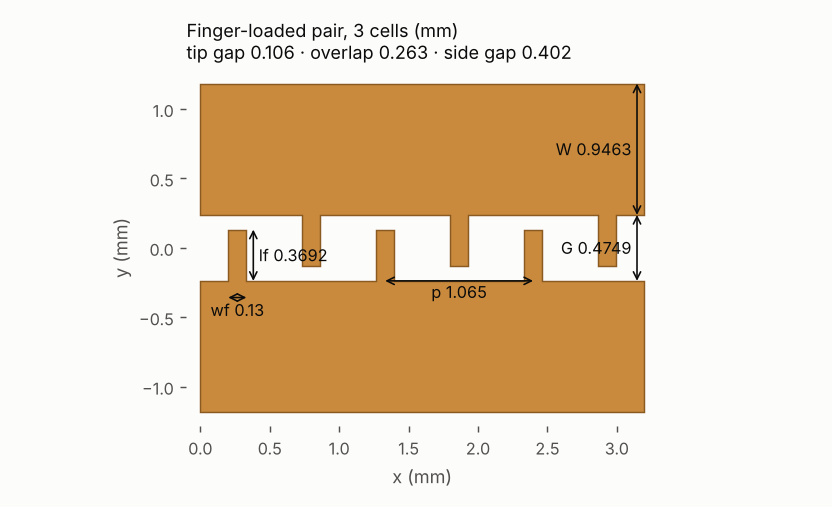
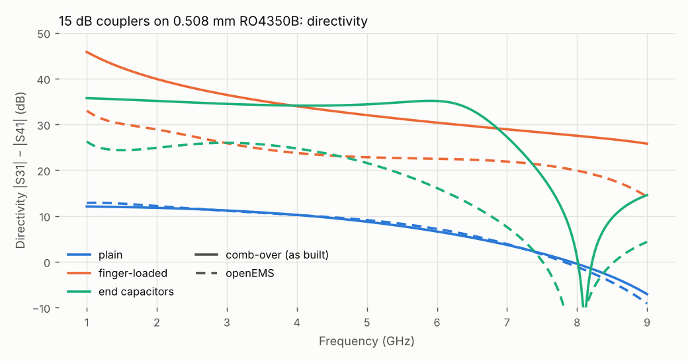
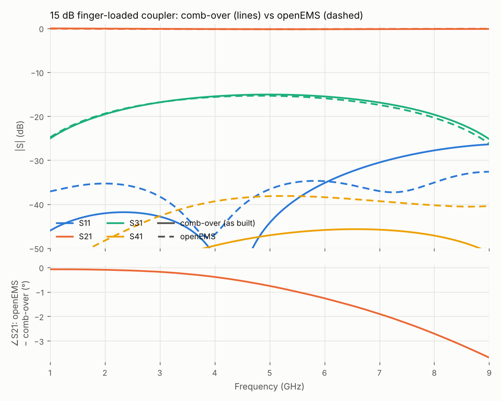

# 14. A velocity-equalised coupler with interdigital fingers

In a microstrip coupled-line coupler the odd mode travels faster than the even mode, because more of its field is in the air. That velocity difference sets the directivity. For the plain 15 dB coupler on 0.508 mm RO4350B, comb-over gives εo/εe = 0.84, and openEMS gives 9 dB directivity at the 5 GHz centre.

Short fingers on each line's inner edge, reaching across the gap and interleaving with the other line's, add capacitance between the lines. That slows the odd mode much more than the even mode. With the right fingers the two velocities are equal. This example designs such a section against openEMS. There is no closed form for it in comb-over: the section enters the circuit model as per-length C and L extracted from full-wave runs.

Netlists and results: [`examples/coupler-15dB-ro4350b.cir`](../../examples/coupler-15dB-ro4350b.cir) (the plain coupler) · [`examples/em/`](../../examples/em/) (both couplers' openEMS results and comparison netlists) · issue #41. It needs openEMS (`OPENEMS_PYTHON`) and numpy.

## 1. The structure



Two backbones of width W, a gap G apart. Each carries fingers of width wf and length lf on its inner edge, one per pitch p, at x = (k + ¼)p on line 1 and (k + ¾)p on line 2 (`js/fingers.js`). The fabrication limits are the gaps:

- **Tip gap** G − lf, from a finger's tip to the other backbone.
- **Side gap** p/2 − wf, between neighbouring fingers.
- **Overlap** 2lf − G, how far the fingers interleave.

At JLC's 0.09 mm minimum spacing, the tip gap and the side gap are both at least 0.09 mm.

## 2. Extracting the section

Each design point is two openEMS runs of a straight finger-loaded section between plain coupled feeds, 8 and 14 cells long. Only ports 1 and 2 are driven, because the pair's 180° rotation symmetry gives the other two (the export's `excite` and `perm` options).

- **Velocities.** The two runs differ only in the number of cells. With T the 4×4 wave transfer matrix, T₁₄·T₈⁻¹ = E·U⁶·E⁻¹: the feeds, ports and finger ends (E) cancel, and its eigenvalues are exp(∓jβ·6p) of the even and odd modes (`tools/fingerbloch.py`). This is exact for any ends. On the sections here it agrees to 0.001 in εeff over any pair of lengths, and is flat over 1–6 GHz.
- **Impedances.** Ze and Zo are then fitted to the 14-cell run with the velocities held.

A per-length C and L fitted to a single short section does not work. It folds the finger ends into the line constants, and at 8 cells it reported equal velocities for a section whose de-embedded εo/εe is 1.07.

The extraction also found a bug in the openEMS export's mesh: a strip narrower than the maximum step was a single cell between its edge lines. On these backbones that put εo 3.5 % low and Zo 11 % low. It is fixed (worked example 13, section 4).

## 3. The design

`tools/fingerdesign.mjs` solves for three targets: Ze and Zo for the coupling, and εo = εe. It uses Newton's method with one finite-difference Jacobian, then Broyden updates, with each evaluation the extraction above (about 7 min). Steps are limited to 0.1 mm and kept within the fabrication limits.

```sh
export OPENEMS_PYTHON=…                       # openEMS's Python, with numpy
# 1: tip gap held at 0.09 mm, search backbone width, gap and pitch
node tools/fingerdesign.mjs oems/fd15 --C 15 --tip 0.09 --min 0.09 --wf 0.13 --W 0.95 --G 0.4 --p 0.6
# 2: pitch fixed so that 8 cells are a quarter wave at 5 GHz; search width, gap and finger length
node tools/fingerdesign.mjs oems/fd15b --C 15 --min 0.09 --wf 0.13 --p 1.065 --W 0.9526 --G 0.473 --lf 0.383
```

The first search converged in 6 steps after the Jacobian, at a pitch of 1.136 mm. A quarter wave at 5 GHz is 8.52 mm, 7.5 of those cells. The second search fixes the pitch at 8.52/8 = 1.065 mm and converged in one step:

| | plain (comb-over's model) | finger-loaded (openEMS) |
|---|---|---|
| backbone W / gap G | 1.0059 / 0.3187 mm | 0.9463 / 0.4749 mm |
| fingers: width / length / pitch | — | 0.13 / 0.3692 / 1.065 mm |
| tip gap / side gap / overlap | — | 0.106 / 0.403 / 0.264 mm |
| Ze / Zo (target 59.85 / 41.77 Ω) | 59.85 / 41.77 Ω | 59.81 / 41.75 Ω |
| εe / εo | 3.066 / 2.572 | 3.095 / 3.092 |

## 4. The coupler in openEMS

`tools/fingercoupler.mjs` puts the section, 8 cells, into the plain coupler's layout (the same diverging arms, tapers and 50 Ω feeds) and writes comb-over's model of it, with the section as the extracted C and L. The run is 2.7 M cells, 8 min on two cores.

```sh
node tools/fingercoupler.mjs gen oems/fc15 --fit oems/fd15b/W0.9463_G0.4749_lf0.3692 --long oems/fd15b/W0.9463_G0.4749_lf0.3692_n14 --cells 8 --net examples/coupler-15dB-ro4350b.cir
(cd oems/fc15 && $OPENEMS_PYTHON f.py)
node tools/fingercoupler.mjs cmp oems/fc15 --plain oems/plain15     # the plain coupler: tools/openems.mjs … --out oems/plain15 --excite 1 --run
```



openEMS, port 1 driven:

| | 1 GHz | 3 GHz | 5 GHz | 7 GHz | 9 GHz |
|---|---|---|---|---|---|
| S31, coupling: plain / fingers (dB) | −25.03 / −24.84 | −17.00 / −16.82 | −15.73 / −15.35 | −18.32 / −17.44 | −28.26 / −26.24 |
| S41, isolation: plain / fingers (dB) | −37.9 / −57.8 | −28.1 / −42.7 | −24.8 / −38.2 | −22.2 / −39.3 | −19.1 / −40.4 |
| S11, match: plain / fingers (dB) | −65.8 / −37.1 | −35.8 / −38.3 | −26.8 / −36.6 | −29.1 / −37.0 | −30.8 / −32.6 |
| **directivity: plain / fingers (dB)** | 12.9 / **33.0** | 11.1 / **25.9** | 9.1 / **22.8** | 3.9 / **21.9** | −9.1 / **14.2** |

- **Directivity.** The fingers raise it by 14 dB at the centre, to at least 20 dB from 1 to 8 GHz. The plain coupler stays at or below 13 dB, and below 4 dB from 7 GHz.
- **Coupling.** −15.35 dB at 5 GHz, against 15 dB designed and comb-over's −15.06 dB. openEMS's coupling is weaker by about the same 0.3–0.5 dB as for the plain couplers (worked example 13).
- **Match and loss.** Match is below −32 dB everywhere. Loss is 1.7 % at 5 GHz, the same as the plain coupler.



**comb-over overestimates the directivity** of the finger-loaded coupler: 32 dB at 5 GHz against openEMS's 22.8 dB. The section is not the cause; its velocities and impedances come from openEMS. The isolation that remains comes from the layout around the section: the corners where the arms leave it and the arms' own coupling, neither of which is in comb-over's netlist. In the plain couplers the section's own isolation term is much larger and hides them. On the 10 dB attempt (section 6), adding the fingerless layout's error to the model reproduced openEMS's directivity within 1–2 dB. So treat comb-over's isolation figure for a velocity-equalised section as an upper bound, and check the layout in openEMS.

## 5. The board

[`examples/coupler-15dB-fingers-ro4350b.cir`](../../examples/coupler-15dB-fingers-ro4350b.cir) is the coupler as a netlist. The section is a `geom msl` pair (the backbones) with a `fingers` line that carries the extracted modes (manual §4.6):

```
cline K geom=msl W=0.9463mm S=0.4749mm      # the backbones
  fingers wf=0.13mm lf=0.3692mm p=1.065mm Ze=59.81 Zo=41.75 ee=3.095 eo=3.092
  len 8.52mm                                # 8 whole cells: λ/4 at 5 GHz
  …
.layout coupler K
```

The `coupler` layout splices the fingers into each line's outline, the KiCad export puts them in the core footprint, and the openEMS export meshes them from the finger features. Exported from this netlist, openEMS gives the same result as the coupler of section 4.

```sh
node tools/kicad.mjs examples/coupler-15dB-fingers-ro4350b.cir --out kicad/ --board
```

The tip gap (0.106 mm) is the smallest spacing on the board. CI exports it, checks it with KiCad's DRC and makes Gerbers.

## 6. Limits

- **Tight coupling does not fit.** At 10 dB on 0.508 mm RO4350B with 0.09 mm spacing, the fingers do equalise the velocities, but Ze/Zo reaches only about 1.76 (about 11 dB coupling) against the 1.925 needed. The fingers need room in the gap (G ≥ 2 × tip gap + overlap), and that room weakens the coupling between the backbones. 15 dB needs Ze/Zo 1.43 and fits easily. Tighter coupling needs finer spacing or a different structure.
- **Per design, not per substrate rule.** Each design point is two openEMS runs (about 7 min). A design takes about 1 h. A different substrate or coupling needs its own design.
- **Isolation from comb-over** is an upper bound, as above.
