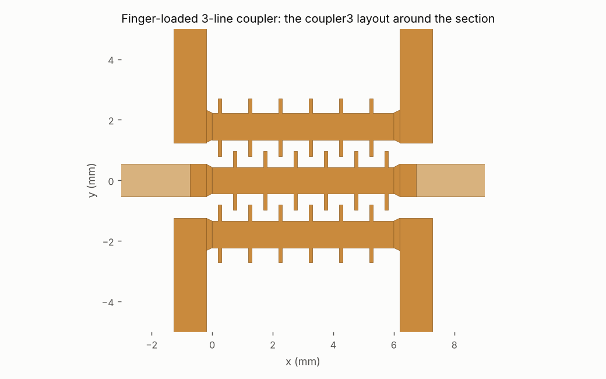
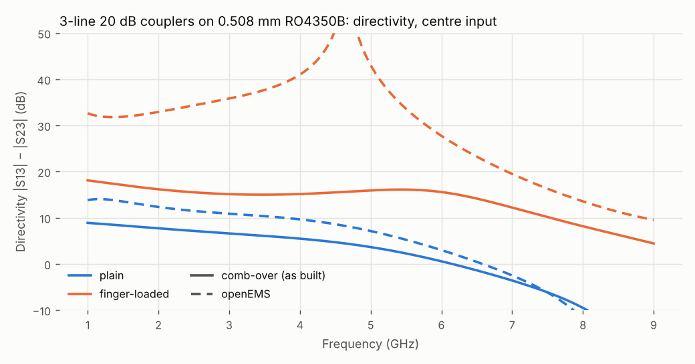

# 15. A three-line coupler with fingers

A three-line coupler sends a sample of the signal on its centre line to both outer lines. On microstrip it has the same problem as a pair, more strongly: the modes travel at different speeds, so its directivity is poor. The plain 20 dB design below has symmetric modes at εeff 2.57 and 3.14, 20 % apart, and 7 dB directivity at 5 GHz in openEMS. Fingers between the lines bring the two modes that a centre-line signal excites to within 1.7 %, and the directivity to at least 27 dB from 1 to 6 GHz, with coupling centred at 5 GHz.

This example extends worked example 14 to three lines. It covers the match conditions for a centre-driven coupler, the 3-line extraction and design, and the `coupler3` layout. That layout is shaped by what openEMS showed about the coupling around the section's ends. Section 5 covers driving an outer line.

Netlists: [`examples/coupler3-20dB-ro4350b.cir`](../../examples/coupler3-20dB-ro4350b.cir) (plain) · [`examples/coupler3-20dB-fingers-ro4350b.cir`](../../examples/coupler3-20dB-fingers-ro4350b.cir) (finger-loaded) · results: [`examples/em/`](../../examples/em/) · issues #41, #60, #61. The design needs openEMS (`OPENEMS_PYTHON`) and numpy.

## 1. What a centre input needs

The lines are mirror-symmetric (outer, centre, outer). A signal on the centre line excites only the two mirror-symmetric modes:
- the **c mode**, with all three lines in phase;
- the **π mode**, with the centre line opposed to the outer pair.

The antisymmetric mode (the outer lines in antiphase) only affects the outer ports' match and the outer-to-outer leakage.

In the symmetric subspace the outer pair acts as one line terminated in Z0/2 (its two ports in parallel), and the centre line as one terminated in Z0. That is an asymmetric coupled pair. Normalised to its terminations, it is an ideal coupler when its two modes travel at the same speed and the characteristic impedance matrix Z meets:

- (Z11 + Z13) / Z22 = 1,
- ((Z11 + Z13)/2 · Z22 − Z12²) = Z0²/2.

The coupling to each outer port is then 20 log(k/√2), with k = Z12 / √((Z11 + Z13)/2 · Z22).

For ideal lines that meet these conditions, comb-over gives S23 and S33 below −190 dB.

Matching each line's own impedance to Z0 instead is not enough. It gives S33 −25 dB and S23 −41 dB even for ideal lines with equal velocities. The first finger design here used that target, and its first coupler had a centre-port match of −12 dB.

## 2. Extraction and design

`tools/fingerlibN.mjs` generalises the pair's extraction (worked example 14, section 2) to N lines:
- **Cases:** each case is a 2N-port. Only the lower half of the lines and the centre line are driven, and the mirror gives the rest.
- **Velocities:** de-embedded from two lengths (`tools/fingerbloch.py`). Each mode is labelled symmetric or antisymmetric from its eigenvector.
- **C and L:** the section's 3×3 C and L, mirror-symmetric with 4 + 4 parameters, are fitted to both lengths, with the feeds from the 2-D field solver. The fit's rms is 0.003–0.004.

`tools/fingerdesign3.mjs` searches the outer width Wo, centre width Wc, gap G and finger length lf. It also searches lfo, the length of fingers on the outer lines' outer edges. Its targets are coupling, centre-input match and equal symmetric-mode speeds. Each point is two openEMS sections of 6 and 10 cells, about 10 minutes.

| | plain (field solver) | finger-loaded (openEMS) |
|---|---|---|
| Wo / Wc / G | 1.1259 / 1.0765 / 0.6133 mm | 0.8844 / 0.8607 / 0.9113 mm |
| fingers: width / length / pitch / outer-edge length | — | 0.13 / 0.5423 / 1.0 / 0.4761 mm |
| section | 8.869 mm | 6 cells, 6.0 mm (section 4) |
| symmetric modes, εeff | 2.57 / 3.14 | 3.595 / 3.656 (1.7 %) |
| match conditions; coupling | met; −20.0 dB | within 2.4 %; −19.9 dB |

The search was stopped at the best point, not driven to the tolerance. Near it the velocity residual moves by ±1 % from point to point, which is about the extraction's noise. Whether the outer-edge fingers are needed is open: the search shortened them steadily (0.6 → 0.48 mm), and longer ones moved the modes apart.

## 3. The layout: what openEMS showed about the ends

A first 3-line test structure took the outer lines away at 45° and ran their 50 Ω feeds beside the centre feed, about 2 mm apart. In openEMS it coupled 3–4 dB more strongly at 1 GHz than its netlist, and its coupling peaked near 3 GHz instead of 5. The extraction was not at fault: on a straight 3-line run, the 2-D solver's C and L reproduce openEMS's centre-to-outer coupling within 0.3–0.7 dB.

The extra coupling came from the ends, in two ways:
- **The feeds.** Moving the outer feeds 4 mm out halved the discrepancy.
- **The side-by-side run where the lines leave the section.** Only the outer line turns away; the centre line runs straight on. So the gap opens at half the rate of a pair's, where both lines diverge. With about 1.5 mm at each end counted as coupled 3-line, the netlist reproduces openEMS within 0.1 dB to 4 GHz.

So `.layout coupler3` (manual §8.1):
- **Ends:** tapers each line to its feed width right at the section's end. A centre-driven coupler's match conditions hold for Z0 terminations at the section itself: with the lines' own ~56 Ω widths carried to the feeds, S33 was −12 dB.
- **Outer lines:** turn straight away, 90°, to ports a pitch above and below. The turns are square by default (section 5 has the mitred alternative).
- **As-built netlist:** models the short side-by-side run before the turn as a coupled 3-line (`K_ea`, `K_eb`), up to the first turn's centre, and each turn as a `bend`.



```sh
node tools/kicad.mjs examples/coupler3-20dB-fingers-ro4350b.cir --out kicad/ --board
```

The KiCad core is six pads in three net-tie pairs, and carries all 36 fingers. CI exports both boards and checks them with KiCad's DRC.

## 4. The result

Exported from the netlists through `.layout coupler3`, with no connectors and a centre input (port 3):



| openEMS, centre input | 1 GHz | 2 GHz | 3 GHz | 4 GHz | 5 GHz | 6 GHz | 7 GHz |
|---|---|---|---|---|---|---|---|
| directivity: plain (dB) | 13.8 | 12.3 | 10.9 | 9.6 | 7.1 | 3.0 | −2.5 |
| directivity: fingers (dB) | 32.6* | 32.9* | 35.8* | 41.0* | 43.1* | **27.7** | 19.5 |
| coupling S13, fingers: comb-over / openEMS (dB) | −30.9 / −30.6 | −25.2 / −25.0 | −22.3 / −22.3 | −20.8 / −20.9 | −20.1 / **−20.4** | −20.1 / −20.6 | −20.8 / −21.5 |
| centre match S33, fingers (dB) | −44.8 | −40.5 | −38.5 | −37.1 | −35.2 | −32.4 | −29.3 |

\* From 1 to 5 GHz the finger coupler's isolation is −58 to −63 dB. Below about −45 dB it moves with the mesh: on the 8-cell version, halving the edge cell moved such figures by up to 10 dB and the coupling by less than 0.1 dB. Read these as "above about 30 dB", not as the numbers given.

- **Centring (#60).** The extracted C and L hold for any whole number of cells at the 1 mm pitch, so the length was chosen without new openEMS runs. With 8 cells (8.0 mm) the coupling peaked near 4.0 GHz in openEMS. comb-over's as-built netlist puts the peak at 5 GHz for about 6.6 mm. openEMS runs about 8–9 % electrically longer than the netlist on this coupler (4.0 against 4.3 GHz at 8 cells), so 6 cells (6.0 mm) were chosen. openEMS then peaks at 5.0 GHz, at −20.4 dB. The design's coupling target (−20 dB at the section's own λ/4) did not need changing.
- **Coupling.** comb-over agrees with openEMS within 0.3 dB to 5 GHz on the finger coupler, 0.5–0.7 dB at 6–7 GHz. On the plain one it agrees within 0.75 dB to 5 GHz, 1.2–2.1 dB at 6–7 GHz. Both are as built, through `coupler3`.
- **Directivity.** The fingers lift it from 7 dB to above 30 dB at 5 GHz, and to at least 27 dB from 1 to 6 GHz. comb-over predicts less (15–20 dB). Its as-built netlist treats the side-by-side runs at the ends as bare coupled lines, and their mode mismatch then dominates its isolation figure. So comb-over's directivity for this layout is a lower bound, not an upper one as in example 14.
- **Match.** The centre port is −35 dB at 5 GHz in openEMS (comb-over −40 dB), and −29 dB at 7 GHz.
- **Mesh.** The plain coupler's default edge cell, a third of its 0.61 mm gap, is not converged: at 0.1 mm its coupling moved by 0.5–0.7 dB. Its committed result uses `--fine 0.1`. The finger coupler's committed result uses half its default edge cell.

## 5. Driving an outer line (#61)

Here the input is an outer line, port 1, with the other ports terminated in Z0.

**What depends on what.** An outer-line signal splits into half the symmetric excitation and half the antisymmetric (outer lines in antiphase). The centre line sees only the symmetric half. So by reciprocity and the mirror:
- **Coupling and isolation are the centre input's.** S31 = S13 and S41 = S23.
- **The antisymmetric mode affects only the rest.** It sets the outer port's match S11, the leakage to the other outer line at the same end (S51) and at the far end (S61).

**The antisymmetric mode.** The design search did not set it. From the section's C and L, Za = Z11 − Z13 = 48.8 Ω and εeff = 3.53, 2–5 % below the symmetric modes. The section alone, between Z0 terminations, shows what each property does at 5 GHz:
- **Leakage S51** is set by Za: −36 dB at 48.8 Ω, −45 dB at 50 Ω.
- **Far-end leakage S61** is set by the mode's speed: −39 dB now, −44 dB at the π mode's speed.
- **S11, S31 and S41** are unchanged by either.

Both leakages are already about 14 dB or more below the coupling. So outer-input use needs no new design targets. Za = Z0 would be the target if S51 matters.

**Result** (openEMS, `.layout coupler3`, port 1):

| openEMS, outer input | 1 GHz | 2 GHz | 3 GHz | 4 GHz | 5 GHz | 6 GHz | 7 GHz |
|---|---|---|---|---|---|---|---|
| coupling to the centre S31, fingers (dB) | −31.0 | −25.2 | −22.4 | −20.8 | −20.2 | −20.2 | −21.0 |
| leakage S51, fingers: comb-over / openEMS (dB) | −45.5 / −48.3 | −39.5 / −43.2 | −36.6 / −40.5 | −35.5 / −38.0 | −35.3 / −36.2 | −35.6 / −35.3 | −36.1 / −34.6 |
| far-end leakage S61, fingers (dB) | −54.6 | −53.1 | −48.7 | −47.4 | −50.2 | below −60 | −47.7 |
| outer match S11, fingers (dB) | −37.6 | −28.9 | −54.4 | −32.2 | −37.4 | −24.2 | −19.2 |
| outer match S11, plain (dB) | −25.2 | −25.4 | −39.8 | −31.3 | −48.5 | −24.2 | −27.1 |
| leakage S51, plain (dB) | −45.0 | −38.3 | −36.3 | −35.0 | −34.7 | −35.1 | −35.2 |

- **Coupling and isolation** are the centre input's, as the symmetry says: in the 6-port, S31 and S13 differ by at most 0.4 dB, which is openEMS's reciprocity error here, and S41 and S23 by less than the isolation's mesh noise.
- **Leakage.** S51 is about −35 dB at 5–7 GHz on both couplers, close to comb-over's figure for the section.
- **Match.** The outer port is the weak point: −24 dB at 6 GHz and −19 dB at 7 GHz on the finger coupler, against the centre port's −32 and −29 dB. The difference is the two square 90° turns on each outer line: each reflects −20 dB at 7 GHz in comb-over's bend model. The as-built netlist now models them as `bend` elements (#61). With them it reproduces the size of openEMS's S11 peaks, about −20 to −25 dB, but not the frequencies of its ripple.

**Mitred turns** (`.layout coupler3 K mitre=opt`). An optimal mitre on the 1.07 mm feed cuts 1.2 mm along each edge. So the straight before the first turn grows from 0.54 to 0.66 mm, and the cut faces the centre line. For the finger coupler, openEMS gives:

| openEMS, fingers | 4 GHz | 5 GHz | 6 GHz | 7 GHz |
|---|---|---|---|---|
| outer match S11: square / mitred (dB) | −32 / −29 | −37 / −27 | −24 / −29 | −19 / −33 |
| centre-input directivity: square / mitred (dB) | 41 / 31 | 43 / 25 | 28 / 21 | 20 / 17 |
| coupling S13: square / mitred (dB) | −20.9 / −21.2 | −20.4 / −20.7 | −20.6 / −20.7 | −21.5 / −21.4 |

The mitre lifts the outer port's worst-case match over 1–7 GHz from −19 to −27 dB. It costs the centre input 7–18 dB of directivity at 4–6 GHz and 0.3 dB of coupling at 5 GHz, and the plain coupler shows the same pattern. The outer match also stays near −27 dB, not the −37 dB or better the netlist predicts for mitred turns. So the remaining reflection comes from the ends of the coupled section, not from the turns. Square turns stay the default, and `mitre=opt` is there for an outer-input application that needs the match at the top of the band.

## 6. Limits

- **The design was not driven to tolerance.** The search stopped at its best point, with the symmetric modes 1.7 % apart. The centring is by cell count, which steps the band by about 0.3–0.6 GHz per cell; a finer adjustment needs a different pitch and a new extraction.
- **Per design.** Each design point is two 6-port openEMS runs, about 10 minutes. A design takes a few hours.
- **Outer ports.** The antisymmetric mode is not designed (section 5): Za is 2.4 % low, which sets S51 near −36 dB, and the outer ports' match is −19 dB at 7 GHz.
- **The turns' model.** The 90° turns are `bend` elements on their own; the coupling between a turn and the centre line is not modelled. The 45° and 90° turns tried gave similar coupling within about 1 dB in openEMS.
