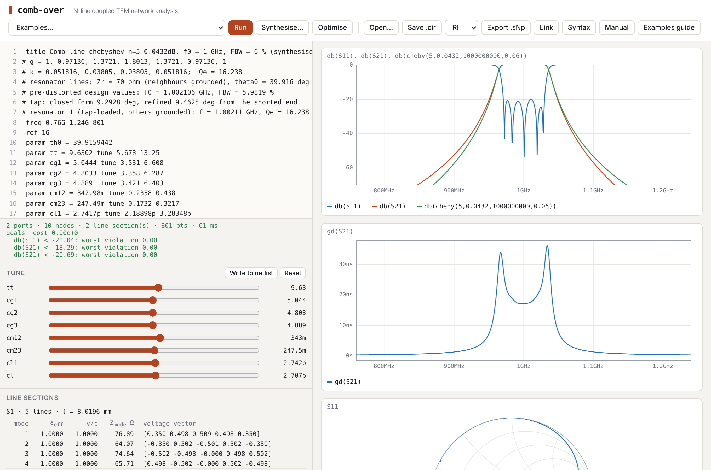
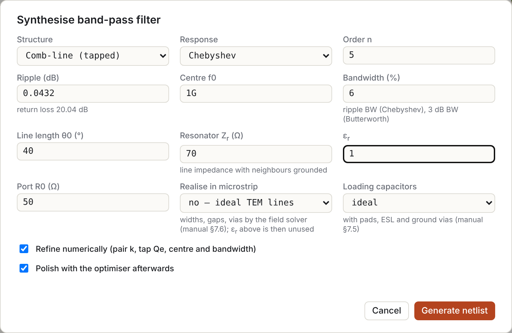
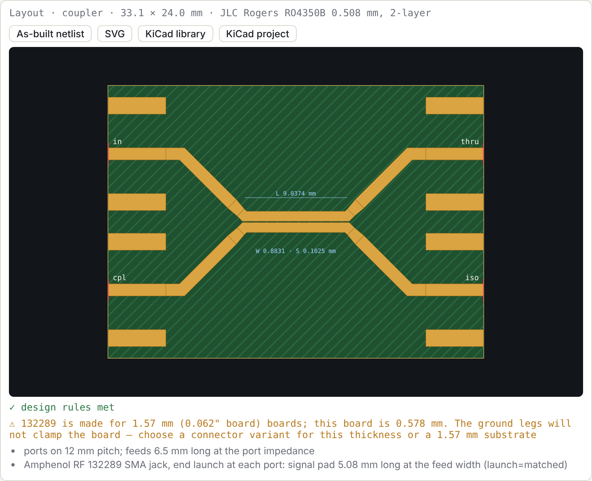

# comb-over manual

comb-over analyses linear networks built from **uniform coupled multiconductor TEM / quasi-TEM line sections**, single lines and lumped R/L/C. It also synthesises tapped comb-line and interdigital band-pass filters. Everything runs in the browser, and the same engine runs under Node for scripting and tests.

Worked examples are in [docs/examples](examples/README.md).

## Contents

1. [Running it](#1-running-it)
2. [The interface](#2-the-interface)
3. [Netlist language](#3-netlist-language)
4. [Coupled-line sections](#4-coupled-line-sections)
5. [Plots and trace expressions](#5-plots-and-trace-expressions)
6. [Tuning and optimisation](#6-tuning-and-optimisation)
7. [Filter synthesis](#7-filter-synthesis)
8. [Export and sharing](#8-export-and-sharing)
9. [The model, its assumptions and limits](#9-the-model-its-assumptions-and-limits)
10. [Command-line tools](#10-command-line-tools)
11. [Troubleshooting](#11-troubleshooting)

---

## 1. Running it

The app is a static page with ES modules and has no build step. Browsers refuse to load modules from `file://`, so serve the folder:

```sh
python3 -m http.server 8000        # from the repository root
# open http://localhost:8000
```

Or enable GitHub Pages for the repository (Settings → Pages → deploy from `main`, root).

Tests and tools need Node 18 or later:

```sh
npm test                           # engine + synthesis tests
```

---

## 2. The interface



| Area | What it does |
|---|---|
| **Editor** (left) | The netlist. It re-solves 350 ms after you stop typing, or on **Run** / Ctrl+Enter. Tab inserts two spaces. A parse error shows in red in the status line, and its line number is highlighted in the gutter. |
| **Status line** | Port, node, section and point counts and solve time. Also shows the goal cost and worst violation per goal (if any), singular-point count and warnings. |
| **Tune** | One slider per `.param … tune lo hi`. Sliders override the netlist values without editing the text.<br>• **Write to netlist** copies the slider values into the `.param` lines.<br>• **Reset** discards them.<br>• Editing the text also discards slider overrides. |
| **Line sections** | For each coupled section: physical length, and for each mode its ε<sub>eff</sub>, v/c, modal impedance and voltage eigenvector (§4.4). |
| **Plots** (right) | One panel per `.plot` / `.smith` statement. Hovering shows a cursor synchronised across all plots, and the legends show the values at that frequency. |
| **Examples…** | Loads a netlist from `examples/`. |
| **Synthesise…** | Filter synthesis dialog (§7). |
| **Optimise** | Runs the goal optimiser (§6). The button becomes **Stop** while it runs. |
| **Open… / Save .cir** | Load or save the netlist text. |
| **Data…** | Loads Touchstone files as `.data` sets, for overlay and fitting (§5.1). |
| **RI / MA / DB + Export .sNp** | Touchstone export of the full S-matrix (§8). |
| **Link** | Copies a URL with the netlist embedded. |
| **Syntax** | Quick reference, with links into this manual. |
| **Manual / Examples guide** | Open these documentation pages in a new tab. |

The editor content is also kept in the browser's localStorage, so a reload restores it.

---

## 3. Netlist language

### 3.1 Lexical rules

- **Statements:** one per line.
- **Comments:**
  - from `#` or `//` (at the start of a line or after whitespace) to the end of the line;
  - a line starting with `*` (SPICE style).
- **Tokens:** statements are split on whitespace. Inside `( )` and `[ ]` whitespace does not split, so an **expression must not contain spaces except inside brackets**. For example, `Z0*sqrt((1+k)/(1-k))` is fine, but `Z0 * 2` is three tokens.
- **Keywords:** case-insensitive. Node and parameter names are case-sensitive.

### 3.2 Numbers and units

A number may carry an SI prefix, optionally followed by a unit, which is ignored:

| Prefix | f | p | n | u (µ) | m | k (K) | M, meg | G | T |
|---|---|---|---|---|---|---|---|---|---|
| ×  | 1e-15 | 1e-12 | 1e-9 | 1e-6 | 1e-3 | 1e3 | 1e6 | 1e9 | 1e12 |

Examples: `2.2pF`, `1.5GHz`, `68nH`, `25mm` (= 0.025), `50Ohm`.

There are three special units:
- `mil` (25.4 µm);
- `in` (25.4 mm);
- `deg`, which marks a section length as electrical degrees (§4.2).

> **Watch out:**
> - `m` is *milli*, so `1m` is 0.001. A bare number in a length field is **metres**: `len 25` is 25 m. Write `25mm`.
> - `M` is *mega*, so `1M` is 10⁶.

### 3.3 Expressions

Values anywhere in the netlist are expressions:

- **Operators:** `+ − * / ^` (right-associative) and unary `−`.
- **Functions:**
  - trigonometric, radians: `sin cos tan cot asin acos atan atan2`;
  - trigonometric, degrees: `sind cosd tand cotd`;
  - hyperbolic: `sinh cosh tanh asinh acosh atanh`;
  - others: `sqrt exp ln log log10 abs min max floor ceil round db2mag mag2db` (`ln` and `log` are both natural logarithms).
- **Constants:**
  - `pi` and `e`;
  - `c0` (speed of light);
  - `mu0`, `eps0`;
  - `eta0` (376.73 Ω).
- **Parameters:** any `.param` defined earlier in the file.

### 3.4 Directives

| Directive | Meaning |
|---|---|
| `.freq START STOP [POINTS] [log]` | Sweep (required). POINTS defaults to 401. `log` gives log spacing. |
| `.ref F0` | Reference frequency for `deg` lengths. Default: the sweep centre. |
| `.param NAME = EXPR [tune LO HI]` | Parameter, evaluated in file order. `tune` adds a slider and makes it an optimiser variable bounded by LO..HI. |
| `.title TEXT` | Title, used for export file names. |
| `.plot [ylim=LO,HI] [title=Text_with_underscores] TRACE …` | Rectangular plot against frequency (§5). |
| `.smith TRACE …` | Smith chart of complex traces. |
| `.goal TRACE OP VALUE [F1 F2] [w=W]` | Optimisation goal. OP is `<`, `>` or `=` (§6). |
| `.opt maxiter=N` | Optimiser iteration limit (default 400). |
| `.layout TEMPLATE SECTION… [key=value …]` | Board layout preview from a template (§8.1). At most one per netlist. |
| `.substrate ID [key=value …]` | PCB technology (§3.6). At most one per netlist. Required by lines given by dimensions. |
| `.data NAME FILE [overlay] [z=Z]` | Measured or EM-simulated S-parameters from a Touchstone file, as traces `NAME.S21` (§5.1). |

Unknown directives are ignored with a warning.

### 3.5 Nodes, ports and elements

- **Ground:** `0`, `gnd`, `GND` or `ground`.
- **Open (unconnected) terminal:** `-`, `open` or `nc`. Each use is a separate floating node.
- **Other names:** any other name is a node. The same name anywhere means the same node.

| Statement | Meaning |
|---|---|
| `port NODE [Z0]` | Port numbered in order of appearance (1, 2, …). Z0 is the real reference impedance, default 50 Ω. A port cannot be on ground, and two ports cannot share a node. |
| `R<name> N1 N2 VALUE` | Resistor (non-zero). |
| `C<name> N1 N2 VALUE [Q=..]` | Capacitor. With Q, it has a shunt conductance ωC/Q. |
| `L<name> N1 N2 VALUE [Q=..]` | Inductor. With Q, it has a series resistance ωL/Q. |
| `T<name> N1 N2 Z0=.. len=.. [er=..] [Q=..] [f0=..]` | Single uncoupled line, both ends referenced to ground. |
| `T<name> N1 N2 W=.. len=.. [Q=..] [f0=..]` | Single microstrip line of width W on the `.substrate` (§4.6). |
| `wire N1 N2 [N3 …]` | Joins nodes (a zero-ohm short). Use this instead of a 0 Ω resistor. |
| `cap <name> N1 [N2] C=.. [type=ideal\|smd\|printed\|trimmer] [pkg=0402\|0603\|0805] [Q=..] [esl=..] [d=..] [n=..] [a=..] [series=E12\|E24] [mpn=..]` | A loading capacitor with its parasitic model (§7.5): to ground unless N2 is given. |
| `via <name> N1 [N2] d=.. [n=..] [h=..] [Q=..]` | `n` plated vias of drill `d` from N1 to ground (or to N2), as the Goldfarb–Pucel inductance (§4.7). `h` defaults to the `.substrate` height. |
| `tee <name> A B SIDE Wa=.. Wb=.. W2=..` | Microstrip T-junction on the `.substrate` (§4.7): main line A–B (arm widths Wa, Wb), side arm SIDE of width W2. Its reference planes are the edges of the crossing strips. |
| `bend <name> A B W=.. [mitre=none\|opt]` | 90° microstrip bend on the `.substrate` (§4.7): square corner, or the optimum mitre. Reference planes at the edges of the crossing strip. |
| `step <name> A B W1=.. W2=..` | Step in width from W1 (at A) to W2 (§4.7): the junction parasitics only. The lines either side carry the impedance change. |
| `res <name> N1 [N2] R=.. [pkg=0402\|0603\|0805\|ideal] [esl=..] [cp=..] [d=..] [n=..]` | Chip resistor with pads, ESL and body capacitance (§8.5): between N1 and N2, or a termination to ground through `n` vias when N2 is omitted. `pkg=ideal` is a plain R; `esl=0` leaves out the inductance. |
| `cline NAME … end` | Coupled multiconductor section (§4). |

Element names follow SPICE: the first letter selects the type (`C1`, `Cload`, `Lchoke`, `T5`).

---

### 3.6 Substrates

`.substrate` names the PCB technology the design is meant for. Pick a preset, optionally overriding values, or describe a board of your own:

```
.substrate jlc-ro4350b-0.508                 # preset
.substrate jlc-fr4-1.6 er=4.3 tand=0.018      # preset with overrides
.substrate custom h=0.8mm er=3.0 tand=0.002 t=18u
```

The presets cover the JLCPCB 2-layer boards, each with its source and access date:

- **FR-4** at 0.4–2.0 mm board thickness.
- **Rogers RO4350B** at 0.508, 0.762 and 1.524 mm. These use the Rogers *design* Dk of 3.66, not the process Dk of 3.48 that JLCPCB quotes.
- **Four PTFE laminates** at 0.762 and 1.524 mm.

The full list, with every assumption flagged, is on the generated [substrate presets](substrates.md) page.

| key | meaning | default (custom) |
|---|---|---|
| `h` | dielectric thickness | required |
| `er` | relative permittivity | required |
| `tand` | loss tangent, quoted at `ftand` | 0 |
| `ftand` | frequency at which `tand` applies | 1 GHz |
| `t` | copper thickness | 1 oz (34.8 µm) |
| `sigma` | copper conductivity | 5.8×10⁷ S/m |
| `rough` | RMS copper roughness | none |
| `mintrace`, `minspace`, `mindrill` | fabrication limits | none |

Behaviour:

- **Order.** `.substrate` is processed in file order together with `.param`. Overrides may therefore use earlier parameters, including tuned ones, so slider and optimiser values flow into the substrate.
- **Expression names.** Statements after it can use `sub_h`, `sub_er`, `sub_tand`, `sub_t` and `sub_sigma` in expressions, e.g. `er sub_er` in a `cline` block.
- **Display.** The substrate's values, assumptions and sources are shown at the top of the info panel.
- **Effect on the simulation.** Lines given by physical dimensions (`T … W=`, `cline … W= S=`) take their impedances, effective permittivities and losses from the substrate (§4.6). Otherwise the substrate only affects the simulation through the `sub_*` names. Layout and KiCad export will also use it (issues #5–#10).

## 4. Coupled-line sections

### 4.1 Syntax

```
cline NAME [len=..] [er=..] [Q=..] [f0=..]
  <line constants>          # exactly one parameterisation, see 4.3
  er   EPS_R                # homogeneous dielectric (default 1)
  len  LENGTH               # e.g. 90deg, 25mm, tt*1deg
  f0   F                    # reference for deg (default .ref)
  Q    QU                   # unloaded Q of the line (optional)
  A    n1 n2 … nN           # terminal nodes at end A (z = 0), lines 1..N
  B    n1 n2 … nN           # terminal nodes at end B (z = ℓ)
end
```

`end`, `.end` and `endc` all close the block. N is taken from the line constants. `A` and `B` must each list exactly N nodes.

Line i at end A and line i at end B are the two ends of the same conductor. Terminations are just node names:

- `0` shorts the end;
- `-` leaves it open;
- a named node connects it to ports, elements or other sections.

Sections that share node names connect, so cascades, tapped lines and stepped structures are made from several `cline` blocks. Example 4 shows a tapped interdigital filter built from two sections.

### 4.2 Length

- **Physical length:** a value with a length unit (`25mm`, `980mil`), or a plain number in metres.
- **Electrical length:** any expression containing a `deg` number (`90deg`, `tt*1deg`, `(th0-tt)*1deg`). This is degrees at f0, the section's `f0` or else `.ref`. ℓ = θ/360 · v̄/f0.
  - Homogeneous section: v̄ is the phase velocity.
  - Inhomogeneous section: v̄ is c divided by the mean of √ε<sub>eff</sub> over the modes. The modes then have different electrical lengths, and the Line sections panel shows each mode's ε<sub>eff</sub>.

### 4.3 Line constants

Use exactly one of these. Lines are numbered 1..N in the order used by `A`/`B`.

| Keyword | Medium | Meaning |
|---|---|---|
| `Zeo Z0e Z0o` | homogeneous (`er`) | Symmetric pair, per-line even/odd impedances. |
| `Zeo Z0e Z0o εe εo` | inhomogeneous | Same, with even/odd effective permittivities. |
| `Y0 [y11 y12; y21 y22]` | homogeneous | Characteristic admittance matrix (S). Y0 = v·C. |
| `Z0 [ … ]` | homogeneous | Characteristic impedance matrix (Ω), Z0 = Y0⁻¹. |
| `Cn [ … ]` | homogeneous | Normalised Maxwell capacitance matrix C/ε (dimensionless, ε = ε0·εr). Matthaei/Getsinger convention. |
| `Cg g1 … gN` + `Cm m12 m23 …` | homogeneous | Normalised ground capacitances and adjacent mutual capacitances (all positive). Add non-adjacent terms with `Cm(i,j) value`. |
| `C [ … ]` and `L [ … ]` | general | Per-unit-length Maxwell capacitance (F/m) and inductance (H/m) matrices. This is the form a 2-D field solver gives; `node solver/cli.mjs` computes them for N strips (§10). |
| `geom msl` + `W …` + `S …` | `.substrate` | Coupled microstrip given by strip widths and gaps (§4.6). A symmetric pair (scalar W and S) uses the closed-form model; lists `W [w1 w2 …]`, `S [s12 s23 …]` (or one S for all gaps) give N lines through the field solver. Also accepted inline: `cline K geom=msl W=0.88mm S=0.1mm`, `W=[0.8mm 1mm 0.8mm]`. |

Matrices are written `[a b c; d e f; g h i]`, with rows separated by `;` and entries by spaces or commas. They must be square and symmetric, and C must be positive definite.

The **Maxwell capacitance matrix** has positive diagonal entries (each line's total capacitance with all other lines grounded) and negative off-diagonal entries. Ground and mutual capacitances convert to it as

```
C_ii = Cg_i + Σ_j Cm_ij,    C_ij = −Cm_ij
```

The homogeneous forms are converted to C and L with v = c/√εr:

| Form | Conversion |
|---|---|
| `Cn` | C = ε·Cn |
| `Y0` | C = Y0/v |
| all homogeneous forms | L = C⁻¹/v² |

For `Zeo`, the mode capacitances are C<sub>e,o</sub> = √ε<sub>e,o</sub>/(c Z<sub>0e,0o</sub>) and the mode inductances are L<sub>e,o</sub> = Z<sub>0e,0o</sub>√ε<sub>e,o</sub>/c. They are combined as C = [[(Ce+Co)/2, (Ce−Co)/2], …], and likewise for L.

### 4.4 Modes (Line sections panel)

For each mode the panel shows:

- **ε<sub>eff</sub>:** the effective permittivity, (c/vᵢ)².
- **v/c:** the mode velocity.
- **Z<sub>mode</sub>:** 1/(vᵢ·tᵀCt), where t is the unit-norm voltage eigenvector. For a symmetric pair this is exactly Z0e and Z0o.
- **Voltage vector:** the eigenvector t.

In a homogeneous medium all modes have the same velocity, so any basis is valid. The panel then shows the eigenvectors of C (the characteristic-admittance eigenmodes).

### 4.5 Loss

`Q` on a section gives every mode an attenuation αᵢ = βᵢ/(2Q). The characteristic admittances are left real. This is a low-loss, frequency-independent-Q approximation: it gives the right insertion loss and dissipation of a high-Q resonator, but not the √f behaviour of conductor loss.

### 4.6 Microstrip models

`js/microstrip.js` gives physical models for single microstrip lines and coupled pairs. Netlists use them through lines given by dimensions on the `.substrate`:

```
.substrate jlc-ro4350b-0.508
.param w = 0.883mm tune 0.5mm 1.3mm
T1 a b W=1.07mm len=20mm                 # single microstrip line
cline K geom=msl W=w S=0.1025mm          # coupled pair (geom msl is the default when W and S are given)
  len 90deg
  A in   cpl
  B thru iso
end
```

How these lines are modelled:

- **Evaluation frequency.** The models are evaluated once, at the section's `f0` (or `.ref`), including dispersion of εeff. The section then behaves as a TEM line with those values across the sweep. Away from `f0` this ignores the change of εeff and Z with frequency. For example, for the 10 dB coupler on 0.508 mm RO4350B the even-mode εeff goes from 2.995 at 1 GHz to 3.025 at 5 GHz and 3.058 at 9 GHz: about ±1 %, or ±0.5 % in phase velocity. Frequency-dependent sections are a possible follow-up.
- **Losses.** Substrate losses are included by default: conductor loss with roughness, plus dielectric loss, evaluated at `f0` and applied as a Q. A coupled pair gets separate Q values for its even and odd modes. Write `Q=` to override this; a very large `Q` (e.g. `Q=1e30`) makes the line lossless.
- **Tuning.** W and S are ordinary expressions, so `tune` parameters let the sliders and the optimiser adjust the actual copper dimensions.
- **Warnings.** Model-range and fab-rule warnings (e.g. a gap below JLC's 0.1 mm) appear in the status line. The Line sections panel shows the resulting Z or Ze/Zo and the Q values.

**N lines: the field solver.** Give the widths and gaps as lists:

```
cline R geom=msl W=[0.8mm 1.2mm 1.2mm 0.8mm] S=[0.3mm 0.4mm 0.3mm]
  len 90deg
  A 0  0  0  0
  B r1 r2 r3 r4
end
```

C and L come from the 2-D field solver (`solver/`, method and validation in `solver/README.md`). They include the couplings between non-adjacent lines and the unequal modal velocities. `model=field` also sends a symmetric pair through the solver; `model=closed` (the default for a pair) keeps Kirschning–Jansen.

| | field solver | closed-form pair |
|---|---|---|
| lines | any N, unequal widths and gaps | 2, symmetric |
| accuracy | about 1e-6 for zero-thickness strips, about 5e-5 with thickness (quasi-static) | about 1 % (published); the thickness correction is worse for tight gaps (below) |
| strip thickness | rectangular strips with the substrate's copper t | Jansen's effective widths |
| dispersion | none (quasi-static) | even/odd εeff |
| loss | Wheeler's rule as a matrix (receded geometry solved again); dielectric filling factor per mode | Wheeler per mode; filling factor |
| cost per new geometry | 3 solves (with dielectric, in air, receded): about 50 ms for a thick pair, 0.1 s for 5 lines, 0.6 s for 10 | microseconds |

With zero-thickness copper (`.substrate … t=0`), the two agree for a symmetric pair to within Kirschning–Jansen's accuracy: for W 1.1 mm and S 0.2 mm on 0.508 mm RO4350B, Ze differs by 0.3 %, εe by 0.2 %, Zo by 0.1 % and εo by less than 0.01 % (the closed form includes dispersion at 2 GHz).

**Strip thickness.** The solver models each strip as a rectangle of the substrate's copper thickness, so the side walls and the air between them are included. Thickness matters on thin substrates: on 0.508 mm RO4350B, 35 µm copper lowers Zo by 5–8 % for gaps of 0.1–0.2 mm.

For single lines, the solver's thickness effect agrees with Hammerstad–Jensen's correction to 0.1 % of Z0. For tight coupled pairs, the closed-form correction (Jansen's effective widths, published for S ≫ 2t) captures only part of it, because the air-filled gap between the walls pulls the odd mode's εeff down:

| 35 µm copper, RO4350B | field solver vs closed form, both with t |
|---|---|
| h 0.508, W 1.1, S 0.2 mm | Ze +0.7 %, Zo −1.6 %, εe −0.9 %, εo −4.9 % |
| h 0.508, W 1.1, S 0.1 mm | Ze +0.4 %, Zo −3.1 %, εe −0.9 %, εo −7.2 % |
| h 0.254, W 0.5, S 0.15 mm | Ze +1.5 %, Zo −1.7 %, εe −1.9 %, εo −7.2 % |
| h 1.524, W 3, S 0.3 mm | Ze 0.0 %, Zo −1.3 %, εe −0.3 %, εo −3.0 % |

So for tight gaps on thin boards use `model=field` for pairs too. The independent checks in `solver/README.md` back the solver's numbers. Not modelled: etch profile (trapezoidal strips), solder mask, plating.

**Loss with the field solver.** Each mode's Q comes from two terms:

- **Conductor loss.** The conductor-loss matrix is R = K<sub>r</sub>·ω·(L(receded) − L). The receded geometry has widths −δ, gaps +δ, h + δ and thickness t − δ, with δ the skin depth at f0. For a mode with voltage vector v, Q<sub>c</sub> = vᵀL⁻¹v / (K<sub>r</sub>·vᵀL⁻¹ΔL L⁻¹v).
- **Dielectric loss.** The single-line filling-factor formula, with the mode's own εeff.

For a symmetric pair, the even and odd Q agree with the closed-form path to 0.1 %.

You can also use the models directly, through the command-line calculator or from JavaScript:

```sh
node tools/mscalc.mjs --sub jlc-ro4350b-0.508 --z0 50 --f 2G          # width for 50 Ω
node tools/mscalc.mjs --sub jlc-ro4350b-0.508 --ze 69.4 --zo 36 --f 5G  # W and S for a 10 dB coupler
node tools/mscalc.mjs --sub jlc-fr4-1.6 --w 2.8mm --f 1G                 # analyse a geometry
```

| | model | notes |
|---|---|---|
| single line | Hammerstad & Jensen (1980), with their strip-thickness correction | quasi-static Z0, εeff |
| single-line dispersion | Kirschning & Jansen (1982) for εeff; Jansen & Kirschning (1983) for Z0 | uses the thickness-corrected width, as scikit-rf does |
| coupled pair | Kirschning & Jansen (1984) | quasi-static even/odd Z and εeff; dispersion of even/odd εeff |
| coupled strip thickness | Jansen's even/odd effective widths with the Hammerstad–Bekkadal ΔW | published for S ≫ 2t |
| conductor loss | Wheeler's incremental-inductance rule applied to the same models, with the Hammerstad roughness factor | default; `model: 'hammerstad'` gives Rs/(Z0·W)·Ki·Kr instead |
| dielectric loss | αd = π f/c · εr(εeff − 1)/(√εeff (εr − 1)) · tan δ | |

**Validity ranges.** The functions return warnings when an input is outside the published range:

| model | range |
|---|---|
| single line | 0.01 ≤ W/h ≤ 100 |
| single-line dispersion | f·h ≤ 60 GHz·mm, εr ≤ 20 |
| coupled pair | 0.1 ≤ W/h ≤ 10, 0.1 ≤ S/h ≤ 10, εr ≤ 18 |
| coupled dispersion | f·h ≤ 25 GHz·mm |

They also warn about gaps below 20 t and about copper thinner than 3 skin depths.

**Synthesis.**

- `synthMsline` (Z0 → W) bisects in log W, optionally at a frequency.
- `synthMscoupled` ((Ze, Zo) → (W, S)) is a damped Newton iteration in (ln W, ln S) from several starting gaps. It reports non-convergence rather than returning a poor answer.
- `fabCheck` compares the result with the substrate's fabrication limits.

Some results on JLC's 0.508 mm RO4350B:

- **50 Ω line:** 1.07 mm wide.
- **10 dB coupler** (Ze 69.4 / Zo 36.0 Ω): W 0.88 mm, S 0.10 mm, right at the 0.1 mm minimum space.
- **3 dB edge-coupled pair:** needs a 7 µm gap. The calculator flags it as below the minimum space and outside the model's range.

**Validation** (`tests/microstrip.mjs`):

- **Single lines vs scikit-rf.** Static and dispersive Z0 and εeff agree with scikit-rf's independent implementation of the same models to 1e−8 (Z0 1e−5 with dispersion), over 30 geometries on five substrates.
- **Coupled pairs vs Qucsator.** Quasi-static even/odd Z and εeff agree with Qucsator's independent implementation to 1e−9, over 82 cases with εr 2.2–16 and W/h, S/h 0.1–10 (zero thickness).
- **Published example.** An alumina example (Steer, *Microwave and RF Design II*, Example 5.6.1) agrees within the 2 % precision of its graph readings.
- **Limits and consistency:**
  - a widely spaced pair converges to the single line, statically and in dispersion;
  - finite thickness lowers both mode impedances;
  - the odd mode is lossier than the even mode;
  - synthesis round-trips to 1e−6.

**Known limitations.**

- **Coupled impedance dispersion.** Even/odd *impedance* dispersion is not included: Z_e and Z_o are quasi-static at every frequency, and only εeff disperses. The published Kirschning–Jansen impedance-dispersion equations could not be confirmed from two independent sources, and the one available implementation shows inconsistencies. At typical PCB frequencies (f·h of a few GHz·mm) the effect is around 1 %.
- **Conductor-loss models disagree for narrow lines.** The two models differ by up to about 3× near W/h = 0.1, and Hammerstad's is the higher. The Wheeler result agrees within 3 % with the Pucel–Massé–Hartwig narrow-strip formula (four substrates at W/h = 0.1), so it is the default. A measurement should settle which is right.
- **Thickness correction for tight gaps.** For gaps below about 20 t, the coupled-line thickness correction is approximate. The field solver shows how far off it is (Zo 1–3 %, εo 3–7 % for 0.1–0.3 mm gaps with 35 µm copper); use `model=field` there.

---


### 4.7 Discontinuities

The line model is pure TEM, so it has no parasitics of its own (§9.3). The layout templates add the most important ones automatically, and a `via` element is available for netlists written by hand. The models live in `js/discontinuities.js`.

| discontinuity | model | where it is used |
|---|---|---|
| **Open end** | Equivalent length extension Δl of the open-circuited line (Kirschning, Jansen & Koster, *Electronics Letters* 1981; stated accuracy about 2.5 % for 0.01 ≤ W/h ≤ 100, εr ≤ 128). | Marchand main line: a `Tmain_oe … len=Δl` stub on the open end in the as-built and core netlists. |
| **Via to ground** | L = (μ0/2π)[h ln((h + √(r² + h²))/r) + 1.5(r − √(r² + h²))], r = d/2 (Goldfarb & Pucel, *IEEE MGWL* 1991). n vias in parallel give L/n, with mutual coupling neglected, which is optimistic for closely spaced vias. | `via` element; Marchand grounded ends (a stub to the via-pad centre plus `via … n=2`). |
| **Edge-connector launch** | Placeholder series L / shunt C at each port, with parameters `sma_l` and `sma_c`. | Every connector port (§8.4). |
| **T-junction** | Hammerstad's model as implemented in Qucs (`mstee`): a junction node with a shunt susceptance B<sub>T</sub>, reached from each main arm through a line of length W2/2 − d and an ideal transformer, and from the side arm through a line of length max(Wa, Wb)/2 − d2 (negative for a wide main line). Plane shifts, transformer ratios and B<sub>T</sub> follow the equivalent parallel-plate widths and the first higher-order-mode frequency f<sub>p</sub> = 0.4 Z/h (GHz, h in mm). | `tee` element; the tap of every synthesised comb-line or interdigital filter (§7.6), where the junction spans the feed width of the resonator. |
| **90° bend** | Series L / shunt C / series L (T network), as Qucs `mscorner` and `msmbend`. **Square corner**: C/W = (10.35εr + 2.5)W/h + (2.6εr + 5.64) pF/m, L/h = 220[1 − 1.35 e<sup>−0.18(W/h)^1.39</sup>] nH/m (Kirschning, Jansen & Koster, MTT-S 1983; 0.2 ≤ W/h ≤ 6, 2.36 ≤ εr ≤ 10.4). **Optimum mitre**: C/W = (3.93εr + 0.62)W/h + (7.6εr + 3.80) pF/m, L/h = 440[1 − 1.062 e<sup>−0.177(W/h)^0.947</sup>] nH/m, mitre M = 52 + 65 e<sup>−1.35 W/h</sup> % of the corner diagonal (Douville & James, *IEEE MTT* 1978; 0.2 ≤ W/h ≤ 6, 2.5 ≤ εr ≤ 25). Other angles are not modelled. | `bend` element; routed and meandered lines (§8.5). |
| **Width step** | L1 / shunt C / L2, as Qucs `msstep` (Gupta; Garg & Bahl), with Wa ≥ Wb: C = √(Wa Wb)[(10.1 log εr + 2.33)Wa/Wb − 12.6 log εr − 3.17] pF/m (εr ≤ 10, 1.5 ≤ Wa/Wb ≤ 3.5), L = h[40.5(Wa/Wb − 1) − 75 log(Wa/Wb) + 0.2(Wa/Wb − 1)²] nH/m (Wa/Wb ≤ 5), split between the sides as Z√εeff. log is log10. C is clamped at 0 where the fit goes negative, near equal widths. | `step` element. |

**Typical values:**

| | 0.508 mm RO4350B | 1.524 mm RO4350B |
|---|---|---|
| Open end Δl (50 Ω line) | 0.22 mm (Δl/h 0.42) | 0.65 mm (Δl/h 0.43) |
| One 0.3 mm via | 83 pH | 0.50 nH |

**Effect on the Marchand demo.** On 1.524 mm RO4350B, the 2 × 0.3 mm vias at each grounded end (0.25 nH, j1.6 Ω at 1 GHz) and the 0.52 mm open-end extension move the outputs by less than 0.1 dB at f0.

**The tee as a network.** The transformers are folded into the main-arm lines (Y′ = TᵀY<sub>line</sub>T with T = diag(1, 1/T<sub>x</sub>)), so the junction is a 4-node admittance block over the three arms and the internal junction node, stamped like a line section. It is lossless; the arms' conductor and dielectric loss over a few hundred micrometres is ignored. At low frequency it reduces to the ideal three-way junction (S11 = −1/3, S21 = 2/3).

Every model warns, on the netlist's line, when it is used outside its published range.

**Checks.** The KJK Δl agrees with Hammerstad's older formula within 5 % for 0.5 ≤ W/h ≤ 3, and differs by up to 25 % at the extremes of W/h. The tee, bends and step are checked against a hand evaluation of the published equations, for losslessness and reciprocity over 10 MHz–10 GHz, and for the low-frequency limit (`tests/tee.mjs`); like the other models here it has not been checked against EM simulation. The via formula is checked against its own long-via limit and against S11 = (jωL − 50)/(jωL + 50) for a via at a port (`tests/discontinuities.mjs`). Neither model has been checked here against EM simulation or measurement yet; the openEMS export (§8.6) can do the first, and #17 covers measurement.


## 5. Plots and trace expressions

A trace is an expression evaluated at every sweep point. It is complex unless it passes through a real function.

**Variables**

| Name | Meaning |
|---|---|
| `S21`, `S11`, … | S-parameters with single-digit port numbers. Sᵢⱼ is the wave out of port i for a wave into port j. |
| `S_10_3`, `S(i,j)` | Any port numbers. |
| `NAME.S21`, `NAME.S_10_3` | S-parameters of a `.data` set (§5.1). |
| `f` or `freq` | Frequency in Hz. |
| `j` | Imaginary unit. |
| constants and `.param` names | As in §3.3. |

**Operators:** `+ − * /`, and `^` with a real exponent.

| Function | Result |
|---|---|
| `db(x)` | 20 log₁₀\|x\| |
| `db10(x)` | 10 log₁₀\|x\| |
| `mag(x)`, `abs(x)` | \|x\| |
| `ang(x)` | phase in degrees, −180…180 |
| `angu(x)` | unwrapped phase in degrees |
| `gd(x)` | group delay −dφ/dω in seconds, by central differences |
| `re(x)`, `im(x)` | real and imaginary parts |
| `conj(x)`, `sqrt(x)` | complex conjugate, principal square root |
| `vswr(x)` | (1+\|x\|)/(1−\|x\|) |
| `cheby(n,ripple_dB,f0,fbw)` | ideal Chebyshev band-pass \|S21\| with the mapping Ω = (f/f0 − f0/f)/fbw |
| `butter(n,f0,fbw)` | ideal Butterworth \|S21\| (fbw is the 3 dB bandwidth) |

Useful combinations:

- `db(S31/S41)`: directivity of a coupler.
- `ang(S31/S21)`: quadrature of a coupler.
- `ang(-S21/S31)`: deviation of a balun's phase balance from 180°.
- `db(S21/S31)`: amplitude imbalance.
- `ang(S21/S43)`: phase difference between two networks in one netlist.

A rectangular plot shows the real part of each trace. A Smith chart plots the complex value; the small square marks the first sweep point.

### 5.1 Measured data

```
.data meas board.s4p overlay
.data em   sonnet.s2p z=50
.plot db(S21) db(meas.S21)
.goal db(S31)-db(meas.S31) = 0 1G 2G
```

`.data NAME FILE` reads a Touchstone file (`.sNp`, version 1.1 or 2.0; S-parameters only) and makes its S-matrix available as `NAME.Sij` in plots, Smith charts and goals. In the browser, **Data…** loads one or more files and adds a `.data measK FILE overlay` line for each file that is not already named. Loaded files are kept in the browser's local storage, matched by file name. The command-line tools read `FILE` relative to the netlist.

| Option | Effect |
|---|---|
| `overlay` | Every trace of S-parameters in a `.plot` or `.smith` gets a dotted twin from the data, in the same colour: `db(S21)` is drawn again as `db(NAME.S21)`. |
| `z=Z` | Renormalises the data to Z (one value for all ports) through Z = √z (I+S)(I−S)⁻¹ √z. |

The data are interpolated onto the sweep: magnitude and unwrapped phase, each linear in frequency. Sweep points outside the file's frequency range are blank, and the status line says how many there are. The status also warns when the file is not loaded, when its port count differs from the netlist's, or when its reference impedances differ from the netlist's ports (add `z=` to renormalise). Noise data in 2-port files is ignored.

A `.goal` against data fits the model to a measurement. For example, with `.param` values marked `tune` for a launch's series L and shunt C, `.goal mag(S11-meas.S11) < 0.001` recovers them from a measured S11.

A Touchstone file exported by comb-over reads back to the same S-matrix (to the 10 significant digits written), so an export can be used as a reference for later changes.

---

## 6. Tuning and optimisation

**Tuning.** `.param x = 2.3p tune 1p 5p` creates a slider from 1 to 5 pF. The slider is logarithmic when LO > 0 and HI/LO > 10, linear otherwise. Dragging it re-solves immediately.

**Goals.** `.goal TRACE OP VALUE [F1 F2] [w=W]`, for example:

```
.goal db(S11) < -20 0.95G 1.05G
.goal db(S21) < -40 0.5G 0.8G w=0.5
.goal ang(S21/S43) = 90 1.3G 2.7G
```

A compact form `.goal db(S11)<-20 0.95G 1.05G` is also accepted. The trace should be real-valued; the real part is used.

**Cost.** For each sweep point inside [F1, F2], the violation v is:

| OP | v |
|---|---|
| `<` | max(0, y − VALUE) |
| `>` | max(0, VALUE − y) |
| `=` | y − VALUE |

Each goal contributes w·(mean(v²) + max(v)²). The max term pushes towards an equiripple (minimax) result.

**Optimiser.** Nelder–Mead over all `tune` parameters. Each parameter is mapped to [0, 1] within its LO..HI range, logarithmically under the same rule as the sliders, and leaving the box is penalised.

- **Frequency points:** each goal band is evaluated on at most about 121 sweep points, so a wide stopband goal cannot drown a narrow passband goal.
- **Live display:** the status line shows progress and the plots update while it runs.
- **Result:** the best values are written into the `.param` lines when it finishes or you press **Stop**.

Optimisation is local. Start from a sensible design (§7) and give realistic ranges.

---

## 7. Filter synthesis

**Synthesise…** generates a complete netlist for a tapped **comb-line** or **interdigital** band-pass filter.



| Field | Meaning |
|---|---|
| Structure | **Comb-line:** all lines shorted at one end, with a loading capacitor at the other end and length θ0 < 90°.<br>**Interdigital:** lines shorted at alternate ends, θ0 = 90°, no capacitors. |
| Response, order n, ripple | Chebyshev or Butterworth prototype. The return loss equivalent to the ripple is shown. |
| f0, bandwidth | Centre and fractional bandwidth: ripple bandwidth for Chebyshev, 3 dB bandwidth for Butterworth. The mapping is Ω = (f/f0 − f0/f)/FBW. |
| θ0 | Comb-line resonator line length at f0. |
| Z<sub>r</sub> | Resonator line impedance **with all neighbouring lines grounded**, i.e. 1/(v·C<sub>ii</sub>). This sets the admittance level; the couplings set the ratios. |
| ε<sub>r</sub>, R0 | Dielectric (homogeneous) and port impedance. |
| Refine numerically | Corrections using the full model (below). |
| Polish | Runs the optimiser on the result. |
| Realise in microstrip | A substrate preset: synthesise the physical geometry (widths, gaps, length, tap, vias) on it instead of ideal TEM lines (§7.6). |
| Ground vias | Drill diameter and number of vias at each shorted end (physical geometry only). |

### 7.1 Closed form

Prototype values g₀…g<sub>n+1</sub> give

```
k(i,i+1) = FBW / √(g_i g_{i+1})        Qe = g0 g1 / FBW
```

Take each resonator's open end as a node, with all other resonator nodes grounded. Let Yₐ = 1/Z<sub>r</sub> and Yₘ be the adjacent mutual admittance (v × mutual capacitance).

| | Comb-line | Interdigital |
|---|---|---|
| Node susceptance | B<sub>ii</sub> = ωC<sub>l</sub> − Yₐ cot θ | B<sub>ii</sub> = −Yₐ cot θ |
| Coupling susceptance | B<sub>i,i+1</sub> = Yₘ cot θ | \|B<sub>i,i+1</sub>\| = Yₘ csc θ |
| Resonance | C<sub>l</sub> = Yₐ cot θ0 / ω0 | θ0 = 90° |
| Slope parameter b = (ω0/2) dB/dω | (Yₐ/2)(cot θ0 + θ0 csc² θ0) | πYₐ/4 |
| Inverter J | Yₘ cot θ0 | Yₘ |

Setting J = k·b gives each Yₘ. The normalised capacitances are then Cg = (Yₐ − ΣYₘ)·η and Cm = Yₘ·η, with η = η0/√εr.

For the tap, the resonator voltage is ∝ sin βz from the short. A load R0 tapped at θ<sub>t</sub> therefore appears at the open end as G0·(sin θ<sub>t</sub>/sin θ0)², so

```
sin θt = sin θ0 · √(b R0 / Qe)
```

### 7.2 Refinement

1. **Couplings.** For each pair, the split-mode frequencies (B<sub>ii</sub> ± B<sub>i,i+1</sub> = 0) are found by bisection. Yₘ is then scaled until (f<sub>o</sub>² − f<sub>e</sub>²)/(f<sub>o</sub>² + f<sub>e</sub>²) equals the target k. Within the model this is exact.
2. **Tap.** The first resonator is modelled with the full multiconductor sections, singly loaded, with the others grounded. Q<sub>e</sub> = ω<sub>r</sub>·τ<sub>max</sub>/4 comes from the S11 group-delay peak.
   - θ<sub>t</sub> is iterated until Q<sub>e</sub> is on target.
   - The end capacitor is Newton-corrected (ΔC = (ω<sub>r</sub> − ω0)·2b/ω0²) until the resonance is at f0.
   - Interdigital end resonators get a small trim capacitor for this, which can only lower their frequency.
3. **Centre and bandwidth.** The realised centre (geometric mean of the −3 dB points) and −3 dB bandwidth are measured. The design f0 and FBW are pre-distorted until both match the ideal prototype.

### 7.3 The generated netlist

The generated netlist contains:

- a comment header with g, k, Qe, the closed-form and refined tap positions, the pre-distorted design values, and any warnings;
- symmetric `.param`s with ±30 % tune ranges: `cg1…`, `cm12…`, `cl1` (end resonators), `cl`, and `tt` (tap angle);
- the coupled sections split at the tap planes;
- a return-loss `.goal` over the ripple band;
- two skirt goals, which hold the realised rejection at the ideal −20 dB points (+0.5 dB). These stop the optimiser from buying return loss by widening the band.

### 7.4 What to expect

These figures are from `npm test` and Example 3:

- **Refined:** centre within 0.05 % and −3 dB bandwidth within 0.5 % of the ideal. Return loss is typically 1–5 dB short of the target, because the nodal model ignores couplings such as the tap line coupling directly to resonator 2.
- **After polishing:** the target return loss is normally reached in about 100 evaluations.
- **Unreachable specifications** are reported:
  - "tap position impossible" means the tap would need sin θ<sub>t</sub> > 1: raise Z<sub>r</sub>, lower R0, or reduce the bandwidth;
  - "ground capacitance ≤ 0" means the couplings are too strong for this bandwidth (and θ0 for comb-line). Yₘ/Yₐ does not depend on Z<sub>r</sub>.

---

### 7.5 Loading capacitors

A comb-line's resonators are loaded by capacitors at their open ends. **Loading capacitors** in the synthesis dialog chooses how they are built. The comb sections stay as synthesised, with their εr; the **capacitor substrate** sets only the pads and ground vias.

| option | model (`cap … type=`) | the synthesiser |
|---|---|---|
| ideal | `C` | as before: `cl1`, `cl` tunable |
| SMD 0402 / 0603 / 0805 | hot pad shunt C → ESL → C (Q) → cold pad → ground vias | Finds the nominal value whose **effective** capacitance at f0 equals the ideal one, snaps it to E24 or E12, re-tunes the common line length (and tap) to absorb the snapping, and reports each resonator's residual detuning. `th0` becomes tunable for polishing. |
| trimmer (Murata TZC3) | pad C → ESL → C (Q) → ground vias | Picks the narrowest TZC3 that covers each value with ±10 % adjustment. The `cl1`/`cl` sliders span the trimmer's range, so they are the trimmer screws. |
| printed pad | square pad to the bottom ground: an open microstrip stub, side a + open-end Δl | Sizes each pad for its value at f0 and warns when the substrate cannot reach it |

**The models** (`js/capacitors.js`):

- **Pad capacitance.** A short microstrip section with Kirschning–Jansen–Koster end fringing (§4.6, §4.7).
- **Vias.** Goldfarb–Pucel (§4.7).
- **SMD effective capacitance.** C<sub>eff</sub> = C<sub>pad</sub> + C/(1 − ω²(ESL + L<sub>via</sub>)C), which also gives the self-resonance.
- **Printed pad.** Its input capacitance tan(β(a + Δl))/(ωZ0), valid while a ≤ λg/8 and W/h ≤ 100. Pads are also capped at a practical 25 mm side.

**Sources and assumptions:**

- **SMD land patterns:** KiCad's `C_0402_1005Metric`, `C_0603_1608Metric` and `C_0805_2012Metric`.
- **SMD ESL** (0.4 / 0.6 / 0.8 nH) and **Q** (300) are typical values, not from a particular part. Set `esl=` and `Q=` from your capacitor's datasheet.
- **Trimmer ranges:** from Murata's TZC3 datasheet, 1.4–3, 2–6, 3–10, 5–20 and 6.5–30 pF. Murata specifies Q only at 1 MHz and draws frequency curves to 2 GHz (Z types) or 1 GHz (R/P types). The trimmer's RF Q (100) and ESL (1 nH) are assumptions.
- **Gap and interdigital printed capacitors** are not included yet.

**Measured on a 5-pole, 6 % comb-line at 1 GHz** (θ0 40°, Zr 70 Ω, lossless lines), against the ideal design, which is centred at 1.0006 GHz with a 7.08 % −3 dB bandwidth:

| option | capacitors | centre | −3 dB BW (below the peak) | peak S21 | note |
|---|---|---|---|---|---|
| SMD 0603, E24, 0.508 mm RO4350B | 2.4 pF × 5 | −0.21 % | 6.43 % | −1.37 dB | length 39.92° → 40.18°; residual detuning ±0.3 % per resonator |
| SMD 0402, E12 | 2.7 pF × 5 | −0.18 % | 6.73 % | −1.38 dB | length 39.92° → 38.00° |
| printed, 0.508 mm RO4350B | 5.9 mm square pads | −0.03 % | 6.66 % | −1.54 dB | pad conductor and dielectric loss |
| trimmer, 1.524 mm RO4350B | TZC3Z030 (1.4–3 pF) | −0.06 % (0.00 % lossless) | 5.64 % | −4.21 dB | with the assumed Q 100 |

The SMD loss is set by the assumed Q of 300. The narrower bandwidth comes from the ESL, which makes the effective capacitance rise with frequency and steepens each resonator's slope. **Polish** recovers the bandwidth by retuning `cg`/`cm`/`tt` and the now-tunable `th0`.

The designer warns, in the netlist comments and the status line, when an option cannot reach the value:

- a printed pad that would need to be too large;
- no trimmer that covers the value;
- an SMD pad that alone is more than the value;
- E-series detuning above FBW/10;
- self-resonance below 3 f0;
- more than 1 dB of loss from capacitor Q.

**Footprints.** `capFootprint()` in `js/kicad.js` gives each option's KiCad footprint: pad 1 on the resonator end, pad 2 and its via land to ground. The comb-line layout template places them on the board (§8.1, §8.3). `node tools/kicad.mjs --caps SUBSTRATE --out DIR` writes them as a library, and CI checks that library in KiCad.

### 7.6 Physical geometry in microstrip

With **Realise in microstrip** set to a substrate, the dialog goes on from the homogeneous design to a buildable geometry. It produces a netlist whose array is given by its strip widths and gaps (`geom msl W [...] S [...]`, solved by the field solver with the substrate's copper thickness, §4.6). The netlist also has a `via` at every shorted end, the open-end fringing at every open end, a `tee` junction at each tap, the loading capacitors as chosen under **Loading capacitors** (§7.5), and a `.layout` line for the board (§8.1). The computation takes from a few seconds to about 40 s, and runs in the background. The steps:

1. **Map the admittances.** Find widths and gaps (symmetric) whose field-solved characteristic admittance matrix Yc matches the design's Y0 on the diagonal and in the adjacent couplings. Newton's method in ln W and ln S does this, first with zero-thickness strips, then with the real copper. Widths and gaps below the substrate's fabrication limits are clamped, with a warning.
2. **Coupled-resonator refinement on the physical model.** The model is the inhomogeneous multi-mode section, with via inductance (Goldfarb–Pucel) at each shorted end and the KJK open-end Δl as a capacitance at each open end. Throughout, the other resonators are shorted at their open ends, as in §7.2:
   - each resonator is tuned to f0: its own loading capacitor for comb-line, the common length for interdigital;
   - each gap is adjusted until the pair's split-mode coupling equals the prototype's;
   - the tap and the end capacitor are set from the S11 group delay of the singly loaded first resonator, with the tap's T-junction in place (the junction spans the 50 Ω feed width, so it changes with the tap position only through the tee model).
   - With SMD or trimmer capacitors, each resonator is tuned with the part's own model (pad capacitance, ESL, ground vias), and the nominal value is the one whose effective capacitance at f0 is right. Interdigital filters have no capacitors; the end resonators' trim is a short extension of the line beyond the array (`ext1`).

   The reduced susceptance comes directly from the section's admittance matrix: B = B<sub>OO</sub> − B<sub>OS</sub>(B<sub>SS</sub> − 1/ωL<sub>via</sub>)⁻¹B<sub>SO</sub> + ω(C<sub>oe</sub> + C<sub>l</sub>).
3. **Polish on the actual spec.** The goal optimiser works on the netlist's goals: return loss across the ripple band, and the −3 dB band at most 3 % wider than ideal. It moves the gaps, widths, length, loading capacitors and tap. The response shape is judged lossless: lines and capacitors without their Q. For speed, C and L are linearised in the widths and gaps around the last field solve. Each step is limited to ±15 % (a trust region), and the geometry is solved again exactly after each round until the exact model meets the goals.

**Why step 3 is needed.** In microstrip, coupling between non-adjacent resonators is significant, because it is mostly inductive and falls off slowly. For the 5-pole comb below, k13/k12 ≈ 0.2. The nearest-neighbour design then gives only 6–10 dB return loss in these examples, and no choice of adjacent couplings can make the response exactly Chebyshev. The cross-couplings also put a transmission zero above the band (at 2.1 GHz for that comb), so the skirts come out asymmetric: steeper above and gentler below. The polish therefore aims at the return loss and the bandwidth, and leaves the skirt shapes to the physics.

**Results** (`tests/synth-geom.mjs` checks the same designs with ideal capacitors; the netlists are `examples/combline-5pole-ro4350b.cir`, with 0603 capacitors, and `examples/interdigital-3pole-fr4.cir`):

| | 5-pole comb-line, 2 GHz, 5 %, 0.1 dB, θ0 45°, Zr 60 Ω on 0.762 mm RO4350B | 3-pole interdigital, 1.5 GHz, 10 %, 0.1 dB, Zr 50 Ω on 1.6 mm FR-4 |
|---|---|---|
| geometry | W 1.205 / 1.211 / 1.240 mm, S 2.437 / 3.516 mm, ℓ 11.51 mm, tap 2.28 mm | W 3.006 / 2.476 mm, S 2.488 mm, ℓ 25.67 mm, tap 4.73 mm |
| capacitors | 0603, 1.06 / 0.98 / 0.99 pF nominal | none (end extension 1.12 mm) |
| return loss, central 80 % of the band | 16.37 dB (ideal 16.43) | 16.90 dB (ideal 16.43) |
| centre | 1.9970 GHz | 1.5004 GHz |
| −3 dB bandwidth | 5.555 % (ideal 5.674 %) | 14.29 % (ideal 13.89 %) |
| insertion loss at f0 | 3.47 dB (modal Q ≈ 173; capacitor Q 300) | 2.37 dB (modal Q ≈ 51, FR-4 tan δ 0.02) |

These are judged on the lossless response, as for the homogeneous synthesis; the insertion loss is reported separately. A narrow comb-line on low-loss laminate loses about 2 dB with ideal capacitors, because the copper limits Q to about 170 at 2 GHz on 0.762 mm. The 0603 capacitors' assumed Q of 300 adds another 1.3 dB: at 5 % bandwidth every resonator Q counts. Set `Q=` on the `cap` lines from your part's datasheet. Worked example 9 doubles the bandwidth and the board thickness, which brings the loss down to 1.5 dB.

**Capacitor choice belongs in the synthesis.** An SMD part's ESL and via make its effective capacitance rise with frequency, which steepens the resonator slope and narrows the band by several per cent. With the capacitor chosen in the dialog the synthesis compensates; an ideal capacitor realised only at layout time (`.layout comb cap=…`) keeps the same C<sub>eff</sub> at f0 but not the slope.

**The feed.** The tap port of the netlist sits at the side arm of the tee. The feed lines and connectors are added by the layout (§8.1), whose as-built netlist carries them.

The netlist keeps `tune` ranges on every geometric parameter, so it can be optimised further with the substrate's loss included.

**When it falls short.** The report and the status line say so if, in the lossless model, any goal is missed by more than 1 dB. Another θ0 or Zr, or running the optimiser on the result, usually helps.

### 7.7 Edge-coupled and hairpin filters

**Structure** in the synthesis dialog also offers two microstrip-only designs built from half-wave resonators, which need a substrate under **Realise in microstrip**. [Worked example 10](examples/10-hairpin-and-edge-coupled.md) designs both from one specification.

**Edge-coupled** (parallel-coupled; Cohn 1958, Matthaei, Young & Jones §10.03). The design runs in four steps:
1. **Inverters.** n + 1 admittance inverters from the low-pass prototype: J₀₁Z₀ = √(πΔ/2g₀g₁), J<sub>k,k+1</sub>Z₀ = πΔ/(2√(g<sub>k</sub>g<sub>k+1</sub>)), and J<sub>n,n+1</sub>Z₀ by symmetry.
2. **Even/odd impedances.** Z0e/Z0o = Z₀[1 ± JZ₀ + (JZ₀)²].
3. **Geometry.** Each section becomes a symmetric coupled-microstrip pair (Kirschning–Jansen) for its Z0e/Z0o, 90° long at the mean modal velocity.
4. **Polish.** The netlist's goals, by Nelder–Mead on W, S and θ (symmetric), recover what the unequal mode velocities detune.

The netlist models the open ends as KJK Δl capacitances, and each width step at a resonator's middle as a `step` element when the step is 1.5:1 or more (the step model's range). The `.layout edgecoupled` template draws the staircase (§8.1). Synthesis takes a few seconds.

**Hairpin.** The edge-coupled filter folded. Each half-wave resonator becomes a U, and consecutive U's are flipped, so facing arms are open at opposite ends, as in the coupled sections they come from. Input and output are tapped on the outer arms with the Hammerstad tee. The model:
- all 2n arms are one field-solved array, so each hairpin's own arm-to-arm coupling and the non-adjacent couplings are included;
- each U bottom is two optimally mitred bends and a line, the inner gap long (§4.7);
- open ends are KJK Δl capacitances.

The design:
1. **Arm width** from Zr (default R₀). Inner gap `selfGap` × W (2 by default).
2. **Gaps between hairpins**, from the coupling coefficient (Z0e − Z0o)/(Z0e + Z0o) of the edge-coupled section each replaces, realised at the arm width.
3. **Tap**, from the tapped half-wave resonator: Q<sub>e</sub> = (π/2)(R₀/Z<sub>r</sub>)/sin²θ, with θ measured from the U's midpoint.
4. **Polish**, on C/L linearised in the widths and gaps around a field solve, as in §7.6. It moves the widths, both kinds of gap, the common arm length and the tap. Each resonator is trimmed by its own inner gap, which lengthens its U bottom; all arms share one length, so they stay one array.

A 5-pole hairpin takes 1.5–2 minutes, most of it field solves of the 10-strip array.

**The spurious passband near 2f0.** Both report it. In a homogeneous TEM medium every coupled section is λ/2 at 2f0 and transmits nothing. `tests/hairpin.mjs` checks that the same inverters as ideal TEM sections give below −100 dB at 2f0. Microstrip's unequal even/odd velocities remove that zero, and both filters pass at about 1.9–2.1 f0. The report gives the peak; nothing in the synthesis suppresses it.

**Not modelled:**
- coupling of the U bottoms to their neighbours;
- radiation;
- width steps under 1.5:1;
- the one-sided drawing of the edge-coupled steps (the model's step is symmetric).

### 7.8 Duplexers

A duplexer (diplexer) joins two bandpass filters at a common antenna port. `node tools/synth.mjs SPEC.json --substrate ID` designs one when the specification has `"bands": [{ "f0", "fbw" }, { "f0", "fbw" }]` (band A the lower) and `"isolation"` in dB. The filters are comb-line, interdigital or hairpin (`structure`), with the other fields as for a single filter. [Worked example 11](examples/11-duplexer.md) goes from specification to Gerbers.

```
ant ── tee (side arm) ──┬── vertical vA ── bend ── h ── filter A ── port A
                        └── vertical vB ── bend ── h ── filter B ── port B
```

1. **The filters**, each synthesised on its own (§7.6, §7.7), are merged into one netlist by `tagNetlist` (`js/duplexer.js`):
   - Every node, parameter and element name gets the suffix `_A` or `_B`, and the parameters lose their tune ranges.
   - Each section keeps its own f0, because degree lengths and microstrip dispersion are evaluated at a section's `f0` (§4.2). A tagged filter in a netlist with another `.ref` gives exactly the original response, which the tests check.
   - Headers, goals and plots are dropped, and the input port becomes the manifold node.
2. **The manifold.** The antenna is on the tee's side arm, and the main arms run to the two filters. The line to filter X must make X look like an open circuit in the other band, so that it does not load the other filter there. With Γ<sub>X</sub> the reflection at X's input at the other band's centre, the branch is θ<sub>X</sub> = arg Γ<sub>X</sub>/2 + k·180°. k is chosen so that the filters, stacked one above the other, keep max(5h, 4 mm) between their copper.
3. **The polish.** The two vertical runs are polished on the joint goals: antenna return loss 1 dB below the filters' over the central 80 % of each band, and isolation between the filter ports over each ripple band.

The **isolation budget** in the report shows, for each band:
- the isolation between the filter ports;
- the antenna return loss;
- the insertion loss;
- the leakage to the other port;
- what the other filter alone rejects there.

When the isolation is short of the specification, the budget says whether the other filter's rejection limits it (raise n or move the bands apart) or the manifold does.

**Not modelled:**
- coupling between the two filters, and between the manifold and the filters, through the layout. This is why the gap between them is generous. An EM check (§8.6) is the way to know.
- the filters themselves are as their own synthesis left them: the polish moves only the manifold.

### 7.9 Power dividers and hybrids

`node tools/divider.mjs SPEC.json [--substrate ID]` designs dividers and hybrids. Without a substrate it gives an ideal TEM netlist of uniform lines; with one, a microstrip design with its layout (Wilkinson with equal split, branch-line). [Worked example 12](examples/12-wilkinson-and-branch-line.md) builds both at 2.4 GHz.

| `type` | ideal design (`js/dividers.js`) |
|---|---|
| `wilkinson` | Equal split, `sections` 1–3. Each arm is a Chebyshev quarter-wave transformer from 2R₀ to R₀ for `fbw` (small-reflection theory). One resistor per section: 2R₀ for one section; for more, the optimiser's best result from several starting points, since the cost has local minima. Unequal split (`splitDb` = 10 log P₃/P₂, one section) follows Pozar §7.3: K² = P₃/P₂, Z₀₃ = R₀√((1+K²)/K³), Z₀₂ = K²Z₀₃, R = R₀(K + 1/K), with quarter-wave transformers from R₀K and R₀/K to R₀. |
| `wilkinson-tree` | 2, 4, 8 or 16 ways: a tree of equal two-way stages. |
| `branchline` | Series arms R₀/√2, shunt arms R₀, all 90°. Port 1 input, 2 through (−90°), 3 coupled (−180°), 4 isolated. |
| `ratrace` | A 1.5 λ ring of R₀√2 with arms of 90/90/90/270°. Port 1 is Δ (2 and 4 out of phase), port 3 is Σ (2 and 4 in phase); 1 and 3 are isolated. |
| `gysel` | From the even/odd analysis: Z₁ = √2R₀ and Z₂ = √(R·R₀), R = R₀ by default; Z₃ (the half-wave between the resistor nodes) sets only the bandwidth, R₀/√2 by default. In the even mode Z₃ is a half-wave shorted at both ends, a mode trapped exactly at f₀ that leaves the resistors unexcited. With ideal lossless lines it shows as a spike of zero width at f₀ (\|S₂₂\| = \|S₃₂\| = 0.5 within about 1e-7 of f₀); any line loss removes it. |

**Compact Wilkinson in microstrip** (`js/dividers-ms.js`):
- **Layout.**
  - **Input.** The input line tapers out to the arms' outer edges over `lt` (default the port-line width; `.param lt`). The netlist models the taper as four stepped lines.
  - **Arms.** The two arms run side by side at a gap s (default 1 mm, at most what the resistor's pads can bridge).
  - **Resistors.** A chip resistor (`res`, §8.5) stands across the gap at each section end.
  - **Outputs.** After the last resistor, the outputs (at the port impedance) run on side by side for `lo` (default max(2W, 3 mm); `.param lo`), modelled as a coupled pair. Each then turns away through two optimally mitred bends to the port pitch (`--pitch`, default 20 mm, which keeps the bends apart).
- **Arm model.** `--coupled true` (the default) models each section as a coupled pair (Kirschning–Jansen). The divided power travels in the even mode, so the pair's even-mode impedance is set to the arm impedance; the odd mode carries the isolation, with its own impedance and velocity. `--coupled false` models the arms as independent lines, the usual simplification, kept for comparison.
- **Design.** It starts from the ideal design and polishes widths, lengths and resistors on the goals: return loss at all three ports and isolation over `fbw`.
- **Not modelled.** The start of the gap at the end of the taper, the interaction of the two outputs' bends where they split, and the resistor body over the gap.
- **Full-wave trim.** On 1.524 mm RO4350B, comb-over's design falls short in openEMS: 14.4 dB match against 20.1 dB in the model. The cause is the bend model and the bends' interaction at the split ([worked example 13](examples/13-openems-coupler.md), section 5). `node tools/emtrim.mjs SPEC.json --substrate ID --out DIR [--rounds 4] [--target -20] [--e24]` trims a one-section design against openEMS by output space mapping:
  1. Simulate the design in openEMS (all ports).
  2. Take delta(f) = S_openEMS − S_comb-over at the same reference planes.
  3. Re-optimise arm width, arm length, resistor and taper so that comb-over + delta meets the goals (3 dB inside the target).
  4. Repeat until openEMS meets the target.

  `--e24` then rounds the resistor and checks once more. The output is the trimmed netlist (no `.goal` lines, the trim recorded in its header) and the last openEMS run. It needs openEMS (`OPENEMS_PYTHON`).

**Branch-line in microstrip**:
- **Layout.** A rectangle of series and shunt arms with a Hammerstad tee at each corner (§4.7). The port line and the series arm are the main arms, the shunt arm the side arm.
- **Lengths.** Measured between the tees' reference planes.
- **Design.** It starts from the closed form and polishes widths and lengths on return loss and isolation over `fbw` and an equal split at f₀.

**Not here yet:**
- layouts for rat-race, Gysel and the N-way tree;
- multi-branch couplers;
- unequal-split Wilkinsons in microstrip.

## 8. Export and sharing

**Touchstone.** Exports the full S-matrix at all sweep points, with frequency in Hz, as RI (real/imaginary), MA (magnitude/angle°) or DB (dB/angle°).

| Port reference impedances | Format |
|---|---|
| All equal | Touchstone 1.1 (`# Hz S RI R 50`) |
| Different | Touchstone 2.0 with a `[Reference]` line (2-ports declare `[Two-Port Data Order] 21_12`) |

**Link.** Encodes the netlist in the URL fragment (`#n=…`). Nothing is uploaded.

**Example links.** `index.html?example=NAME.cir` opens a file from `examples/`; the worked-example pages use this for their "open in designer" links.

When a netlist arrives from a link of either kind and you already had a different one in the editor, your previous netlist is kept and a **Restore it** button appears above the status line. The query string is removed after loading, so reloading the page keeps your edits.

**Save .cir / Open….** Plain text netlists.

### 8.1 Layout

A `.layout` statement turns sections given by physical dimensions (§4.6) into a board layout. The designer shows it in the **layout panel** above the plots. [Worked example 8](examples/08-coupler-to-board.md) goes from an impedance-defined coupler to a KiCad board using only the panel; [worked example 9](examples/09-combline-to-gerbers.md) from a filter specification to Gerbers.

**The layout panel.** The netlist text stays the source of truth: every control rewrites a line of it and re-runs.

- **No `.layout` yet.** If the topology fits a template, the panel offers one, for example "this netlist fits **coupler** (K)". Choose a substrate and press **Make PCB layout**. That sets `.substrate`, converts the sections given by impedance to microstrip and adds the `.layout` line.
  - **Coupled pairs:** for symmetric pairs in any input form (`Zeo`, `Y0`, `Cn`, `Cg/Cm`, `C/L`), Z0e and Z0o are taken from the Maxwell matrices and synthesised to W/S.
  - **Single lines:** these get W for their Z0.
  - **Not converted:** sections with three or more lines, which need the field solver (#11/#12).
  - Your previous netlist is kept for **Restore it**.
- **Substrate.** Rewrites `.substrate` and re-synthesises every section's W/S, so the impedances stay those the sections had on the previous substrate. Any overrides on the old `.substrate` line are dropped.
- **Template, Connector, Launch, Pitch, Feed, Margin.** These rewrite the `.layout` line. A blank number uses the default, shown greyed; defaults are not written.
- **Physical view.** Adds a dashed twin of every plotted trace, computed from the as-built netlist: feeds, tapers, connector pads, launch placeholders, vias and open ends. It is remembered in this browser.
- **Buttons.**
  - **As-built netlist:** opens the as-built netlist for editing or optimisation.
  - **SVG:** the preview.
  - **KiCad library:** the part alone (§8.2).
  - **KiCad project:** the whole board (§8.3).

Hovering a copper shape in the preview shows its net and width.



```
.layout coupler K                         # 4-port coupled-line coupler
.layout schiffman CS TREF                 # C-section (far ends joined) + reference line
.layout marchand S1 S2                    # two coupled sections, grounded secondaries
.layout comb [cap=smd-0603]               # comb-line resonator array (from Realise in microstrip)
.layout interdigital                      # interdigital resonator array
.layout hairpin                           # hairpin filter: folded half-wave resonators (§7.7)
.layout edgecoupled                       # edge-coupled (parallel-coupled) filter (§7.7)
.layout duplexer                          # duplexer: two filters on a manifold (§7.8)
.layout wilkinson [pitch=12mm]            # compact Wilkinson divider (§7.9)
.layout branchline                        # branch-line hybrid (§7.9)
```

| option | default | meaning |
|---|---|---|
| `connector` | `amphenol-132289` | edge-launch connector at every port (§8.4); `none` for bare feeds to the edge |
| `launch` | `matched` | `matched`: the connector's signal pad is the feed width; `library`: KiCad's 1.5 mm pad plus a taper (§8.4) |
| `pitch` | 12 mm (10 mm without a connector) | spacing between neighbouring ports on the same edge; the default clears the connector's courtyard (11.16 mm) |
| `feed` | connector pad + launch taper + 1 mm, rounded up to 0.5 mm (5 mm without a connector) | length of the straight port-impedance feed at each port |
| `margin` | 6 mm (4 mm without a connector) | board margin beyond the copper; the default keeps the connector's ground pads on the board |
| `gap` (marchand) | 0.5 mm or the fab minimum | separation between the two sections' secondary lines, where the outputs come out |
| `drill` (marchand) | 0.3 mm or the fab minimum | grounding-via drill; the pad is 0.3 mm larger |
| `vias` (marchand) | 2 | grounding vias at each grounded end |
| `stub` (comb, interdigital) | 1 mm | length of feed-width line from the resonator edge that belongs to the part |
| `cap` (comb) | `smd-0603` | how ideal loading capacitors in the netlist are realised: `smd-0402`/`0603`/`0805`, `trimmer`, `printed` |

**What the templates do:**

- **Coordinates.** Everything is in millimetres, with the y axis pointing down as in KiCad.
- **Port feeds.** Each port gets a feed of its reference impedance (50 Ω → the microstrip width on the substrate). The feed runs to the board edge, where an edge-launch SMA connector attaches.
- **Leaving a coupled line.** A feed first runs diagonally (45°) at the coupled-line width. As soon as it is clear of its neighbour by the coupling gap, a linear taper of length max(w<sub>f</sub>, 3|w<sub>f</sub> − W|) widens it to the feed width w<sub>f</sub>. The taper replaces an abrupt width step and belongs to the part (§8.2). The as-built netlist models it as three stepped sections.
- **Connectors.** An edge-launch SMA at every port (§8.4).
- **Ground.** The back of the board is a full ground pour.
- **Schiffman reference line.** It is lengthened by the length of the C-section's feeds, so the designed phase difference between the two networks is kept.
- **Marchand.** The secondary lines get via pads at their grounded ends. The two sections are separated by `gap` so that both outputs can leave from between them, which adds a short uncoupled piece of main line.
- **Comb-line and interdigital.** The templates read the resonator array from the netlist that **Realise in microstrip** writes (§7.6): the `geom msl W [...] S [...]` sections stacked along the lines, the `via` at each shorted end, a `tee` at each tap and the loading capacitors. They check that the netlist is what the template draws: every line shorted at exactly one end (all the same end for comb, alternate ends for interdigital), a tap on each outer line, each tee spanning its feed width. Then:
  - **Resonators** are drawn as one strip each, with a via land at the shorted end (two vias of the netlist's drill, land width max(W, row + 0.2 mm)). A land wider than its line is noted, since it is not modelled.
  - **Taps.** A feed-width stub (`stub`) leaves the outer line at the tee, and the 50 Ω feed runs from it to the edge connector. The tapped resonator, its land and the stub are the port's pad in the part.
  - **Capacitors** (comb) are placed on the open end of each resonator as separate footprints (§7.5): pad 1 on the line, pad 2 to ground through its vias, pointing away from the array. Ideal capacitors in the netlist are realised with `cap=`, at the nominal value whose effective capacitance at f0 is the ideal one; the notes give the values.
  - **End extensions** (interdigital `ext1`) are drawn as line beyond the array.
  - **Board room.** The board extends the RF keepout plus a via row beyond the part (unless `margin=` and `feed=` are given), so the KiCad board gets a closed via fence (§8.3).
  The as-built netlist renames each tee's side node and inserts the feed line (stub + feed) and the connector; the core netlist has only the stubs. In the preview all copper is on net GND, since these filters are DC shorts.
- **Hairpin** (§7.7). The same resonator-array template, with U bottoms in place of vias:
  - Each line ends either open or in a `bend` → line → `bend` chain to its neighbour at the same end. The template checks that:
    - each chain joins two neighbouring arms;
    - its line equals the arms' spacing;
    - consecutive hairpins are flipped.
  - Each U bottom is drawn as one strip under both arms, its outer corners chamfered by 2MW along each edge (the Douville–James optimum M, §4.7). Where M > 0.5 the chamfer reaches past the corner square, and the arm's outer end corner gets the matching cut. The taps are as for comb-line.
  - Every hairpin is a separate conductor. The tapped ones carry the port nets, the others nets of their own (`h2`, …), so the part needs no net tie and no vias.
- **Duplexer** (§7.8). The two filters are laid out by the resonator-array template from their parts of the merged netlist:
  - Their input feeds are dropped.
  - A filter is mirrored top to bottom when that puts less of its copper between the two taps.
  - The filters are placed so that their input taps meet the ends of the manifold branches.
  - The manifold is drawn as two L-shaped branches with chamfered outer corners. The antenna feed goes to the left edge, and both output feeds run to the right edge.

  In the KiCad part the antenna, both outputs and GND form one net tie when the filters are DC shorts (comb-line, interdigital).
- **Wilkinson** (§7.9). Draws the compact Wilkinson that `tools/divider.mjs` designs:
  - The arm sections side by side at the gap s, with their inner edges kept at ±s/2.
  - A chip resistor (a separate `RES_<pkg>` part, references RI1 …) standing across the gap at each section end. The template checks that its pads reach at least 0.3 mm onto both arms.
  - The output routes through two mitred bends to `pitch`.

  The conductor is one piece of copper, so `in`, `o1` and `o2` share a net tie.
- **Branch-line** (§7.9). The rectangle of series and shunt arms with a corner square at each tee, and a 1 mm port stub per corner. The four pads form one net tie.
- **Edge-coupled** (§7.7). The coupled sections form a staircase. The halves of a resonator that differ in width are aligned on the edge facing no other line, so every coupling gap is kept and no open-end corner meets a neighbour. That step is drawn one-sided, while the `step` model is symmetric. Each port line gets a linear taper to the feed width and a feed to the connector.

**Checks.** The layout is checked against the substrate's fabrication limits:

- copper-to-copper spacing between different nets (and shorts), and gaps below the minimum space within one net;
- overlapping connector courtyards;
- trace width and via drill;
- copper too close to the board edge or outside it.

Results appear under the preview.

**As-built netlist.** The **As-built netlist** button opens the netlist of what is laid out: the original sections plus every taper, feed line and connector pad section. Simulate it to see what the feeds do to the response; your previous netlist is kept for **Restore it**.

For the 10 dB coupler at 5 GHz the as-built coupling is −10.25 dB, against −10.07 dB for the bare section, and the match stays below −34 dB. The as-built netlist does not model:

- bends;
- coupling between the diverging feed sections;
- the Schiffman bridge;
- the comb-line via lands where they are wider than the line, and the capacitor footprints' own coupling to the array.

It does model the discontinuities of §4.7: grounding vias, open ends, the filter taps' T-junctions, and a tunable placeholder for each connector launch. For the synthesised filters the as-built response tracks the design closely: worked example 9 moves by 0.001 % in centre and 0.07 % (relative) in −3 dB width.

**SVG** downloads the preview. From the command line:

```sh
node tools/layout.mjs examples/coupler-10dB-ro4350b.cir --svg coupler.svg --netlist asbuilt.cir
```

### 8.2 KiCad component library

**KiCad library** (on the layout card) downloads the core of the layout as a self-contained KiCad 9 library, a footprint plus a matching schematic symbol, so the part can be reused in any design. The board around it, with its connectors, is §8.3.

The zip holds one folder:

| file | contents |
|---|---|
| `LIB.pretty/PART.kicad_mod` | footprint (board file version 20241229, as written by KiCad 9.0) |
| `LIB.kicad_sym` | symbol, one pin per port (plus GND for the Marchand); its Footprint field is `LIB:PART` |
| `fp-lib-table`, `sym-lib-table` | project library tables using `${KIPRJMOD}`: put them next to your `.kicad_pro`, or add the library under Preferences → Manage Libraries |
| `PART.cir` | the **core netlist**: the part alone, with its ports at the reference planes |
| `README.txt` | the pin list, substrate and notes |

The part name carries the template, f0 and substrate, e.g. `COUPLER_5G00_jlc-ro4350b-0.508`, because the copper is only right on that stack-up. The library name is the same as the part name.

**What is in the footprint:**

- **Reference planes.** The part ends where the feeds change to the port-impedance width: the split points of §8.1 on coupled lines, and the ends of the reference line's matched feeds (Schiffman). They are drawn dashed on F.Fab. Attach each feed at its pad end.
- **Pads.** Every conductor is a custom-shape SMD pad on F.Cu, so the copper has a net and DRC treats it as such. A conductor that carries two ports, like a coupler's through line, is cut at mid-length into two abutting pads.
- **Net ties.** Those pad pairs are declared in `net_tie_pad_groups`, so KiCad accepts the DC path between two different nets. A side effect: KiCad then skips clearance checks between all pads of the footprint (§8.3, Validation). The part's internal gaps are checked by comb-over's DRC, which refuses to export when they fail. On the Marchand the two outputs and GND form one group, since both secondaries are grounded.
- **Grounding vias** (Marchand) are thru-hole pads on the GND pad number, with solid zone connection.
- **Keepout.** A rule area named "RF keepout" forbids copper pour on F.Cu within max(3h, 1 mm) of the copper. Tracks, vias and pads are still allowed in it, so feeds can enter.
- **Solder mask** is opened over the conductors, which matches the model (no mask dielectric). The paste layer is not used.
- **Properties:** the substrate (h, εr, tanδ, copper thickness) and a hash of the source netlist.

**Core netlist.** `PART.cir` is the as-built netlist without the board feeds, so it can be dropped into another simulation. For the 10 dB coupler at 5 GHz: bare section −10.07 dB, core −10.14 dB, as built with feeds and connector pads −10.25 dB.

The **Schiffman** reference line in the part is the designed length plus the C-section's in-part escape lengths, and its two board feeds are as long as the C-section's feeds. The phase difference is therefore set by the part alone.

From the command line:

```sh
node tools/kicad.mjs examples/coupler-10dB-ro4350b.cir --out lib/ [--zip] [--mask covered] [--keepout 2] [--name PART]
```

`--board` writes the whole KiCad project instead (§8.3).

### 8.3 KiCad board

**KiCad project** (on the layout card) downloads a complete KiCad 9 project for the layout: open the `.kicad_pro`, press **B** to fill the zones, and the board is ready for review and Gerber export.

| file | contents |
|---|---|
| `NAME.kicad_pro`, `NAME.kicad_pcb` | the project and board (file version 20241229) |
| `NAME-asbuilt.cir` | the as-built netlist of the whole board (§8.1) |
| `NAME.pretty`, `NAME.kicad_sym`, lib tables, `NAME.cir` | the component library of §8.2, which also holds the connector footprints |
| `NAME.kicad_dru` | custom design rules: the connector pads may meet the board edge; the loading capacitors' courtyards may overlap the part they sit on; inside a filter part, the shorting-via holes may sit in the tapped resonator's copper (one conductor, net-tied) |

**What is on the board:**

- **The part** from §8.2, placed with its nets: one net per port node, plus GND.
- **Ports.** `J1`…`Jn` are edge-launch SMA footprints (§8.4) on the board edge. With `connector=none` they are placeholder pads (`PORT_…`) the width of the feed.
- **Loading capacitors** (comb-line). `C1`…`Cn`, footprints `CAP_<pkg>_GND<n>V` (§7.5) from the project library, rotated onto each resonator's open end, with pad 1 on the resonator's net and the Value the nominal capacitance. A tapped line is its port's net; every other comb-line resonator is a net of its own (`r2`, …, the netlist's open-end node, with a symbol pin), tied to GND in the part's net tie like the ports. To KiCad a capacitor from GND to GND would be an unrouted connection.
- **Feeds.** Port-impedance tracks along the layout's feed paths, from each port pad to the part's reference planes.
- **Ground.**
  - A full GND pour on B.Cu.
  - A GND pour on F.Cu, kept the part's keepout distance (max(3h, 1 mm)) clear of all RF copper.
  - Stitching vias on a grid of pitch min(λ<sub>eff</sub>/10, 5 mm), at least 1.5 mm, where both pours exist.
  - Fence vias along both sides of each feed at half that pitch.
  - For the filter templates, a fence ring round the part and its capacitors, just outside the keepout, broken only where the feeds and connectors cross it.
- **Stack-up.** Taken from the substrate: core thickness, εr, tanδ, copper thickness and ENIG finish. KiCad's stack-up manager and impedance calculator therefore see the same board as comb-over.
- **Design rules.** The board and project carry the fab's minimum space and trace width as the default net class clearance and track width.
- **Notes.** The title block and a note on User.Comments record the substrate, f0, the part name and the netlist hash, and warn the fab not to substitute material or thickness.

The F.Cu pour can be switched off from the command line (`--no-top-pour`). On thick substrates the 3h clearance leaves little room for it anyway. The 1.524 mm Marchand and Schiffman demos get only a few vias, while the 0.508 mm coupler gets a full fence.

**Validation.** Every pull request generates KiCad projects and checks them with KiCad's own tools in the official `kicad/kicad` containers (`tools/kicad-check.sh`). The projects are the three demos, worked example 8 (converted to microstrip as the layout panel does it), the comb-line and interdigital filters of §7.6, worked example 9 (synthesised from its specification in CI, which must reproduce the committed netlist exactly) and a deliberately broken board. The checks are:

- the footprint and symbol libraries parse;
- every footprint re-saves identically with KiCad's writer;
- the board loads and its zones fill;
- DRC;
- Gerber and drill export.

DRC is judged against `tools/kicad-expected.json`: any violation type not listed for a design fails the build, warnings included. Allowed today: "isolated copper" on the 1.524 mm Marchand and the example 8 board, where the 3h keepout leaves only small top-pour islands.

Two deliberate faults check that faults are caught:

- **A 0.06 mm coupled gap**, below JLC's 0.1 mm. comb-over's own DRC must refuse the export. KiCad cannot catch this one: declaring net ties turns off KiCad's clearance checks between *all* pads of that footprint, not only those tied together. This was verified on 9.0.8 and 10.0.7: without the declaration the same board shows four clearance violations. So the gaps inside a part are checked by comb-over, and everything around the part (connectors, feeds, vias, pours) by both.
- **Connectors on an 8 mm pitch**, so their 11.16 mm courtyards overlap. The board is exported with `--force`, and KiCad's DRC must report `courtyards_overlap`.

**KiCad 9.0.8** is the target and gates merges. **KiCad 10.0.7** runs the same checks but only reports, so format changes show up early. Under KiCad 10 the footprint re-save comparison is informational, because KiCad 10 converts files to its own format on save.

The Marchand board has two "isolated copper" warnings. On 1.524 mm material the 3h keepout around the part, a rectangle, leaves only small top-pour islands, each touching a single connector ground pad. A keepout that follows the conductors instead of their bounding box would fix this.

```sh
node tools/kicad.mjs examples/coupler-10dB-ro4350b.cir --out board/ --board [--zip] [--no-top-pour] [--via-pitch MM]
```

### 8.4 Edge-launch connectors

Every port gets an edge-launch SMA. The default, and so far the only one, is the **Amphenol RF 132289**, a 50 Ω jack rated 0–18 GHz for **0.062" (1.57 mm) boards** ([listing](https://ciiva.com/part/132289-579270)). Its pads come from KiCad's library footprint `Connector_Coaxial:SMA_Amphenol_132289_EdgeMount` (CC-BY-SA 4.0 with the KiCad library exception):

- a 5.08 mm signal pad;
- 5.08 × 1.5 mm ground pads at ±4.25 mm, on both copper layers;
- an 11.16 mm courtyard, which sets the default 12 mm port pitch.

The generated footprint (`SMA_Amphenol_132289_EdgeMount_W<feed width>`) has its origin on the board edge. It adds three thru-hole ground vias in each ground pad to tie the top and bottom ground together at the launch. The pads carry paste, so expect solder to wick into those vias. A `.kicad_dru` rule (severity ignore) lets the connector's pads meet the board edge.

**Launch.** The signal pad is a 5 mm length of line, so its width matters:

| `launch=` | signal pad | when |
|---|---|---|
| `matched` (default) | the feed width w<sub>f</sub> | the pad is simply part of the 50 Ω line |
| `library` | KiCad's 1.5 mm, then a taper of max(1 mm, 2\|Δw\|) to w<sub>f</sub> | to keep the stock land pattern |

On 0.508 mm RO4350B the stock 1.5 mm pad is a 41 Ω, 5 mm section, about 50° at 5 GHz, at every port. It moves the 10 dB coupler's coupling from −10.07 dB to −11.29 dB. With `launch=matched` it stays at −10.25 dB.

The as-built netlist models the pad and any taper as line sections. The transition into the connector is a placeholder (§4.7): a series L (`sma_l`) and shunt C (`sma_c`) at every port. They are effectively zero by default, with tune ranges of 1 pH–2 nH and 1 fF–1 pF, so they can be fitted to EM or measured data.

**Board thickness.** The connector's ground legs straddle the board. The layout card warns when the board (core + 2 × copper) is more than ±0.15 mm from the connector's 1.57 mm, which is the case for the 0.508 mm coupler demo. Either choose a variant of the connector made for the actual thickness, or use a 1.57 mm stack-up. The 1.524 mm RO4350B demos (1.594 mm with copper) fit.


### 8.5 Routing, meanders and chip resistors

These are the building blocks for the folded and routed layouts that follow (hairpin filters, power dividers and hybrids; issues #38–#40). They are in `js/routing.js` and `js/resistors.js`, and no `.layout` template uses them yet.

**Orthogonal routes.** `routeOrtho(points, { W, mitre, sub })` takes a polyline with 90° turns, in mm, and returns two things:
- the copper: an outline with square corners, or corners cut at the optimum mitre (§4.7);
- the netlist that models it: `T` segments plus a `bend` at each corner.

Each segment's modelled length is its centre-line length less W/2 at every bent end, because the bend's reference planes are the edges of the crossing strip. A segment too short for its bends is refused. 45° segments are refused too, since no 45° bend model is included.

**Meanders.** `meander({ W, theta, f0, sub, legs, gap })` builds a square-wave meander with an even number of legs, so it enters and leaves on one axis. It solves the leg height on its own netlist, bends included, until the electrical length at f0 is `theta`. The default leg gap is 3W.

The coupling between neighbouring legs is **not modelled**. Each meander reports a coupling coefficient k = (Z0e − Z0o)/(Z0e + Z0o) from the coupled-microstrip impedances at its gap. It warns below a 2W gap. For a 3.3 mm line on 1.524 mm RO4350B at a 3W gap, k ≈ 0.01, about −40 dB.

| example (1.524 mm RO4350B, 2 GHz) | result |
|---|---|
| 180°, 3.3 mm (50 Ω) line, 2 legs, gap 9.9 mm, mitred | leg height 13.12 mm; footprint 26.4 × 16.4 mm; \|S11\| 4·10⁻⁴ at f0, < 0.05 at ±20 % |

**Chip resistors** (`res`, §3.5), for Wilkinson isolation and terminations:
- **Land patterns:** KiCad's `R_0402_1005Metric`, `R_0603_1608Metric` and `R_0805_2012Metric`.
- **Pads:** each pad's capacitance to ground, as a short microstrip section with open-end fringing (as for the capacitors, §7.5).
- **ESL:** 0.4 / 0.6 / 0.8 nH.
- **Body capacitance across the part:** 0.03 pF.

The ESL and body capacitance are typical values, not from a particular part; set `esl=` and `cp=` from your resistor's datasheet. A termination's pad 2 goes to ground through a land with `n` vias, as the loading capacitors' does.

The footprints are `RES_<pkg>` (series) and `RES_<pkg>_GND<n>V` (termination). `node tools/kicad.mjs --caps SUBSTRATE --out DIR` writes them with the capacitor footprints, and CI checks them in KiCad.

**Not checked yet** against EM simulation or measurement: the bend, step and resistor models. The openEMS export (§8.6) includes them as drawn.
---

### 8.6 openEMS export (full-wave check)

`node tools/openems.mjs FILE.cir --out DIR` writes a self-contained [openEMS](https://openems.de) Python script for the netlist's `.layout`, and `compare.cir`, the as-built netlist at the same reference planes. Running the script (it needs openEMS's Python modules) writes the S-parameters next to it as a Touchstone file; `--run` runs it straight away (`OPENEMS_PYTHON` selects the interpreter). [Worked example 13](examples/13-openems-coupler.md) checks the 10 dB coupler this way.

**The model:**
- **Copper.** The layout's core, feeds and part pads at the top of the substrate, as zero-thickness conducting sheets (copper conductivity and thickness from the `.substrate`), or PEC with `--lossless`. Vias are PEC cylinders; `res` and `cap` parts are lumped R and C across their pads. A `res` goes to openEMS as a plain R, without its ESL and body capacitance (series lumped elements were unreliable in openEMS v0.37 development), and `compare.cir` gives it `esl=0 cp=0` to match.
- **Substrate.** εr from the `.substrate`; tan δ as a conductivity that matches it at the sweep centre (so dielectric loss is right only near there), or none with `--lossless`.
- **Ports.** The layout is rebuilt with plain feeds to the board edge (connector=none). If a feed's straight part is shorter than Lp + 3h, every feed is lengthened for the simulation, so the measurement planes stay clear of the core's near field; `compare.cir` follows. Each feed carries an openEMS microstrip port, terminated in the port impedance, with its measurement plane Lp = max(3 mm, 2W) in from the edge (at most the feed length less 0.5 mm). The feed must leave along x or y.
- **Boundaries.** PEC under the substrate; PML (8 cells) on all other sides, at least 5h (and 3 mm) from the copper, except at the port ends, where the feeds run into the PML.
- **Excitation.** openEMS's Gaussian pulse over the sweep, less its DC component.
- **Mesh.** At each straight copper edge, one line fine/3 inside the metal and one 2·fine/3 outside (the "thirds rule"); along diagonal edges, lines every third of the narrowest strip; graded at ratio 1.4 to at most λ/20 in the substrate at the top frequency. In z: lines graded from the strip plane both ways, starting at `zfine` (default `fine`), at most h/nz in the substrate (nz default 4), and air to above 9h. Each port end has 12 uniform cells of Lp/20, so the feed point lies outside the PML.

| option | default | |
|---|---|---|
| `--fmin`, `--fmax` | the netlist's `.freq` | band of the excitation and of the result (401 points) |
| `--excite all\|N` | all | which ports to drive; one run per port. Undriven columns of the S-matrix are written as 0 |
| `--fine MM` | a third of the narrowest strip or gap (at least 0.02 mm) | edge cell |
| `--zfine MM`, `--nz N` | `fine`, 4 | z cell at the strip plane; the largest substrate cell is h/nz |
| `--end X` | 1e-4 | stop when the field energy falls to X of its peak (−40 dB) |
| `--lossless` | | PEC copper and no dielectric loss in openEMS, Q → ∞ in `compare.cir`. 1 − Σ\|S\|² is then radiation |

**Comparing.** `node tools/openems.mjs --compare DIR` (or `--compare FILE.cir`) tabulates comb-over and openEMS side by side for the driven port: \|S\| in dB, the power not accounted for, and the difference in transmission phase. `--at F1,F2,…` picks the frequencies, `--port N` the driven port, and `--csv FILE` writes the whole sweep. `compare.cir` names the Touchstone file in a `.data em … overlay` line; open it in the designer and load the file with **Data…** to see both on one plot.

**Accuracy.** For the coupler of example 13, halving the edge cell moves the coupling by 0.24 dB and the phase by less than 0.1°; isolation and match 30–40 dB down move by 1–2 dB. Port wave separation is good to about 1 % of power. Check convergence for your own structure with `--fine` and `--zfine`.

**Not exported:** edge connectors (the feeds stop at the board edge), copper thickness in the field solution (the sheets are zero-thickness), solder mask, and parts other than chip R and C.

## 9. The model, its assumptions and limits

### 9.1 Section admittance matrix

For per-unit-length Maxwell C and inductance L:

| Step | Definition |
|---|---|
| Symmetrised modal problem | M = C<sup>½</sup> L C<sup>½</sup> = P Λ Pᵀ |
| Modal velocities | vᵢ = 1/√λᵢ |
| Voltage eigenvectors | Tv = C<sup>−½</sup> P |
| Weight matrix | W = C<sup>½</sup> P |

With terminals ordered A₁…A<sub>N</sub>, B₁…B<sub>N</sub> and currents flowing into the section:

```
Y11 = Y22 =  W · diag(vᵢ coth γᵢℓ) · Wᵀ
Y12 = Y21 = −W · diag(vᵢ csch γᵢℓ) · Wᵀ          γᵢ = βᵢ (1/(2Q) + j)
```

In a homogeneous medium this reduces to Y11 = vC coth γℓ.

### 9.2 Network solution

All sections and lumped elements are stamped into one nodal admittance matrix Y (n×n, ground eliminated). Each port node is then terminated in its reference conductance G, and

```
(Y + G_ports) X = E_ports,        S = 2 √G · X_pp · √G − I
```

This is valid for real reference impedances.

The terminated form stays well conditioned where a Kron reduction onto the ports would not. An example is a resonance of the network with its ports shorted: the Marchand balun has one at f0/2.

At exact half-wave frequencies a lossless line's admittance is singular. Such points are evaluated a little away from the requested frequency, which gives the limiting value: 1 ppb first, then 0.1 ppm and 10 ppm if the network is still near-singular, as next to a transmission zero. Points that still fail are shown as gaps and counted in the status line.

Line admittances use coth and csch of γℓ, written so that they lose no precision as ℓ → 0. A line shorter than 1e-9 rad at the frequency in question, whether a sliver left by rounding or any line at 0 Hz, is evaluated at 1e-9 rad, where it is indistinguishable from a wire. So a sweep that starts at 0 Hz gives the DC limit there (#50).

### 9.3 Not modelled

- Dispersion; the quasi-TEM ε<sub>eff</sub> is constant.
- Higher-order modes and radiation. An openEMS export (§8.6) checks these on the actual copper.
- Open-end fringing, via inductance and connector launches, except where you add them: the `via` element, the layout templates (§4.7), or explicit lumped elements and short line sections. Tap and junction discontinuities and bond wires are not modelled.
- Frequency-dependent conductor loss, apart from the constant-Q approximation.
- Mutual coupling between sections that do not share a `cline` block.

### 9.4 Verification

- **`tests/run.mjs`:**
  - closed-form quarter-wave transformer and 3 dB coupler;
  - the even/odd closed form for an inhomogeneous pair;
  - reciprocity and SᴴS = I for a general 3-line section;
  - agreement between all homogeneous parameterisations;
  - section cascading;
  - the Q loss law;
  - a Marchand regression at its f0/2 internal resonance.
- **`tests/synth.mjs`:**
  - Matthaei g-value tables;
  - the engine against the analytic pair split;
  - realised centre, bandwidth and return loss of synthesised designs, before and after polishing.
- **Full wave.** The compact Wilkinson of example 12 against openEMS (example 13, section 5): the arms, taper, width step and coupled output run agree piece by piece. The Douville–James mitred-bend model does not: on 1.524 mm it predicts 6 dB more reflection than openEMS. comb-over's own design is 6 dB short in match, so the board is trimmed against openEMS (§7.9).
- **Full wave.** The 10 dB coupler on 0.508 mm RO4350B against openEMS ([worked example 13](examples/13-openems-coupler.md)): coupling within 0.2 dB from 1 to 5 GHz and 0.3 dB at 6 GHz; transmission phase within 6° at 5 GHz, of which about 2° is copper thickness and 4° the layout's unmodelled corners; radiation below 1 %.

---

## 10. Command-line tools

| Command | Purpose |
|---|---|
| `node tools/summary.mjs FILE.cir 11 21 …` | Text table of dB/angle for the given S-parameters, plus section lengths and ε<sub>eff</sub>. |
| `node tools/opt.mjs FILE.cir [iters] [rounds]` | Runs the optimiser headless and writes tuned values back into the file. `.data` files are read relative to the netlist. |
| `tools/measure.mjs` | Helper module (`load`, `at`, `band`, `extreme`) used to compute the numbers quoted in the worked examples. |
| `node solver/cli.mjs --W w1,w2,… --S s12,… (--h H \| --stripline B) --er ER [--t T] [--cover HC] [--json]` | 2-D field solver: C, L and modal ε<sub>eff</sub> of N strips (mm; `--t` thickness, default 0) in microstrip, covered microstrip or stripline, and the `C [...] L [...]` lines for a `cline`. Method and validation: `solver/README.md`. |
| `node tools/mscalc.mjs --sub ID (--z0 Z \| --ze Ze --zo Zo \| --w W [--s S]) [--f F]` | Microstrip calculator: width for Z0, W/S for even/odd impedances, or analysis of a geometry, including losses (§4.6). `--list` shows the substrate presets. |
| `node tools/layout.mjs FILE.cir [--svg F] [--netlist F] [--json F]` | Builds the `.layout` of a netlist, reports the board size and design-rule results, and writes the SVG preview, the as-built netlist or the layout data (§8.1). Exits with code 2 if the layout breaks a design rule. |
| `node tools/synth.mjs SPEC.json\|JSON [--substrate ID] [--cap ideal\|smd-0603\|…\|trimmer] [--out FILE.cir]` | Filter synthesis headless: the dialog's design, and with `--substrate` its **Realise in microstrip** (§7.6). The report goes to stderr; exits with code 1 on warnings. |
| `node tools/kicad.mjs FILE.cir --out DIR [--board] [--zip] [--mask covered] [--keepout MM] [--name PART] [--no-top-pour] [--via-pitch MM]` | Writes the `.layout` core as a self-contained KiCad 9 library (§8.2), or with `--board` the whole KiCad project (§8.3). |
| `node tools/divider.mjs SPEC.json\|JSON [--substrate ID] [--coupled true\|false] [--gap MM] [--pitch MM] [--pkg 0603] [--out FILE.cir]` | Power dividers and hybrids (§7.9): the ideal design, or with `--substrate` the microstrip Wilkinson or branch-line with its layout line. |
| `node tools/openems.mjs FILE.cir --out DIR [--fmin HZ] [--fmax HZ] [--excite all\|N] [--fine MM] [--zfine MM] [--nz N] [--end X] [--lossless] [--run]` | openEMS model of the `.layout` and the comparison netlist (§8.6). `--compare DIR\|FILE.cir [--at F1,…] [--port N] [--csv FILE]` tabulates the result against comb-over. |
| `node tools/emtrim.mjs SPEC.json --substrate ID --out DIR [--rounds 4] [--target -20] [--e24]` | Trims a compact Wilkinson against openEMS by output space mapping (§7.9). Needs openEMS. |
| `python3 tools/oemsfig.py CMP.csv OUT.png [--title T]` | Figure of an openEMS comparison from `--compare --csv` (needs matplotlib). |
| `npm run docs` | Rebuilds these HTML documentation pages from the Markdown in `docs/` (`npm test` fails if they are out of date). |
| `python3 tools/docfigs.py` | Regenerates the figures in `docs/img` (needs Playwright with Chromium and a local server on port 8765). |

The engine modules have no DOM dependencies and can be imported directly:

```js
import { parseNetlist } from './js/netlist.js';
import { solve } from './js/solver.js';
import { design } from './js/synth.js';
const r = solve(parseNetlist(text));      // r.S(2,1) → {re, im} arrays over r.freq
```

---

## 11. Troubleshooting

| Symptom | Cause / fix |
|---|---|
| `line N: unexpected …` | An expression contains a space. Remove it, or wrap it in brackets. |
| A filter appears at a silly frequency or with a silly length | A unit problem: `len 25` is 25 m, and `1m` is 1 milli. Check the Line sections panel for the physical length. |
| `capacitance matrix is not positive definite` | The mutual capacitances are larger than the self capacitances. Check the signs: Maxwell off-diagonals are negative; `Cg`/`Cm` are all positive. |
| `two ports share a node` | Put a `wire` between two nodes and a port on each, or use one port. |
| Gaps in a plot, status says "singular" | An exactly singular lossless point that survived the retry. Shift the sweep slightly or add a little loss (`Q`). |
| Optimiser stalls with nonzero cost | The goals conflict, or the range bounds are active (a slider pinned at an end). Widen the ranges, re-weight the goals, or run it again from the new point. |
| Synthesised filter return loss a few dB short | Expected (§7.4). Tick **Polish**, or press **Optimise**. |
